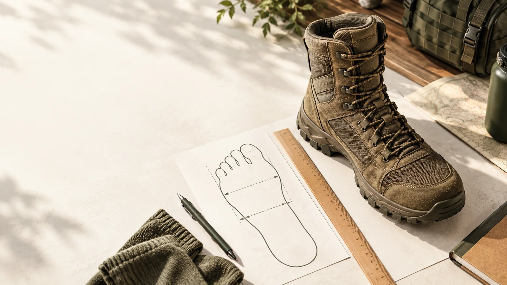
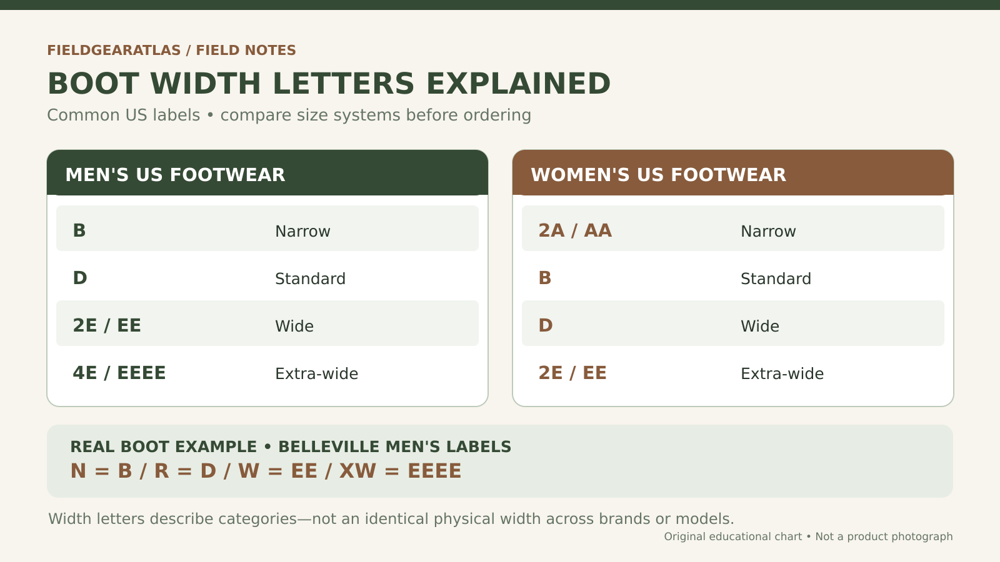
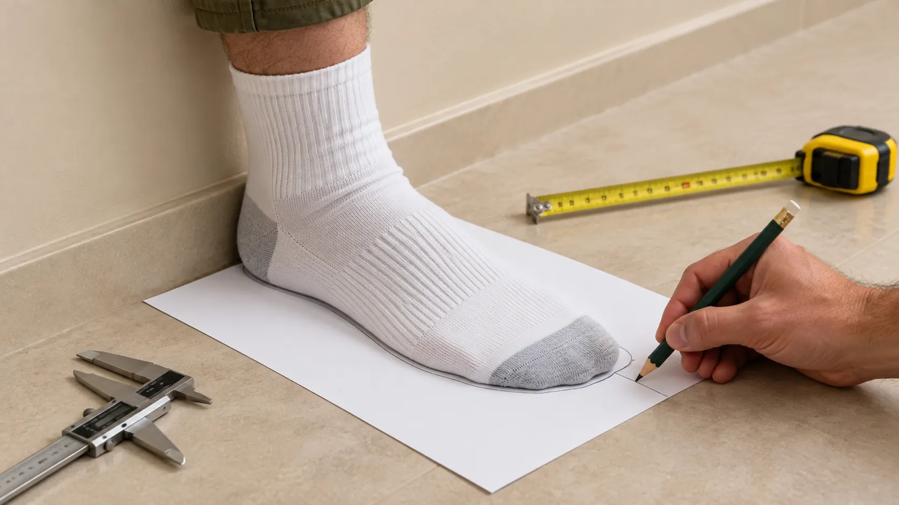
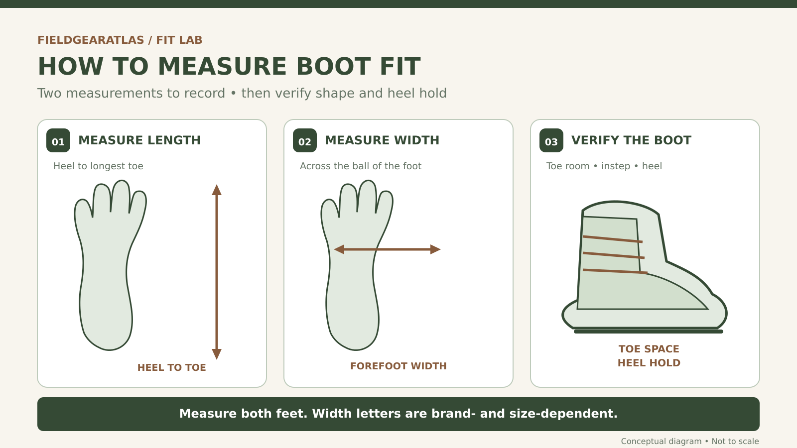

# Tactical Boot Width Chart: D vs EE, Measured Widths & Fit Worksheet

A tactical boot can be the right length and still be the wrong fit. If the sides press against the ball of your foot, your toes feel crowded, or your heel slides as soon as you walk, changing the size number alone may not solve the problem.

**The short answer:** In many US men's footwear charts, **D is standard width, 2E (often written EE) is wide, and 4E (EEEE) is extra-wide**. In many women's charts, **B is standard and D is wide**. These are useful *starting labels*, not a universal inches-to-width conversion. Boot brands and individual models can fit differently even when they use the same letter. [New Balance width guide](https://www.newbalance.com/size-guide.html); [Danner sizing guidance](https://support.danner.com/hc/en-us/articles/360010899593-How-do-I-determine-my-boot-size).

This guide shows what width codes mean, how to measure your foot, and how to check that a tactical boot fits for walking, work, hiking, or rucking. It also includes a **free printable Boot Width Measurement Worksheet** to record both feet, compare measurements, and carry a fit record to a retailer, plus a **source-checked brand-label reference** so you can recognize how different makers label their widths. It doesn't claim that any untested model is the best boot for you.

## Quick boot width chart: what do B, D, EE, and 4E mean?

The chart below summarizes **common US footwear conventions**, using New Balance's published men's and women's labels as an illustration. It is **not** a cross-brand measurement chart for every tactical boot. See the individual manufacturer's sizing chart before ordering.

| Relative fit label | Common men's US label | Common women's US label |
|---|---|---|
| Narrow | B | 2A (AA) |
| Standard / regular | D | B |
| Wide | 2E (EE) | D |
| Extra-wide | 4E (EEEE) | 2E (EE) |

**Why a label is not enough:** Width dimensions change with shoe length, and brands build around different *lasts*—the foot-shaped forms that determine the finished boot's geometry. Two men's D-width boots can have noticeably different toe shapes or internal volume. [New Balance](https://www.newbalance.com/size-guide.html); [Danner on boot lasts](https://support.danner.com/hc/en-us/articles/360010815774-What-is-a-boot-last).

### Does a D or EE label equal a fixed foot width in inches?

**No.** Even within **one manufacturer**, the published numerical width value associated with a letter changes with the shoe length size. To show this with actual numbers rather than inventing a universal chart, here are three rows from the **New Balance US men's/unisex width guide**:

| US men's size | D / standard | 2E / wide | 4E / extra wide |
|---|---:|---:|---:|
| 8 | 10.1 cm | 10.5 cm | 10.8 cm |
| 10 | 10.6 cm | 10.9 cm | 11.3 cm |
| 12 | 11.0 cm | 11.4 cm | 11.7 cm |

*Source: [New Balance's published size-and-width guide](https://www.newbalance.com/size-guide.html) (men's/unisex measurements; values reproduced selectively as an educational example, checked October 17, 2026).*

**Do not apply these numbers to tactical boots from Belleville, Danner, Under Armour or another brand.** This is a concrete demonstration of why both *length size* and *brand-specific sizing* matter. The numbers do not describe boot interior clearance, toe-box shape, instep volume or the correct military boot size for a given foot. Measure your foot, then use the manufacturer chart for the exact model you intend to buy.

### Tactical boot brands may use R, W, or XW instead

A practical military-footwear example is **Belleville**, whose official *men's* width guide gives this correspondence for its boots:

| Belleville men's label | Belleville's published standard-width reference |
|---|---|
| N — Narrow | B |
| R — Regular | D |
| W — Wide | EE |
| XW — Extra Wide | EEEE |

Belleville also states that not every width is available in every style, and that sizing can differ between boot constructions. This is a **Belleville-specific example**, not permission to assume that every manufacturer maps its codes identically. [Belleville official boot sizing guide](https://www.bellevilleboot.com/index.php?l=page_view&p=sizing_guide).

## Manufacturer width codes: three verified examples

The following examples come directly from brand documentation or a specific product listing. **The table translates published labels, not millimeters, not fit guarantees, and not current inventory.** The brand/model listed in the source matters.

| Brand or scope | What the manufacturer actually publishes | Important limitation |
|---|---|---|
| **Belleville men's boots** | N = B, R = D, W = EE, XW = EEEE | N/XW are offered only in some styles; verify the exact boot. [Official Belleville sizing](https://www.bellevilleboot.com/index.php?l=page_view&p=sizing_guide). |
| **Danner men's footwear** | Standard medium = D; wide = EE; some styles also have narrow B, extra-wide 3E/4E | Not all models have these width options. [Official Danner support](https://support.danner.com/hc/en-us/articles/360040554994-Does-Danner-offer-extended-sizing). |
| **Under Armour Micro G Valsetz Wide** | This specific tactical boot is explicitly marketed as **Wide (2E)** | A label on one model is not a full Under Armour footwear conversion table. [Manufacturer product example](https://www.underarmour.com/en-us/p/military_and_tactical_boots/ua_micro_g_valsetz_wide_2e_mens_tactical_boots/3023746.html). |

**How to use this table:** First decide which manufacturer/model you are considering, then interpret that maker's width label, confirm the size/width actually offered, and finally test the *shape* and *volume* of the boot. Do not treat any brand's code as proof that another brand fits identically.

> **Worked example (label translation only):** A shopper sees “W” on a Belleville men's listing and “EE” on a Danner men's listing. Both makers place these labels in their wide categories. That does **not** prove the two boots share the same actual width at US men's size 10, toe-box geometry, or heel fit.

### Is EE the same as 2E?

**Often, yes as a width designation:** Both commonly denote a wide men's option. But you still need the brand's chart to know what that means for the particular model. A boot marked EE is not guaranteed to match the shape of an unrelated boot marked 2E.

## Measure your feet before choosing a boot width

If you have access to a retail store with a **Brannock Device**, use it: the device assesses **heel-to-toe length, heel-to-ball (arch) length, and width** while you're standing. The Brannock Device Company says both length measurements matter, not only the distance to the longest toe. [Brannock fitting instructions](https://brannock.com/pages/instructions-fitting-tips).

If you cannot visit a store, you can record useful at-home measurements, but they are **not a precise replacement for a branded width fitting chart**.

### At-home measurement: five practical steps

*Illustrative AI image created for FieldGearAtlas. Use the written steps and measurement diagram below for technique; do not estimate dimensions from this image.*

1. **Gather paper, a pencil, and a ruler.** Put the paper on a firm, level floor against a wall. A helper makes marking easier.
2. **Stand naturally with weight on the foot.** Wearing close-fitting socks can help avoid tracing bulky material. Keep your heel at the wall and do not curl your toes.
3. **Mark heel-to-toe length.** Identify the furthest point of your longest toe; it may not be the big toe. Record the distance in millimeters or inches.
4. **Record forefoot width.** Mark the widest points across the ball of your foot—the region near the base of the big and little toes—and measure between them. Do not treat this number as a universal D/EE conversion.
5. **Measure both feet.** Record the longer and wider results separately, then compare with the exact size chart for the model you're considering. Don't assume your feet are identical.

**Important:** A paper outline does not capture instep height, arch position, heel shape, or how the boot's upper wraps the foot. For a tricky fit, get a professional measurement, try the boots in person, or choose a retailer with an appropriate return policy. [Brannock](https://brannock.com/pages/instructions-fitting-tips); [Danner](https://support.danner.com/hc/en-us/articles/360010899593-How-do-I-determine-my-boot-size).

## Free Boot Width Measurement Worksheet: record both feet

**Use the interactive worksheet below the measuring diagrams** to record heel-to-toe length, width at the ball of each foot, and optional heel-to-ball length. It supports millimeters and inches, highlights which foot is longer and wider (when both values are entered), lets you note a boot model and fit symptoms, and provides a print-friendly fit record. Your measurements stay in the current browser tab; there is no account, email request, cookie, or automatic upload. You can print or save as PDF using your browser, or download a plain-text record. [Jump to the worksheet](#free-boot-width-measurement-worksheet-record-both-feet) if you are reading the full guide online.

**This is a measurement worksheet, not a shoe-size calculator.** Its output does **not** assign D, EE, 4E, a US shoe length, or a supposedly suitable commercial boot. Those answers require the correct brand/model sizing reference and a real fitting. Brannock notes that manufacturer width terms are not standardized. [Brannock's official fitting instructions](https://brannock.com/pages/instructions-fitting-tips).

<!-- NEXTJS_COMPONENT: BootWidthWorksheet; placement=here; do_not_render_as_text; use component/BootWidthWorksheet.tsx. Standalone preview has the fully working widget embedded. -->

**Prefer paper?** [Download our one-page blank Boot Fit Record (PDF)](BOOT_FIT_RECORD_PRINTABLE.pdf). The PDF is an original FieldGearAtlas recording form, **not** a calibrated print-and-stand sizing device: record values measured using a suitable ruler or fitting device. Check your PDF viewer's print settings; do not use the page graphic as a ruler.

For heel-to-ball length, seek a professional Brannock fitting when possible rather than trying to infer the arch length from a rough outline alone.

**Paper-only fallback for print or readers without JavaScript:**

| Record | Left foot | Right foot |
|---|---|---|
| Heel-to-toe length (mm or inches) | __________ | __________ |
| Width at ball of foot (same unit) | __________ | __________ |
| Heel-to-ball length (optional) | __________ | __________ |

Note your boot brand/model, intended socks and the area of discomfort. Bring the record to a retailer or compare with that model's official fit guidance. Do **not** use the table as a generic inches-to-EE conversion.

## A measurement record you can actually use at a boot shop

Here is an **illustrative entry format, not a recommendation or a real person's foot measurements**. The purpose is to show which observations you should bring to a fitter or compare against a manufacturer chart:

| What to record | Left foot (example only) | Right foot (example only) |
|---|---|---|
| Standing heel-to-toe length | 274 mm | 277 mm |
| Width at the ball | 105 mm | 107 mm |
| Heel-to-ball measurement | Ask a professional fitter to measure | Ask a professional fitter to measure |
| Fit symptom | Forefoot pressure in current boot | Toe-side rubbing in current boot |

In that *fictional example*, the right foot is 3 mm longer and 2 mm wider. It would be a mistake to conclude that the person therefore needs EE boots. The next step is to compare **the correct model-specific sizing information** and try the boot on both feet with intended socks. A Brannock fitting also considers heel-to-ball position. [Brannock fitting procedure](https://brannock.com/pages/instructions-fitting-tips).

The interactive tool above performs these differences using **your own entered measurements**, labels them as observations and provides a printable record without collecting your information.

### Make your measurement repeatable

- Measure while standing on a firm floor, using a helper when possible. Keep the pencil approximately upright when marking; an angled pencil can distort the tracing.
- Record the socks worn during measurement and try-on. Socks used for drawing an outline should fit close enough not to obscure toe position.
- If a measurement seems implausible, measure again rather than inferring a shoe size from a single tracing.
- If you wear thick boot socks at work, confirm the boot fit *with those socks on*, not just with the socks used to draw an outline.
- Treat the home outline as a screening tool. For heel-to-ball and difficult-fit concerns, seek a Brannock measurement and a real fitting. [Brannock](https://brannock.com/pages/instructions-fitting-tips); [Belleville](https://www.bellevilleboot.com/index.php?l=page_view&p=sizing_guide).

## Three different fit problems people call “wide feet”

Where the pressure occurs matters more than the vague statement that a boot is “too narrow.”

| What you notice | What may be happening | What to investigate next |
|---|---|---|
| Squeezing across the ball of your foot | Forefoot width mismatch | A genuine wider size offered in that model |
| Toes touch each other or rub the side of the front | Toe-box shape or length mismatch | Toe shape, usable toe room, and length—not only EE |
| Pressure across the top of your foot | Low internal volume or tight lacing | Instep depth, boot last, lacing, and tongue shape |
| Heel moves while walking | Heel shape, excessive volume, or poor lacing lock | Heel hold; don't automatically add length |
| Only one foot feels cramped | Left/right size or shape difference | Fit both feet rather than judging the easier foot |

Danner explains that its lasts differ in *overall shape, toe-box width and depth (volume)*. This is why a boot can be labeled “wide” and still fail to fit a person's particular toes or instep. [Danner boot-last explanation](https://support.danner.com/hc/en-us/articles/360010815774-What-is-a-boot-last).

### Wide width versus wide toe box

A **wide width option** is a size variation within a manufacturer's sizing system. A **wide toe box** refers more specifically to the space and shape around the toes. Some boots offer both; others give more toe room without being particularly roomy at the midfoot or heel.

If the widest part of your forefoot is squeezed, investigate a width option. If the main problem is crowding in the front while the rest of your foot feels secure, investigate toe-box shape. Neither label guarantees the right fit. A broad forefoot and crowded toes are related but not identical fitting problems. Identify where you need more space before choosing a size label.

## Test the boot the way you will actually wear it

A size chart narrows the options; the wearing test makes the final decision.

1. **Use your intended boot socks.** A thin everyday sock and a thick cold-weather sock can change how a boot feels. Belleville specifically advises trying boots with the socks you plan to wear. [Belleville fitting tips](https://www.bellevilleboot.com/index.php?l=page_view&p=sizing_guide).
2. **Check the toe room while standing.** Your toes should be able to move without repeatedly striking the front; the foot should not be swimming around inside the boot.
3. **Check the ball of the foot.** Expect a secure feel, not pinching or intense side pressure. Lacing cannot manufacture forefoot space that isn't there.
4. **Walk, turn, and stop.** Watch for heel lift, repeated rubbing, or a painful pressure point. Danner's guidance similarly calls for toe room, secure heels, and no pinching. [Danner New Boots](https://global.danner.com/danner-care/new-boots?sortId=position-asc).
5. **Try realistic movement.** For hiking and rucking, a gentle incline or supervised step-down test can reveal toe impact or heel slip you would not notice while seated. Do not undertake a loaded march just to test an unconfirmed fit.
6. **Reject painful fits early.** Break-in may soften some materials; it is not a reliable plan to correct a boot that is already painfully narrow or the wrong length.

**Fit is separate from military compliance.** A boot that feels excellent may still fail a particular organization's current color, height, sole, or construction rules. Check the applicable official requirements independently rather than treating a fit guide as proof of authorization.

## Should you choose a longer boot or a wider boot?

Start by identifying the actual problem:

- **Enough toe length but pressure at the ball?** Check the same model in a wider width, if available.
- **Toes hit the front or curl?** Revisit length and toe shape before changing width.
- **Too much heel movement after sizing up?** Adding length may have traded one fit problem for another.
- **Instep hurts but forefoot fits?** Compare last volume and lacing before automatically moving to EE.
- **Between two models?** Compare each brand's published chart and return policy; never assume D-to-EE increments are the same in all boots.

### Why an inch-based chart can mislead

You may encounter a chart that claims a specific number of inches always equals D, EE, or 4E. That shortcut is misleading unless it identifies the **US size, the footwear sizing system, and the brand or fitting standard**. Width varies with length. A measurement that corresponds to one width at US men's size 8 may belong to another category at size 12. For example, New Balance publishes different forefoot-width measurements for different length sizes within the same width letter. [New Balance size and width guide](https://www.newbalance.com/size-guide.html).

This guide deliberately does **not** supply fabricated universal inch values. Use the measurement to check a brand's specific chart, not to label every foot with a permanent width letter.

## Before you buy: a six-point boot fit checklist

- [ ] I measured both feet and checked length as well as width.
- [ ] I know whether the issue is forefoot width, toe shape, instep volume, or heel hold.
- [ ] I looked at the specific manufacturer's chart for the exact boot model.
- [ ] I tried—or can reasonably evaluate—the boot with my intended socks.
- [ ] I can walk without painful pressure, repeated toe contact, or excessive heel movement.
- [ ] I checked the seller's return policy and any separate duty/uniform requirements.

If several items are unknown, *pause the purchase decision* instead of guessing from a letter code.

## Frequently asked questions

### What does D mean in tactical boots?

For many men's US boots, **D means regular or standard width**. In some women's footwear ranges, D is a wide option. Always identify the size system and manufacturer before comparing width letters.

### What does EE mean on military boots?

EE—also written 2E—commonly signals a wide men's width. Belleville, for example, maps its men's W (Wide) to EE. That does not mean every EE boot has the same physical width or last.

### How wide is a men's size 10 in D or EE?

**It depends on the brand.** As an illustration only, New Balance's men's/unisex width table lists US size 10 at **10.6 cm for D** and **10.9 cm for 2E**. These values belong to New Balance's size chart, not to a universal tactical-boot sizing standard. Always use the current sizing and fit guidance for the specific boot. [New Balance](https://www.newbalance.com/size-guide.html).

### Is 4E much wider than 2E?

It is typically positioned as the next broader width category in US men's ranges. There is no one universal, model-independent number of millimeters separating all 2E and 4E boots. Consult the maker's chart.

### Can I fix a tight boot by going half a size up?

Sometimes a length change helps if the boot is also too short, but it can worsen heel slip when width or shape is the actual issue. Compare width options and lasts before increasing length.

### Do I need EE boots if I want a wide toe box?

Not necessarily. An EE option changes the brand's width fitting, while toe-box shape describes one part of the boot. Check where you need room.

### Should a new tactical boot feel tight across the sides?

Secure is different from painful. Danner advises a relatively snug feel at the sides but no pinching, while Belleville recommends a snug—not tight—width fit. Severe compression, numbness, or persistent pain should not be accepted as a normal break-in target.

## Before checkout: a model-specific verification ladder

1. **Identify the exact product model and generation.** A familiar brand name is not enough when lasts and fit change across styles.
2. **Read the manufacturer's own width legend.** Belleville's R/W codes and Danner's D/EE examples above show how this works.
3. **Confirm that the requested length-and-width combination exists for that model.** A general brand width chart does not prove that a particular variant is offered.
4. **Check the intended boot socks, fit movements, and return policy.** The retailer's fit/return terms matter especially when you cannot try the boot in person.
5. **Keep military/workplace authorization separate.** A brand's marketing language, the width chart and this guide are not proof that a boot meets an organizational footwear rule.

This sequence is deliberately *merchant-neutral*: it remains useful even when FieldGearAtlas has no affiliate relationship, catalog feed or product ranking.

## How we researched this guide

FieldGearAtlas prepared this educational fit guide by cross-checking sizing and construction explanations published by the Brannock Device Company, Belleville, Danner, and New Balance. The brand reference compares only the explicit width labels reported by Belleville, Danner, and Under Armour (one specific model); it is not derived from product feeds. The two technical charts are original instructional artwork. The hero and foot-tracing scene are conceptual AI-generated images; they do not depict or authenticate a named commercial model. **We have not conducted independent physical fit tests for the products mentioned here.** No paid placements, affiliate prices, or product rankings appear in this article.

### Primary sources

1. [The Brannock Device Company — Instructions & Fitting Tips](https://brannock.com/pages/instructions-fitting-tips) (standing measurements, heel-to-toe, heel-to-ball, width).
2. [Belleville Boot — Official Sizing Guide](https://www.bellevilleboot.com/index.php?l=page_view&p=sizing_guide) (N/R/W/XW mapping and boot-fitting practices).
3. [Danner Support — How Do I Determine My Boot Size?](https://support.danner.com/hc/en-us/articles/360010899593-How-do-I-determine-my-boot-size) (Brannock measurements and model differences).
4. [Danner Support — What Is a Boot Last?](https://support.danner.com/hc/en-us/articles/360010815774-What-is-a-boot-last) (toe shape and internal volume).
5. [Danner Care — New Boots](https://global.danner.com/danner-care/new-boots?sortId=position-asc) (toe space, heel stability, pressure checks).
6. [New Balance — Size & Width Guide](https://www.newbalance.com/size-guide.html) (men's/women's label conventions and size-dependent width examples).
7. [Danner — Extended Sizing](https://support.danner.com/hc/en-us/articles/360040554994-Does-Danner-offer-extended-sizing) (D/EE and selected B/3E/4E widths).
8. [Under Armour — Micro G Valsetz Wide (2E)](https://www.underarmour.com/en-us/p/military_and_tactical_boots/ua_micro_g_valsetz_wide_2e_mens_tactical_boots/3023746.html) (example of explicit model 2E designation)..

*Source check: October 17, 2026. Original PDF worksheet and technical diagrams are FieldGearAtlas educational materials. Check manufacturers' current charts again before making a model-specific purchase decision.*
