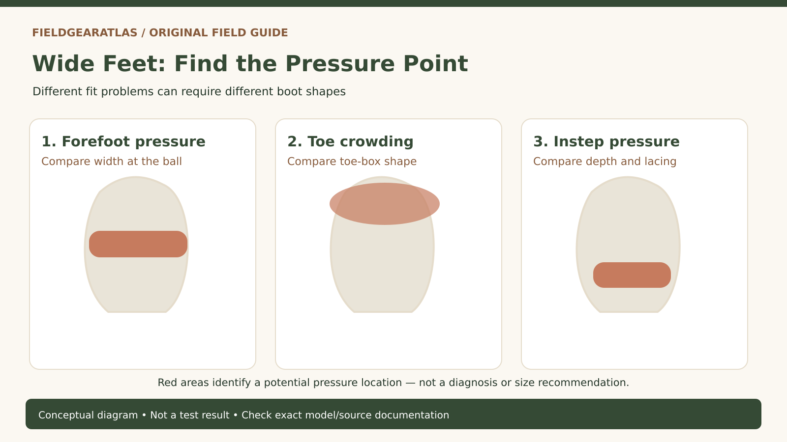

# Tactical Boots for Wide Feet: Identify the Fit Problem Before Choosing EE

*Original conceptual infographic. Not a tested model or product performance result.*

**Quick answer:** If tactical boots pinch across the ball of your foot even though the length is right, try the same model in a documented wider width. But if only your toes are crowded, you may need a differently shaped toe box; if pressure is on top of the foot, instep volume may be the issue. An EE label alone does not settle the fit.

A boot described as 'wide' can still fail a wide-footed wearer. The foot is three-dimensional, while the label on the box usually gives only a length and a width category. A good fitting process therefore begins by identifying **where and when discomfort occurs**, not by choosing the largest available width.

## Pinpoint the pressure before changing sizes

| Symptom during a short indoor fitting | What it may indicate | First useful comparison |
|---|---|---|
| Tight across the ball of the foot on both sides | Forefoot width mismatch | Same length, documented wider width |
| Pinky toe pushed inward or toes unable to spread | Toe-box shape or insufficient length | Different last/toe shape and length check |
| Pressure on top where laces cross | Instep volume or lacing configuration | Different volume, tongue and lacing adjustment |
| Heel lifts with every step after upsizing | Excess length or overly roomy heel | Return to measured length; assess heel hold |
| One boot feels right and the other pinches | Natural left/right difference | Record both feet; fit the more demanding dimension without losing heel control |

These are diagnostic clues, not medical diagnoses. Pain, numbness, persistent swelling or symptoms that continue without the boots warrant advice from a qualified professional.

## What D, EE and 'wide' actually tell you

In many US men's sizing systems, D is a regular width and EE (2E) is a wide width. But labels differ by brand, gender sizing and model. A width letter is **not** a universal fixed measurement in inches. At the same width code, the actual dimensions normally change with shoe length. More importantly, two boots labeled EE may use different lasts—the foot-shaped forms around which the footwear is built.

Some tactical brands use R, W and XW; others publish the conventional letters. Read the specific brand's chart rather than interpreting W as a promise of a wide toe box. Check whether the model exists in that width at the intended length and whether the retailer offers returns after an indoor fit.

For a model-independent recording tool, see the FieldGearAtlas Boot Width Measurement Worksheet once its dedicated guide is published. Measuring both feet provides a repeatable record; it cannot produce a definitive width code for every boot maker.

## Wide width is not the same as a wide toe box

A relatively broad forefoot and a toe-splay problem may overlap, but neither guarantees the other. Imagine a boot with generous volume across the ball of the foot but an aggressively tapered front. It may accommodate width while continuing to crowd the smaller toes. Conversely, a broad anatomical toe box can coexist with a narrower midfoot or heel. That could be useful for one foot shape and unstable for another.

When inspecting a product page, look for **multiple views of the last shape**, a manufacturer-specific width chart, available return terms and—when possible—physical fitting rather than treating terms such as 'comfort fit' or 'roomy' as measurements. Do not infer actual internal toe-box dimensions from a stylized photo.

## A repeatable seven-minute indoor fitting check

1. **Use the actual socks.** Wear the socks planned for work, hiking or rucking. Thick winter socks and thin duty socks do not occupy the same volume.
2. **Confirm length before width.** Place the heel back properly and check whether toes can move without hitting the front. The longest toe may not be the big toe.
3. **Stand with weight on both feet.** Forefoot dimensions under load differ from an unloaded foot outline; pay attention to lateral pressure.
4. **Lace for normal use.** Tightening everything as hard as possible can create artificial instep pressure; very loose laces can hide heel instability.
5. **Walk, stop and turn.** Watch for rubbing at the heel, squeezing at the ball and toe impact during controlled movement.
6. **Try a gentle step-down.** Toe impact during descent is especially relevant if the boots will be used on slopes; use a stable step and avoid a heavy pack during testing.
7. **Compare both feet separately.** One size option may fit one foot and not the other. Write down the conflict instead of declaring a perfect fit.

Keep the trial indoors until you understand the seller's returns policy. A short fitting cannot prove performance after long hours, but it can reject clear mismatches before they become costly.

## What to ask before ordering tactical boots online

Ask the maker or merchant whether **the exact color/model/SKU** is available in a wide width; whether its width notation follows a stated system; what kind of last shape it uses; whether an insole is removable; and whether returns allow indoor try-ons. Compliance language is a separate matter: a boot's width does not establish that it meets an agency's uniform requirements or an occupational safety standard.

**Example:** A buyer normally wears size 10 D, finds that the big toe does not hit the front, but experiences pinching across the ball of the foot in a candidate boot. Trying size 11 D first may create heel slip while failing to resolve the forefoot construction. A more useful next trial is size 10 EE *in that model*, if offered, and comparison with a differently shaped last. This is a hypothetical fitting scenario, not a report from a FieldGearAtlas product test.

## Practical decision example: A two-boot width comparison

A buyer measures both feet, then tries two widths of the **same boot model and length** indoors. In the narrower option the toes clear the front but the ball of the foot is compressed; in the wider version that pressure eases without the heel moving excessively. This is stronger evidence for a width mismatch than a recommendation to buy a longer boot. If the wider option produces new heel movement, try a different last rather than assuming more width is always better.

**Write down before choosing:** Record the model, exact size/width, sock thickness, ball-of-foot pressure and heel movement separately for each foot.

## Common questions

### Can I fix a narrow tactical boot by breaking it in?

Do not rely on break-in to fix painful width or wrong length. Materials may soften, but the underlying last and structural dimensions do not become a different size category.

### Are wide boots always better for bunions or flat feet?

No. Fit requirements depend on the location of pressure, individual anatomy and other factors. A broad toe area may help avoid squeezing, but medical conditions or persistent pain should be assessed individually.

### Is buying one size larger the same as buying a wider width?

No. Upsizing changes length and often heel fit as well. It can create toe clearance while introducing sliding and friction.

## Sources and evidence limits

- [The Brannock Device Company — fitting guidance](https://brannock.com/pages/instructions-fitting-tips) — foot length, arch length and width as distinct measurements.
- [REI — Hiking footwear fit guidance](https://www.rei.com/learn/expert-advice/hiking-boots.html) — foot length/width and walking fit checks.
- [Danner — What Is a Boot Last?](https://support.danner.com/hc/en-us/articles/360010815774-What-is-a-boot-last) — why last shape affects fit.

**Editorial note:** This is a source-aware fit framework. No named commercial boot has been tested, certified or ranked by FieldGearAtlas. Any illustrations must be labeled conceptual, not photographs of an identified model.
