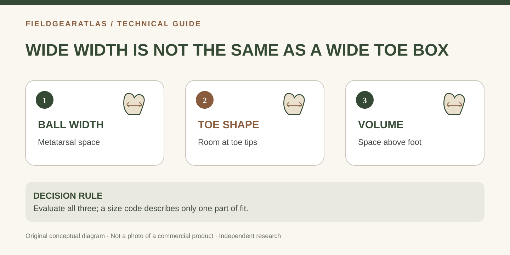

# Wide Toe Box vs Wide Width Boots: The Fit Difference That Matters

*Conceptual diagram; no product claims are certified by the illustration.*

A **wide toe box** describes the shape and usable space in front of the boot. A **wide-width boot** is a width option within a manufacturer's sizing scheme, usually intended to provide more room in one or more parts of the foot. They can overlap, but one does not guarantee the other.

This distinction matters because a boot may pinch the toes even though the ball of the foot fits, or feel loose at the heel despite having an apparently comfortable forefoot. Neither problem is reliably fixed by ordering a longer boot.

## Locate the restriction before changing sizes

Stand in the socks you actually wear with the boot, then walk and stop. Note whether discomfort arises (a) at the tips of the toes, (b) against the little toe or big-toe joint, (c) across the ball of the foot, (d) over the instep, or (e) at the heel. These are different fit zones and call for different questions.

| Where the problem occurs | Likely next investigation | What not to assume |
|---|---|---|
| Toes contact front during a downhill step | Length, lacing and toe-box depth | Wider sizing fixes inadequate length |
| Little toe presses into tapered sidewall | Toe-box geometry | Every EE boot has a broad toe shape |
| Pressure spans the forefoot at the ball | Width option, last and foot volume | A pointier toe box is the only issue |
| Top of foot is squeezed | Instep volume, tongue and lacing | Forefoot width code resolves instep depth |
| Heel moves while forefoot fits | Heel cup and last proportions | Sizing up improves every part of the boot |

**Practical example (hypothetical):** A person measures as wide at the ball but has a narrow heel. A larger overall width may reduce ball pressure yet introduce slipping. They should compare the exact last shape and heel retention rather than declare the entire wide-size category unsuitable.

## Three dimensions that online listings rarely separate

**Ball width** is measured across the forefoot near the metatarsal heads. A Brannock fitting relates width to the chosen shoe length, which is why a single millimeter measurement is not a universal D/EE conversion.

**Toe-box outline** is the lateral shape of the front of the boot. A boot can be generous at the ball and still narrow sharply toward the toes. The reverse can also be true: a front designed for toe movement can lead into a relatively snug midfoot.

**Vertical volume** is the available room above the foot. An anatomical-looking toe outline does not prove sufficient depth for thicker socks, higher insteps or orthotic inserts.

A removable insole can help compare the outline of your forefoot to the footbed, but it is not a complete test: fabric, toe-cap structure and lacing determine actual usable interior space.

## A controlled at-home comparison

1. Record both feet's heel-to-toe length and ball width. If possible, include heel-to-ball/arch length from a calibrated fitting device.
2. Keep sock thickness constant across candidates; do not compare one in casual socks and another in thick boot socks.
3. Check each manufacturer's **exact model** width system and whether it offers a dedicated wide option.
4. Stand and walk on level flooring; note *where* the pressure occurs before adjusting laces.
5. Try a gentle decline or step-down to check toe collision; do not use an unsafe slope or loaded march as a fit test.
6. Repeat after briefly walking. Record whether the heel holds independently of toe freedom.
7. If no option works, change the model/last rather than continually increasing length.

### Should the toes touch the boot?

There should be enough front space to avoid repetitive contact during normal movement, but exaggerated empty length can reduce control. Use the manufacturer's guidance and a qualified fitter for unusual foot-shape needs; there is no universal toe-space number that fits every boot and every person.

### Is a wide toe box always better for rucking?

No. It may suit someone whose toes are constrained, but secure heel/midfoot fit and appropriate length are equally relevant under load. An excessively loose boot may introduce friction even when toe room feels ample.

## Choosing what to read next

If the *whole forefoot* feels compressed, use our **Tactical Boots for Wide Feet** fit-diagnostic guide. If you first need to interpret width letters, start with the **Boot Width Chart and Measurement Worksheet**. This article is about shape, not a universal list of “best wide” products.

## Three-part decision record: outline, compression, release

For a useful comparison, write down three observations **separately**: the toe outline when standing, whether the upper compresses the joints when moving, and whether loosening the laces changes forefoot pressure. This avoids conflating the bottom footprint with the internal three-dimensional boot cavity.

For two candidate models, a simple decision record could read: *Model A — heel secure, little toe pinched on turns; Model B — toe room acceptable, heel too loose.* Neither is ready to purchase just because it wins one dimension. Check whether the maker has another documented width/last option or whether a fitter can adjust lacing without undermining retention.

A useful product-review page would need measured interior dimensions or first-hand fitting evidence before labeling either model “wide toe box.” A stock product image is not an adequate measurement source.

## Practical decision example: Where the space is needed

Compare two unbranded shoe outlines at the same stated length: one is wider around the ball; the other leaves a more naturally spreading toe region but retains a relatively close-fitting midfoot. These sketches represent **shapes**, not a guarantee of internal measurements. Someone feeling pressure on the little toe should ask about the exact front shape; someone squeezed at the metatarsal area should investigate manufacturer width options.

**Write down before choosing:** Photographs of a pointed or rounded exterior alone cannot confirm the usable interior. Use an indoor fitting and the maker’s size guidance.

## Sources and limits

- [The Brannock Device Company — Fitting instructions](https://brannock.com/pages/instructions-fitting-tips): heel-to-ball measurement, reading width relative to shoe size, and non-standard width terminology.
- [REI — Choosing hiking footwear](https://www.rei.com/learn/expert-advice/hiking-boots.html): checking heel position, toe room, sock choice and overall fit.

The diagnostic table is FieldGearAtlas editorial guidance derived from those principles, **not a clinically validated foot-type test**. No specific commercial boot has been physically evaluated for this article.
