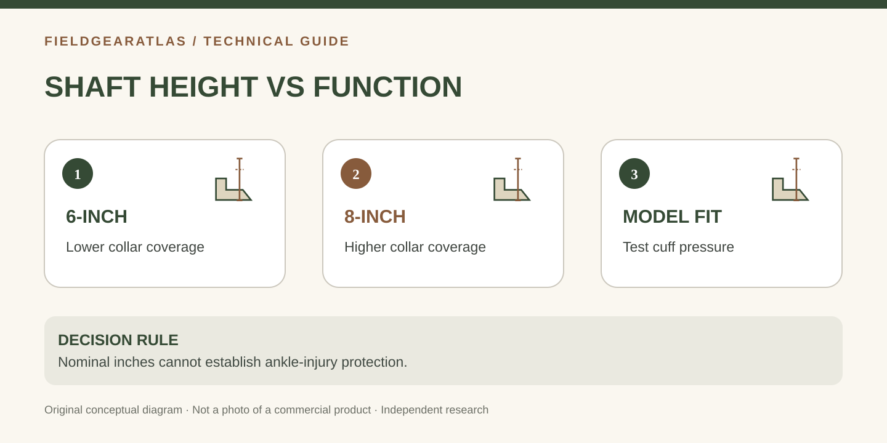

# 6-Inch vs 8-Inch Tactical Boots: What Shaft Height Actually Changes

*Conceptual diagram; no product claims are certified by the illustration.*

A **6-inch** boot and an **8-inch** boot describe different nominal shaft-height categories—not two proven levels of protection. A taller collar generally covers more of the lower leg, but height alone does not establish better traction, ankle-injury prevention, water resistance, comfort or suitability for uniform rules.

The right question is: *what does this construction do for my job and movement?*

## First, check how the manufacturer measured height

A nominal shaft-height label may depend on the manufacturer's measurement convention and boot size. One maker's “8-inch” listing is not a calibrated guarantee that every unit measures precisely eight inches at every point. Check the size-specific description, collar profile and how the height is measured (for example, from heel or sole reference point).

A **higher cuff** increases contact area around the lower leg. It may help keep debris from entering and offer more lacing coverage, but collar padding, stiffness and boot geometry influence how it actually feels.

| Test question | Six-inch category | Eight-inch category |
|---|---|---|
| Where does the upper end? | Usually lower on the leg | Usually higher on the leg |
| How much lacing covers the lower leg? | Often less | Often more |
| Is it automatically lighter? | No; compare weighed sizes and materials | No; compare weighed sizes and materials |
| Does it guarantee ankle protection? | No | No |
| Can it satisfy a uniform requirement? | Only if current rule + model qualify | Only if current rule + model qualify |

## Decide by usage, not appearance

**Warm, active work:** Pay attention to collar contact, sock height and ventilation. A shorter shaft may feel less restrictive for some wearers; a taller boot with suitable material and fit may still be comfortable. Compare full construction, not nominal inches alone.

**Brush, gravel and loose debris:** More lower-leg coverage can be useful, but gaiters, trouser cuffs and the actual top opening also matter. A poorly sealed high collar can admit material.

**Rucking:** Heel hold, forefoot fit, outsole and midsole construction can matter more than adding two inches of upper height. Test in your intended socks on a controlled incline; watch for friction at the cuff and toe impact on descent.

**Uniform or workplace rules:** Read the authoritative rule as written on the date of use. Requirements may include height, color, materials, sole profile or approvals. A product page calling itself “military” is not authorization.

## Comfort check: six motions, one notebook

With the same socks, try these movements on a safe indoor surface: ordinary walk, stair ascent, controlled stair descent, kneel, squat and stand. Note calf pressure, ankle rubbing, heel motion and forefoot compression. Change only one fitting variable at a time. A stiffer collar may be uncomfortable at first but persistent pain should not be treated as mandatory break-in.

**Example:** For someone who kneels throughout a shift, a specific 8-inch boot may rub the shin at the flex point; another 8-inch design might use a more forgiving collar. If the comparison is only between “6” and “8,” the real design variable gets lost.

## Why shaft height does not predict outsole performance

Sole grip depends on compound, tread geometry and surface. Midsole support depends on structure and fit. Upper height does not prove either one. If you need slip resistance, metatarsal protection or other occupational performance, verify the actual applicable requirements and manufacturer documentation.

## Comparison worksheet: make “height” measurable

If you have both candidates in hand, record the maker's listed height **and** a measured height using one documented reference point on both boots. Record the size, outsole, collar shape and material; otherwise a number may be misleading. Then compare the actual pressure points on the shin, sides and rear of the leg after the same controlled movements.

**Do not confuse two outcomes:** (1) covering more skin, and (2) preventing an ankle injury. The first is observable from construction. The second would require relevant testing and evidence beyond the shaft label. Even a higher boot may fit poorly or rub at the upper edge.

If a workplace or service policy sets a minimum upper height, obtain the current primary document rather than relying on a retailer's old product description. Keep the exact revision/date in the research notes.

## Practical decision example: A useful height comparison

Before comparing a 6-inch and an 8-inch boot, confirm whether the maker measures shaft height from the ground, heel bed or another reference point. Measure and record both candidate boots the same way, then check sitting comfort, walking, squatting, lacing access and contact at the shin. A taller shaft may cover more lower-leg area but does not automatically pass an ankle-support test.

**Write down before choosing:** Reject any chart claiming a measured 2-inch protection improvement without a specified measurement method and test.

## FAQ

**Are 8-inch tactical boots better for rucking?** Not as a blanket rule. Fit, secure lacing and verified model construction are more useful decision inputs.

**Can a 6-inch boot be compliant?** It depends on the specific current dress/workplace standard and model. Do not infer compliance from a general height category.

**Can I measure a boot with a ruler?** Yes, but first use the maker's measurement convention so the comparison is meaningful. Do not compare from different reference points.

## References and methods

- [REI — Hiking boots vs hiking shoes](https://www.rei.com/learn/expert-advice/hiking-boots-hiking-shoes.html): explains that overall construction, not merely high/low silhouette, governs differences.
- [REI — How to choose hiking boots](https://www.rei.com/learn/expert-advice/hiking-boots.html): fit, upper materials and intended terrain.

This is a conceptual guide; FieldGearAtlas has not run lab ankle-protection tests. Illustrations must not be labeled as actual boot models.
