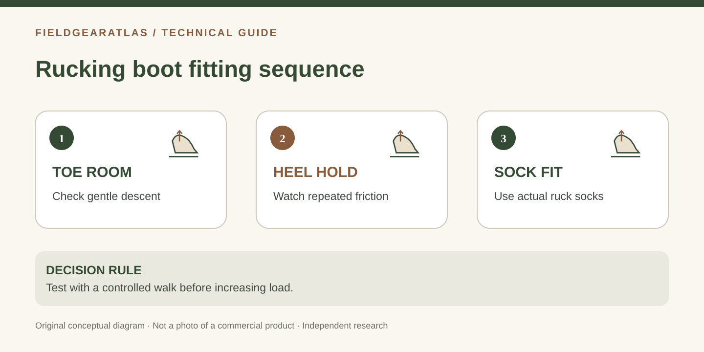

# How to Fit Rucking Boots Without Guessing: Toe Room, Heel Hold and Socks

*Conceptual diagram; no product claims are certified by the illustration.*

A rucking boot is not “properly fitted” merely because it feels comfortable while standing. Walking with a pack introduces repeated heel movement, longer exposure to moisture and pressure on the toes during descents. **Start with length, heel hold and pressure-free forefoot fit at a light, controlled workload.** No boot can compensate for an excessive pack load or a painful fit.

## Prepare a useful fitting session

Bring the **same socks** you expect to use on a ruck. REI's guidance on hiking socks explains that cushioning and sock fit change internal volume and friction; wrinkles or overly tight socks can create pressure points. Measure both feet, and check heel-to-ball length when possible rather than relying only on your casual shoe size.

| Test | Useful observation | If the result fails |
|---|---|---|
| Standing | Toes can move; sides do not pinch | Recheck length, width or toe shape |
| Walking | Heel stays reasonably secure without painful collar friction | Recheck lacing, heel cup and last |
| Controlled decline | Toes do not repeatedly strike boot front | Recheck effective length and foot sliding |
| Slight uphill walk | No new lace/tongue pressure | Recheck instep volume and lacing |
| Short indoor session | No developing hotspot | Stop, locate friction and reassess fit |

## Separate two kinds of movement

**Heel lift** is relative motion between heel and boot. A small amount of movement may occur, particularly in some stiff new designs, but repeated rubbing is a warning. Tightening the top eyelets until the foot goes numb is not a solution to an incorrectly shaped heel cup.

**Foot migration toward the toe** can make a boot seem too short on downhill steps even if it felt roomy on a bench. Check length and lacing before blindly ordering the next width. If the shoe is too long, the foot may move more, not less.

## Why an overlong boot can create new trouble

Sizing up to stop a little-toe pinch changes heel position, arch alignment and how the forefoot sits at the flex point. The Brannock Device Company emphasizes checking *both* heel-to-toe and heel-to-ball lengths. It is reasonable to compare another width or last before increasing length.

## A low-risk first-use progression

Begin with short indoor walking after the shop fitting. Then use brief, easy outdoor walks and evaluate the foot after each outing. Increase duration and load only when comfortable and appropriate for your condition and experience. **This is an editorial progression framework, not a prescribed weight or medical training program.** Stop for pain, numbness or persistent skin irritation.

After a short walk, inspect the sock for damp patches, seams that bunch and early hotspots. REI notes that pressure, friction and moisture contribute to blisters; dry socks and early attention to hotspots are more useful than assuming all pain will disappear with “break-in.”

### Field note template

Record: boot make/model and tagged size, width label, sock brand/thickness, surface, approximate duration, load if any, and precise location of discomfort. A note such as “outside of the little toe after 15 minutes” is more actionable than “boots uncomfortable.” No personal metrics need to be uploaded to FieldGearAtlas.

## What to avoid

Do not test a suspect fit on a long loaded march. Do not assume a stiff boot that causes numbness is still “breaking in.” Do not infer that an official-looking military name means the design fits all wearers. And do not use an unverified online chart to convert a single foot width directly into a universal EE requirement.

## Ruck-boot fit log: what one observation changes

Use one line per trial: **sock / boot model / location of pressure / when it began / what adjustment changed**. Avoid rating the entire boot “good” or “bad” before locating the cause.

For example, *“thin wool-blend crew sock; right heel rubbed on the third indoor lap; top eyelet adjustment reduced sliding but caused instep pressure”* suggests the experiment has not yet found a satisfactory fit. The right action is to re-evaluate last geometry or sizing rather than lace until circulation is compromised.

If friction appears only after activity increases, stop and check whether the sock has wrinkled or become wet before blaming sole stiffness. Do not turn this into a medical diagnosis. Persistent foot pain, skin breakdown or numbness requires appropriate clinical attention.

## Practical decision example: A low-risk ruck-footwear trial

First check the footwear on level ground with the socks you intend to wear. Next use a short, low-risk walk and note toe impact on a mild descent, heel lift and pressure at the laces; only then consider whether longer duration or a load is appropriate for your situation. If rubbing increases at a specific location, stop and adjust or change the fit rather than using a long weighted march as a break-in test.

**Write down before choosing:** Keep a dated fit log that distinguishes fit problems from training progression. No load amount is universally safe for every beginner.

## FAQ

**Should rucking boots be snug?** Secure without pinching. Your toes need room during walking and descents.

**Can thicker socks solve heel slip?** They change volume and may mask an unsuitable fit. Verify the underlying model shape instead of relying only on padding.

**Does higher shaft height mean better rucking boots?** Not independently. Check the whole construction and fit.

## Sources

- [REI — How to choose hiking boots and shoes](https://www.rei.com/learn/expert-advice/hiking-boots.html): fit while standing and walking, toe room and heel checks.
- [REI — How to choose hiking socks](https://www.rei.com/learn/expert-advice/backpacking-socks): sock thickness, fabric and wrinkles.
- [REI — Blister prevention and care](https://www.rei.com/learn/expert-advice/blister-prevention-care.html): pressure, heat, moisture and hotspots.
- [Brannock — Instructions and fit tips](https://brannock.com/pages/instructions-fitting-tips): arch/heel-to-ball fitting measurements.

This article does not report testing on named footwear or prescribe an exercise plan.
