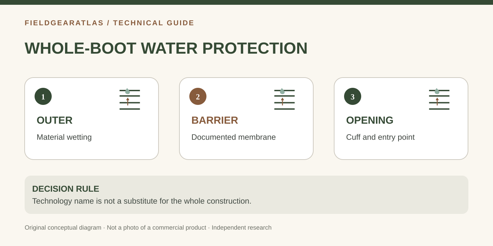

# Waterproof vs GORE-TEX Boots: A Label Is Not a Performance Test

*Conceptual diagram; no product claims are certified by the illustration.*

**Waterproof** describes a performance claim. **GORE-TEX** names a family of branded technologies that may be used within waterproof footwear systems. All GORE-TEX footwear should be evaluated according to its specific product technology and construction; not every waterproof boot uses GORE-TEX, and not every boot without the label is automatically water-permeable.

Your real choice depends on how water enters, how heat and sweat leave and what happens when the inside becomes wet.

## Three layers of the water question

**Outer upper:** Leather, woven fabric, seam layouts and surface treatments affect how quickly the exterior wets out. A water-repellent finish is not necessarily the same as an intact waterproof barrier.

**Internal barrier or membrane:** This layer is intended to block external water while permitting some moisture vapor transport. Gore identifies multiple footwear constructions, including its standard footwear, Invisible Fit and SURROUND variants.

**Whole-boot construction:** Tongue gussets, seams, cuff opening and boot condition matter. Gore says it tests the complete footwear system—including upper fabrics and linings—rather than treating the membrane name alone as proof of a finished boot's quality.

| Scenario | Question to ask | What the label alone cannot answer |
|---|---|---|
| Frequent shallow puddles/rain | Is the *whole boot* rated for intended exposure? | Cuff ingress, wear and fit |
| Hot, humid walking | How does the complete system handle heat and sweat? | Guaranteed cool, dry skin |
| Stream crossing above the cuff | What is the entry and drainage plan? | That lining prevents top-entry water |
| Multi-day wet use | Can you dry footwear and spare socks safely? | Drying time after total saturation |

## Why waterproof and breathable are not opposites

A waterproof membrane may transfer some moisture vapor while resisting external liquid water. Breathability is conditional; activity, sock choice, temperature, humidity and upper construction all influence comfort. Compare *systems* and usage, not a supposed universal “breathability score” that is rarely listed consistently across brands.

Some non-membrane footwear uses more open textile panels that may ventilate and dry differently, but that alone does not make it suitable for prolonged rain. Likewise, a lined boot can keep rain out yet trap moisture entering from its opening during a deep crossing.

## How to read a product page without being misled

Look for the exact technology name, whether seams and tongue are designed to be waterproof, whether the claim applies to the finished boot, whether the maker describes the intended use and what care is required. A listing that says only “water resistant” should not be upgraded to “waterproof” in a product comparison.

**Illustrative decision:** A person walking through cold rain may value a tested whole-boot waterproof system. Someone repeatedly wading above boot height may instead care about quick drainage and spare dry socks. Neither decision is determined by a technology logo alone.

## Waterproof specification evidence checklist

When a product page mentions a waterproof technology, copy the **exact wording** into your comparison record: technology family, full-boot product designation, intended activity, and limitations in the warranty or care instructions. Keep manufacturer claims attributed; do not substitute a generic “GORE-TEX rated” field when you do not know which technology is used.

The outer fabric can wet out even if an intact inner barrier still resists external water. That may change how heavy and clammy the boot feels without proving immediate barrier failure. Conversely, water at the sock after a deep stream crossing may have entered through the top, which a waterproof lining cannot stop.

For FieldGearAtlas's future product database, keep `waterproof_claim`, `membrane_brand`, `membrane_product_line`, and `source_checked_at` as separate fields. This avoids merging the generic waterproof search intent with the distinct GORE-TEX intent validated in Tactical Boots research.

## When a waterproof membrane label is not the whole story

GORE-TEX describes testing of **whole footwear prototypes**—upper materials, lining, insulation and laminate working as a system—not just a detached membrane sample. Its manufacturer account includes walking-simulator, centrifugal, wicking and comfort tests. That supports a narrower conclusion than “any boot mentioning a membrane will perform identically”: construction and model-specific implementation still matter. [GORE-TEX — Testing Footwear](https://www.gore-tex.com/technology/testing/footwear).

**Apply it when reading a listing:** (1) Check whether the exact boot is presented as a GORE-TEX footwear product, not merely “GORE-TEX-like.” (2) Ask whether the stated barrier covers the construction actually sold. (3) Check where water can enter over the collar or through damage. (4) Separate external liquid-water protection from heat and perspiration. **Do not infer** measured leakage or breathability values for an untested boot from this technology overview alone.

## Practical decision example: A listing comparison that avoids false equivalence

Listing A says only “water-resistant leather”; listing B identifies a waterproof footwear construction and gives care instructions. The second supplies stronger evidence of an intended waterproof system, but neither listing establishes performance after wear and damage. Ask whether the full footwear design was tested, how water can enter above the collar and what the warranty covers.

**Write down before choosing:** Use manufacturer terminology accurately: waterproof is a performance claim; GORE-TEX is a brand family, not a generic synonym for any waterproof boot.

## FAQ

**Is GORE-TEX always better?** Not as a universal fit or thermal-comfort claim. The correct construction depends on the situation and user.

**Does leather equal waterproof?** No. Leather may resist water, but the finished boot's design and condition determine performance.

**If water enters over the cuff, will a membrane dry the boot?** The membrane does not solve over-the-top entry; plan safe drying and spare socks.

## Sources and claim boundaries

- [GORE-TEX — Footwear technologies](https://www.gore-tex.com/technologies/footwear): technology families and manufacturer-stated characteristics.
- [GORE-TEX — Testing footwear](https://www.gore-tex.com/technology/testing/footwear): whole-boot testing methods and role of upper material wicking.
- [REI — Hiking boot components](https://www.rei.com/learn/expert-advice/hiking-boots.html): upper materials, membrane and warm-weather considerations.

Technology performance above is attributed to the source manufacturers. FieldGearAtlas has not laboratory-tested a named waterproof boot, and this page is not a “best GORE-TEX boots” product roundup.
