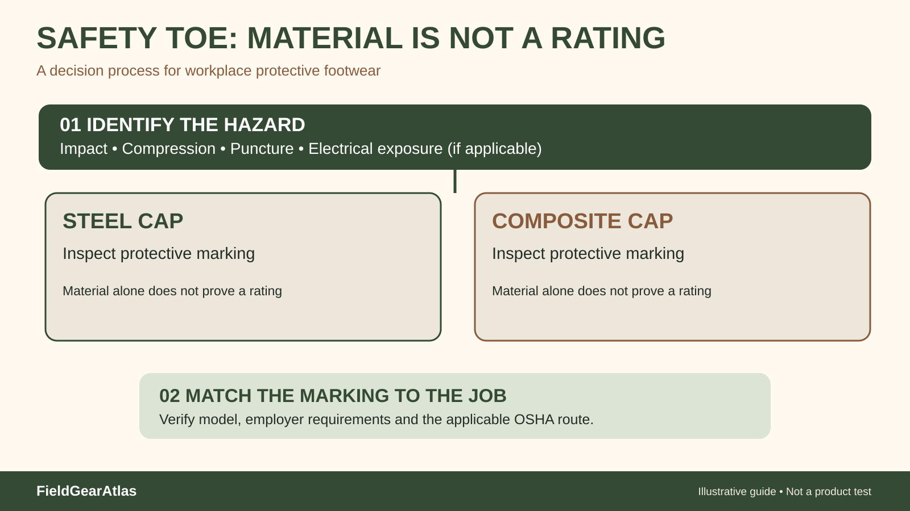

# Steel Toe vs Composite Toe Tactical Boots: Read the Protection Marking First

*Conceptual diagram; no product claims are certified by the illustration.*

The key distinction is the **material used in the safety-toe cap**: steel uses metal; composite designs use nonmetal materials. Neither name is a standalone safety certification. For a job that requires protective footwear, the relevant safety standard, marking and hazards matter more than a marketing claim that one material is “stronger.”

## What the US workplace standard actually covers

OSHA's workplace foot-protection rule, **29 CFR 1910.136**, applies when employees face specified foot hazards such as falling or rolling objects, sole puncture or certain electrical hazards. The regulation identifies recognized standard pathways or demonstrated equivalent protection. ASTM's current F2413-24 standard sets requirements for several safety-footwear characteristics, including toe impact and compression, but it does not mean every certified boot has every optional protective attribute.

You must verify the exact product's marking and your employer's hazard assessment. A listing that simply says “safety toe” does not prove a particular protection classification.

**Which edition applies?** Do not conflate the current ASTM product-standard publication with the standards incorporated into the text of the OSHA regulation. The publicly published text of 29 CFR 1910.136(b) names ASTM F2412-2005/F2413-2005 and specified older ANSI alternatives, and separately provides for footwear that the employer demonstrates offers at least equivalent protection. ASTM F2413-24 is a later published standard; its existence does **not** automatically rewrite OSHA's incorporated-reference language. Ask the employer or safety professional which documentation meets the applicable requirement rather than using a blanket claim of “OSHA-approved” footwear.

| Buying question | Steel toe | Composite toe | What to verify independently |
|---|---|---|---|
| What is the cap made from? | Metal | Nonmetal composite materials | Manufacturer specification |
| Is impact/compression rating adequate? | Depends on tested model | Depends on tested model | Applicable standard and marking |
| Is whole boot nonmetallic? | No, steel cap present | **Not necessarily**—other parts may contain metal | Complete construction and detector requirements |
| Is it always lighter? | Not necessarily | Not necessarily | Weight at identical size/width |
| Is it appropriate for electrical work? | Material is insufficient evidence | Material is insufficient evidence | Actual electrical hazard classification |

## Five common misconceptions

1. **“Composite means metal-free.”** Eyelets, shanks, zippers or hardware can still contain metal.
2. **“Steel toe automatically passes inspection.”** Only a correctly specified and verified model can meet a particular requirement.
3. **“All electrical-hazard boots are identical.”** Electrical hazard and static-dissipative or conductive characteristics are distinct requirements; never guess from the toe material.
4. **“Composite is always lighter.”** The entire boot's materials and size drive its weight, not just the cap.
5. **“A safety toe fixes a cramped toe box.”** Protective caps have finite geometry; try on the actual fit with work socks.

## A purchase workflow for employers and individuals

Write down the hazard and required specification **before** shopping. Request the maker's exact product marking, not a screenshot of a generic standard's logo. Confirm size, protective-toe geometry and fit. If adding orthotic inserts or modifying soles, consult the manufacturer and safety officer; ASTM notes certain post-sale component changes can affect conformity.

For uniformed work, be careful not to conflate military uniform authorization with an occupational safety rating. A military-style boot may be suitable for one use yet unapproved for another. The correct authority is the current job or service requirement.

### Hypothetical example

A technician needs approved impact/compression protection and works around metal detectors. A nonmetal toe cap may be appealing, but the buyer should also check shank, eyelets, hardware and the full product's marking. The example makes **no claim** that a specific boot model will pass the workplace requirement.

## Compliance-first checklist for a product page

For a protective-toe listing, record the exact standard citation **and any specific marked properties**. Do not assume a reference to ASTM means every electrical, puncture or metatarsal classification is included. Seek the manufacturer's marking documentation or confirm through the employer's safety process.

If a listing says “composite safety toe” but offers no standard evidence, it is a description of materials, not independently sufficient proof that the shoe meets a regulated workplace requirement. Conversely, a steel cap is not disqualifying merely because another material is marketed as more modern.

**Editorial separation:** In FieldGearAtlas, occupational safety compliance is a verified-reference topic; it should not be merged with military uniform-compliance guidance. Different authorities and criteria apply, and a claim in one system does not transfer to the other.

## What OSHA actually requires—and why the ASTM edition matters

For applicable US workplaces, OSHA 29 CFR 1910.136(a) addresses protective footwear where falling/rolling objects, sole-puncture hazards or specified electrical hazards remain. Section 1910.136(b) identifies the consensus standards incorporated by reference, including **ASTM F2412-2005 and F2413-2005**, as well as listed ANSI alternatives, and an at-least-as-effective route under subsection (b)(2). [OSHA — 29 CFR 1910.136](https://www.osha.gov/laws-regs/regulations/standardnumber/1910/1910.136/).

**Do not write “OSHA requires ASTM F2413-24” as a blanket legal statement.** Newer manufacturer testing standards can exist without being the edition expressly incorporated by the federal regulation. For a specific worksite, inspect the actual hazard assessment, employer policy and legible manufacturer marking; ask a safety professional where uncertainty remains. A steel or composite cap described as “protective” is not sufficient evidence for every hazard or rating.

## Practical decision example: What to ask before ordering a safety boot

A job hazard assessment calls for protection from falling objects and a puncture risk. Rather than buying “steel toe” by name, request the **exact model’s documented test marking**, relevant impact/compression and puncture-protection information, and confirmation by the employer or safety professional. Composite and steel describe cap material; the actual marked performance matters.

**Write down before choosing:** Do not infer that a toe-cap material automatically meets every workplace hazard or any edition of ASTM.

## FAQ

**Do composite toe boots meet ASTM requirements?** Some do; material alone does not establish certification. Check the exact boot marking.

**Which is warmer in winter?** It depends on insulation, fit, moisture and construction. Do not infer a wearer-level thermal rating from cap material alone.

**Can a regular tactical boot replace safety footwear?** Only if it meets the applicable workplace requirements verified by the employer.

## Primary sources

- [OSHA — 29 CFR 1910.136 Foot protection](https://www.osha.gov/laws-regs/regulations/standardnumber/1910/1910.136): mandatory US workplace regulatory criteria.
- [ASTM — F2413-24 summary](https://store.astm.org/f2413-24.html): publicly available scope, specific protective requirements and component-modification cautions.

This guide is educational, not a product certification or substitute for a workplace hazard assessment.
