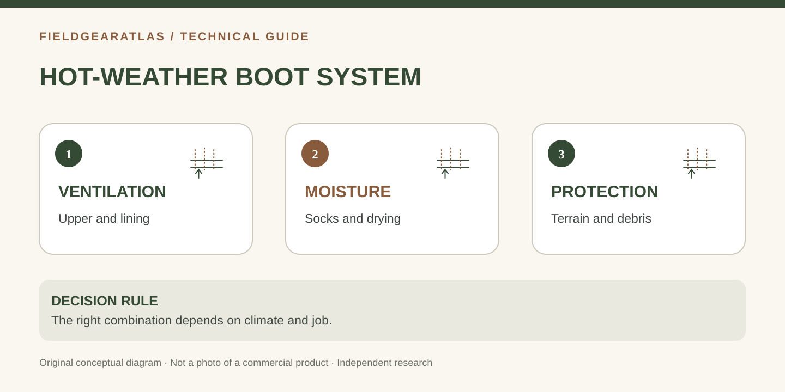

# Hot-Weather Tactical Boots: Breathability, Socks and the Water Tradeoff

*Conceptual diagram; no product claims are certified by the illustration.*

A “hot-weather” label is useful only when tied to the actual upper, lining and fit. In heat and humidity, comfort depends on how the entire footwear system handles **sweat, ventilation, water entering from outside and friction**. There is no universally best hot-weather boot for every climate or job.

## Read the upper construction before the marketing name

Leather and synthetic mesh occupy different positions on the ventilation–abrasion tradeoff. REI's footwear materials guidance notes that split-grain leather and nylon-mesh combinations typically offer greater breathability than full-grain leather while offering different durability and water-resistance characteristics. Actual panel placement and model construction matter; the fabric name alone does not guarantee airflow at your foot.

| Attribute | What it can help with | What to verify |
|---|---|---|
| Open textile/mesh panels | Air exchange, potentially quicker drying | Reinforcement, sand/debris exposure and seam construction |
| Waterproof membrane | External water resistance | Warm-weather comfort and drying after top-entry water |
| Lighter upper | Potentially less material mass | Real weight at your size and fit |
| High collar | Leg coverage and lacing options | Calf contact, sock height and heat management |
| Removable footbed | Inspectability, separate drying | Fit, volume and the maker's replacement guidance |

## Dry heat vs humid heat requires different planning

In dry heat, airflow and protection from hot surfaces, dust and abrasion may be important; excessive mesh in abrasive environments has tradeoffs. In humid conditions, the ability to manage sock moisture and friction may dominate perceived comfort. A waterproof membrane can be valuable for repeated wet vegetation but may be less attractive when heat buildup is a major issue.

Do not make a universal statement that non-waterproof boots always dry faster: materials, padding, construction and airflow differ. When assessing product pages, prefer explicit manufacturer information about lining, membrane, drying care and materials, not a vague “summer ready” badge.

## The sock and fit system

Use socks suited to your climate and boot volume. REI advises checking sock fit because an overly large sock can wrinkle and rub, while an overly small sock can create pressure. Wool/synthetic blends and spare socks may be more useful than changing boots solely because feet became wet after prolonged walking. Adjust footwear fit to the real sock thickness.

Record three observations after a short, easy trial: any toe rubbing, wetness/heat around the instep and heel movement. Identifying the *location* of a problem helps distinguish temperature from sizing.

## Why outsole choice is separate from ventilation

Tread compound and pattern are important for the ground surface; they are not determined by whether the upper is breathable. For hot pavement, gravel or wet rock, ask for the model's intended use and examine its condition. A smooth marketing photograph does not disclose tested traction.

### Decision example (hypothetical)

A person walks in hot, wet vegetation each morning but spends afternoons indoors. They should consider external moisture exposure and indoor heat together, and verify how the specific boot manages both. Another person traversing loose dry trails might put debris exclusion and socks ahead of a waterproof lining. Both should check fit first.

## Three climate scenarios to stress-test the description

**Hot and dry with dust:** Check coverage and entry points for grit as well as airflow. An upper with mesh panels may ventilate, yet a poorly sealed opening can increase debris ingress. The correct compromise depends on the route and expected exposure.

**Hot and humid with frequent sweat:** Check sock fit, footbed drying and whether the membrane trades away ventilation for external water resistance. An outer fabric designed to drain is not automatically comfortable if the inner padding holds moisture.

**Hot days with cold evenings:** The equipment system includes spare socks and other clothing. Avoid choosing an extremely breathable design from a noon-temperature snapshot when your outing extends into cooler, wetter hours.

In each case, distinguish environmental conditions from claims actually documented for the product.

## Use the source correctly: breathable upper is not a hot-weather rating

REI explains that split-grain leather/mesh constructions *typically* ventilate more than many full-grain leather uppers, while also changing durability and resistance to water and abrasion. The same guide notes that some waterproof membranes reduce airflow relative to ventilating mesh. [REI — Hiking Boots: Construction and Materials](https://www.rei.com/learn/expert-advice/hiking-boots.html).

This is **construction-level guidance**, not a controlled comparison of the tactical boots under consideration. When a product has a mostly leather upper with small mesh inserts, do not promote it as equally ventilated as a largely mesh design without testing. For an outdoor work requirement, confirm uniform rules and toe-protection rules independently of the warm-weather recommendation.

## Practical decision example: Heat and water create different decisions

For dry, warm conditions, a buyer may prioritize moisture management and fast drying; for repeated wet crossings, they may prioritize a waterproof construction. Those are different trade-offs, not a universal winner. Compare upper lining, ventilation openings, sock thickness, drying method and use pattern. Ask what happens when water enters through the top of a waterproof boot.

**Write down before choosing:** Do not call an untested model “coolest” or “best in heat” based only on mesh visible in photographs.

## FAQ

**Is GORE-TEX always too hot?** No. Different technologies exist, and total comfort depends on construction and conditions. Neither waterproof nor non-waterproof labels guarantee dry skin.

**Do black boots always overheat?** Color alone does not establish the internal microclimate of a particular boot; materials and use also matter.

**Should I buy a bigger size for thick socks?** Re-measure and fit using actual socks; avoid guessing a blanket size increase.

## Sources and boundaries

- [REI — Hiking footwear uppers and waterproof membranes](https://www.rei.com/learn/expert-advice/hiking-boots.html): materials, breathability and water resistance.
- [REI — Choosing hiking socks](https://www.rei.com/learn/expert-advice/backpacking-socks): fit, cushioning and fabric.
- [GORE-TEX — Footwear technologies](https://www.gore-tex.com/technologies/footwear): manufacturer technology descriptions.

No particular manufacturer's temperature, comfort or performance is independently verified here.
