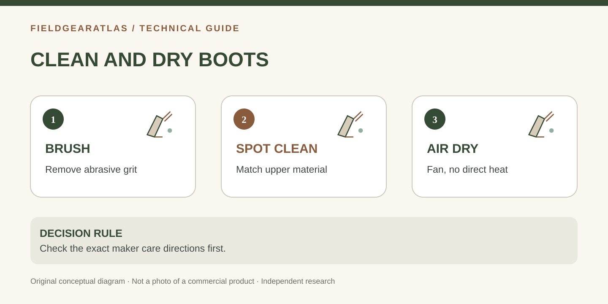

# How to Clean and Dry Tactical Boots Without Damaging Leather or Mesh

*Conceptual diagram; no product claims are certified by the illustration.*

Cleaning mixed-material tactical boots means removing abrasive dirt **without damaging the leather, textile panels, bonding, membranes or finish**. Because different models use different treatments, the manufacturer's care guidance takes priority over any generic recipe.

## Start by identifying what is actually on your boots

Check whether the upper is smooth leather, nubuck/suede-like leather, synthetic textile or a combination. Determine whether the manufacturer permits conditioners or waterproofing treatments. A product appropriate for full-grain leather may be unsuitable for suede-textured surfaces or certain membrane constructions.

REI recommends removing laces and using a soft brush to clear surface grit, then using a boot-compatible cleaner as needed. **Do not automatically machine-wash footwear** or saturate components that the maker says must stay dry.

## Step-by-step routine after a muddy outing

1. Let loose surface mud become manageable, then gently brush off grit that can abrade materials when the boot flexes.
2. Remove the laces if access is obstructed and remove the footbeds if the maker permits it.
3. Brush the outsole grooves and dislodge small stones. Avoid cutting or scraping the sole with sharp tools.
4. Spot-clean the upper with a product approved for the specific material. Follow its dilution/rinsing instructions.
5. Clean lace channels and fabric seams gently, where dried salt or grit can accumulate.
6. Set boots in a ventilated indoor place at normal temperature. Dry insoles separately when removable.
7. Once dry, examine seams, outsole separation, damaged eyelets, toe abrasion and footbed condition before the next use.

## Drying: airflow, not aggressive heat

REI explicitly warns against fireplaces, radiators, direct heaters and high heat because they can weaken adhesives and age leather prematurely. A fan or absorbent paper changed regularly is a safer general approach. Do not place wet boots against an open flame at camp.

| Problem | Better response | Avoid |
|---|---|---|
| Inside damp after rain | Remove approved footbed, ventilate, change absorbent paper | Hair dryer or intense heat |
| Mud in deep lugs | Soft stiff-bristled brush after loosening dirt | Gouging compound with a blade |
| Leather looks dry | Identify leather type and follow model's conditioner guidance | Applying one oil to every leather |
| Water no longer beads | Check recommended cleaning/reproofing route | Assuming membrane is automatically destroyed |
| Persistent odor | Dry fully, wash permitted components | Masking odor with heavy fragrance while damp |

## Reproofing is not the same as fixing a leak

A surface treatment can change how an upper wets out, but it cannot necessarily repair torn membrane, separated seams or water entering over a cuff. If a boot leaks, locate the ingress source and follow warranty/support instructions. Do not describe a coating as restoring the boot to factory waterproof status without model-specific evidence.

## What about mildew or prolonged storage?

Clean and dry before storing; choose a stable, ventilated place rather than a hot car trunk or damp garage. If a boot has severe deterioration, peeling adhesives or persistent biological contamination, seek manufacturer advice before continuing to use it in a demanding setting.

## Cleaning record that preserves the manufacturer's guidance

Keep a small record of the **upper material**, cleaning solution used, whether the model has a waterproof membrane, and the maker's care link. This matters when a boot combines smooth leather panels and nylon mesh: treating every surface with the same product can alter appearance or finish.

After each cleaning, inspect stitching around flex points, outsole separation and high-wear toe and heel zones. These inspections are not a certification of continued performance; they simply help identify whether the boot needs further manufacturer attention.

For boots used regularly, setting a short post-use brush/dry routine may be more practical than postponing heavy cleaning until dirt has hardened in eyelets and flex creases. How often to condition depends on the exact leather and treatment directions, not a fixed calendar invented by FieldGearAtlas.

## Practical decision example: A care record for mixed materials

A boot has a leather section, mesh and a membrane claim. Check that model’s instructions before selecting detergent or treatment: one cleaning product may be suitable for one material and inappropriate for another. Remove loose dirt, clean only as the maker permits and allow airflow drying away from direct heat. Log what product was applied and when.

**Write down before choosing:** If a leak persists, cleaning or reproofing cannot substitute for a diagnosis of seams, damage or construction failure.

## FAQ

**Can I dry boots in the sun?** Temperature and material care matter; the safer default is normal-temperature ventilation as recommended by maker/REI rather than intense heat.

**Should leather be conditioned every time it is cleaned?** Not universally. Conditioning needs depend on material, product formulation and care directions.

**How fast will tactical boots dry?** No reliable universal number exists. Construction, saturation, airflow and indoor humidity vary substantially.

## Sources

- [REI — How to clean hiking boots](https://www.rei.com/learn/expert-advice/caring-hiking-boots.html): cleaning, drying and outsole instructions.
- [REI — Care for leather hiking boots](https://www.rei.com/learn/expert-advice/how-to-care-for-leather-hiking-boots.html): leather treatment and drying guidance.

This guide provides a safe general workflow, not a warranty-approved cleaning prescription for every manufacturer.
