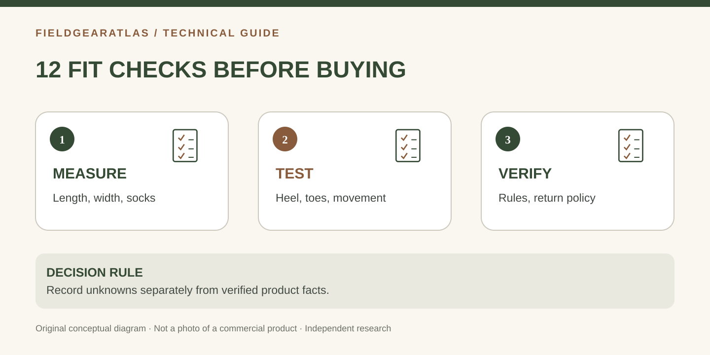

# Tactical Boot Fit Checklist: 12 Questions to Ask Before Buying Online

*Conceptual diagram; no product claims are certified by the illustration.*

An online tactical boot listing usually gives you a size and a collection of performance claims. It rarely tells you whether the heel, forefoot, instep and toe box will fit *your* feet in *your* socks. The goal of this checklist is to turn shopping into a sequence of **answerable checks**, not assign a score to boots we have never worn.

## The twelve checks

| # | Ask this before checkout | Evidence to record |
|---|---|---|
| 1 | Have both feet been measured? | Left and right heel-to-toe length |
| 2 | Have you checked heel-to-ball/arch length? | Brannock fitting result if available |
| 3 | Do you know where your current boots pinch? | Toe, ball, instep or heel location |
| 4 | Does the exact model have width choices? | R/W, D/EE or maker's designation |
| 5 | Does the last suit your toe shape? | Maker description, indoor try-on |
| 6 | Will the planned socks fit? | Sock thickness and cushion type |
| 7 | Does the heel stay put while walking? | Movement noted during trial |
| 8 | Will toes avoid front impact on descents? | Controlled step-down trial |
| 9 | Does the boot suit your climate? | Membrane/ventilation/insulation claims |
| 10 | Is the outsole appropriate for your use? | Sole type and intended surface |
| 11 | Are any uniform or work rules applicable? | Current primary policy and exact model |
| 12 | Can you return it after an indoor fitting? | Actual seller policy and condition |

## Why the first two questions are separate

Heel-to-toe length is not always the only useful length. The Brannock Device Company explains that heel-to-ball measurement helps align the foot with the shoe's flex point. A boot that fits in front but bends in the wrong place may be uncomfortable, so a professional fit remains worthwhile for difficult feet.

## Turn discomfort into an action

- **Ball of foot pinches, toe length fine:** Try an appropriately wider *model-specific width* rather than automatically lengthening the boot.
- **Toes meet the front on stairs:** Re-evaluate length and foot sliding; secure lacing is not a replacement for inadequate length.
- **Instep feels crushed:** Check upper volume and tongue geometry as well as lacing.
- **Heel rubs while the forefoot fits:** Compare another last; extra overall width may worsen heel hold.
- **Feet get wet with no visible leak:** Consider sweat, sock choice and water entering from the cuff, not just membrane failure.

## Two scenarios, different priorities

**Desk-to-field duty:** One person needs a boot suitable for occasional outdoor work and long indoor shifts. Fit, comfort and slip/workplace requirements may matter more than maximizing shaft height.

**Trail rucking:** Another person walks up and down grades with a pack. They should emphasize downhill toe clearance, heel retention and sock moisture control before a long session.

These are hypothetical shopping scenarios, not reports of FieldGearAtlas field testing.

## Downloadable record and privacy

Use the **Boot Width Measurement Worksheet** to log exact dimensions and preferred models. Keep the record locally; the worksheet does not need to upload a user's foot measurements. Print it if you want to compare several models in a physical store. Record manufacturer specifications separately from personal fit observations.

## Scoring the information, not the product

A useful self-check is to group the 12 questions into **known / unknown / not applicable**. If a mandatory item like workplace certification or a service dress rule is unknown, stop and resolve it before buying. If a preference such as appearance is unknown, that does not imply the same consequence.

Record any needed follow-up by source: *manufacturer* for exact width offerings and boot materials; *retailer* for return eligibility; *employer or current policy* for workplace and uniform requirements; *your own fitting* for toe collision and heel slip. This prevents a product listing from pretending to answer every kind of question.

The worksheet should not produce a fake numerical “fit score.” A strong online research process helps narrow options and makes an indoor fitting more informative, but does not replace wearing the actual boot.

## Practical decision example: Turning twelve checks into a purchase decision

A buyer finds no toe impact but experiences recurrent forefoot pinching during indoor walking. That single failed check matters more than passing unrelated appearance or specification checks; the buyer should compare width and last shape before choosing. Conversely, a secure comfortable fit does not prove the boot meets workplace or uniform rules, which require separate documentation.

**Write down before choosing:** Treat the checklist as a diagnostic record, not a numerical score that predicts field performance.

## Frequently asked questions

**Can the same US size fit differently across brands?** Yes. Boot lasts and width systems vary, so use the specific manufacturer's guide.

**Should boots be painfully tight until broken in?** No. Break-in should not be an excuse for persistent pinching or loss of sensation.

**Does “military approved” on a shop page prove compliance?** No. Confirm the current authoritative rule and product evidence where requirements apply.

## Sources

- [Brannock Device — Fit and measurement instructions](https://brannock.com/pages/instructions-fitting-tips): both lengths, width conventions and fitting notes.
- [REI — Hiking boot selection](https://www.rei.com/learn/expert-advice/hiking-boots.html): heel, toe room and movement tests.
- [REI — Hiking sock selection](https://www.rei.com/learn/expert-advice/backpacking-socks): volume and friction considerations.

There are no product rankings, unpublished test scores or invented fit guarantees in this checklist.
