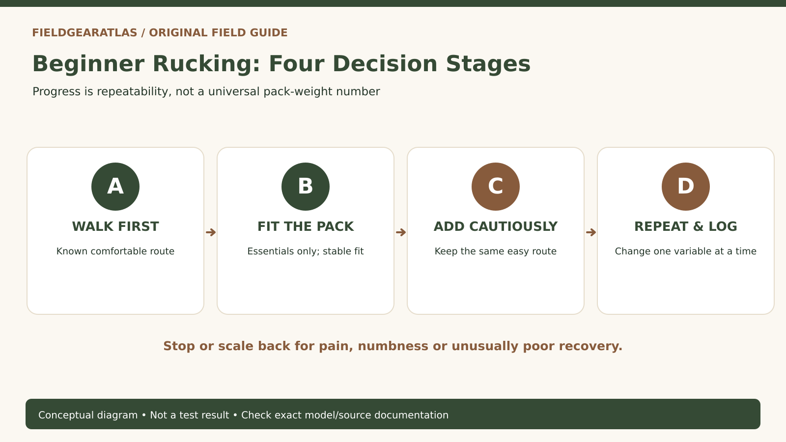

# Rucking for Beginners: Start With Walking, Fit and a Repeatable Plan

*Original conceptual infographic. Not a tested model or product performance result.*

**Quick answer:** Rucking is walking while carrying a load in a backpack. For a first session, choose a familiar, easy route; confirm that the pack and footwear fit; and use a load conservative for *your* current walking ability. Add difficulty gradually rather than copying another person's weight, distance or military training standard.

A ruck is not a contest to make an ordinary walk as heavy as possible. The goal for beginners is to build a repeatable habit without overlooking fit, recovery, route safety or hydration. A beginner can plan a successful session without a branded rucksack or a formal military background.

## Rucking versus ordinary walking

Walking has an essential role before any additional weight enters the picture. A pack changes how the shoulders, hips and feet interact with the terrain, and a steeper route increases the challenge even at the same distance. That is why the variables need to be tracked separately: *pack weight, time, route profile, pace and the next-day response*.

A beginner who can comfortably walk on flat ground should not assume that the same duration plus a heavy pack on rocky hills will feel comparable. Use an easy, familiar route with a straightforward exit plan. If you are uncertain whether loaded walking is appropriate because of pain, injury or health concerns, obtain individualized professional advice first.

## The starter setup: less equipment than you think

| Item | Function | Useful first check |
|---|---|---|
| Comfortable shoes or boots | Stable fit and traction | No pressure points or recurring heel slip |
| Backpack | Carries the load close to the body | Straps work, pack stays stable, no hard objects press into the back |
| Secured weight | Makes the exercise loaded | Cannot shift freely, no sharp or hard contact areas |
| Water and weather layer | Supports a safe outing | Appropriate for route and conditions |
| Phone/map and a route plan | Navigation and contingency | Know where to turn around and how to get home |

Do not confuse a pack's **volume** with its safe carried weight. A 30-liter bag does not necessarily have a heavy-load suspension. Before using additional weight, check the manufacturer's instructions or load guidance if available.

## A four-session progression without arbitrary numbers

This example is a *decision sequence*, not a medical or fitness prescription.

1. **Session A: ordinary walk.** Choose a route and duration you already tolerate well. Record distance, surface and any foot pressure points without deliberately loading the pack.
2. **Session B: pack-fit trial.** Carry only the necessary outing items. Adjust pack height, compression and shoulder straps; notice shifting, rubbing and posture.
3. **Session C: conservative loaded walk.** Only if earlier sessions were comfortable, add a modest, stable load appropriate to your capacity. Keep the same easy terrain rather than increasing every variable.
4. **Session D: repeat before progressing.** Repeat a comparable session to assess consistency. Change one variable at a time if you decide to progress, and allow recovery.

Stop or scale back when pain, unusual numbness, dizziness, chest symptoms or unmanageable strain occurs; do not push through warning signs to complete a target.

## Pack configuration: secure weight, then fit it

Place dense items so they cannot move or create pressure against the spine. Center the load left-to-right and prevent rolling items from colliding with the pack structure. The exact vertical position of the load depends on pack design and manufacturer guidance; there is no universal placement that fits every body and every pack. Adjust straps so the load moves with you rather than swaying at every step.

For packs with a functional hipbelt and sized suspension, torso length is an important fit measurement. For a small daypack without that system, check shoulder comfort and stability without assuming it transfers a large load to the hips. If the only way to keep the pack stable is to overtighten until it causes numbness, revise the setup.

## Foot care belongs in your plan

Wear the socks you will actually use, and assess fit before a long walk. Moisture, pressure and rubbing can create hot spots. A short trial gives you a chance to adjust socks, laces or the route before the problem grows. The moment a location starts to rub repeatedly, stop safely to investigate it; a training target is not worth damaging your feet.

For rucking, walk a slight downhill section during a controlled shoe fitting to see whether toes hit the front. No brand of boots is automatically best for rucking simply because its description contains tactical terminology.

## Simple training log you can actually learn from

Record: date; distance or elapsed time; pack load as actually measured; elevation/route type; footwear and socks; perceived effort; foot hot spots; shoulder/hip comfort; and your recovery by the following day. Comparing logs without matching terrain and load is misleading. A faster time is not necessarily progress if it required an unsustainable effort or worsened foot pain.

**Worked hypothetical:** Two walks take 40 minutes. The first has no additional load on a level path; the second carries a pack on steep stairs. Recording only the same duration hides nearly every difference that matters. Document the conditions before comparing the outcome.

## A lower-risk first-session decision record

A beginner needs **a repeatable outing, not an impressive starting weight**. Define the route, distance, terrain, weather and available daylight first. Decide which essentials the location requires using the National Park Service's planning guidance. Confirm that the backpack is comfortable with the gear actually needed for the outing. If you decide to add training weight, use a load appropriate to your experience and the packmaker's stated conditions; do not copy a military training number from an unrelated situation.

For an initial self-check, note `route`, `planned_duration`, `actual_pack_mass`, `terrain`, `weather`, `comfortable_pace`, `foot_pressure_points`, and `recovery_observations`. Changes in pack weight, walking speed and uphill grade each change effort. The CDC's **talk test** is one possible general cue for relative aerobic intensity: people at a moderate relative intensity can usually talk but not sing, while at vigorous intensity they cannot say more than a few words without pausing for breath. This is **not a clearance test for weighted exercise** or a recommendation for any particular weight.

**Stop conditions:** if sharp pain, chest discomfort, faintness or unusual breathlessness occurs, stop the session and seek appropriate medical advice rather than treating the symptom as normal rucking progression. The guide does not prescribe training for someone with a medical condition.

## Questions beginners usually ask

### How much weight should I start with?

There is no single number that is appropriate for all new participants. Baseline fitness, pack design, health, body size and route all matter. Begin with a load you can control comfortably and progress conservatively; do not copy a military selection standard as a civilian beginner goal.

### Do I need tactical boots?

No. The footwear needs to fit and suit the route. A comfortable hiking shoe or other suitable walking footwear can be more practical than an ill-fitting tactical boot.

### How often should I ruck?

Choose a schedule that allows you to recover and maintain good form. Increase frequency only after you know how the previous outings affect you; individual recommendations require individual context.

## Practical decision example: A first-session choice

The same person can make an ordinary walk easy or demanding by changing route, duration, pace and carried weight. Choose a familiar route and an appropriate setup, then record comfort, perceived effort and any foot hotspots. Keep changes small enough that you can identify why the next session felt different.

**Write down before choosing:** The goal is a repeatable learning process—not hitting an invented starter weight or universal pace.

## Research and limitations

- [REI — Backpack fitting and torso sizing](https://www.rei.com/learn/expert-advice/backpacks-adjusting-fit.html) — fitting concepts, suspension and straps.
- [REI — Preventing blisters](https://www.rei.com/learn/expert-advice/blister-prevention-care.html) — friction, fit and moisture.
- [REI — Beginner trip planning](https://www.rei.com/learn/expert-advice/backpacking-beginners.html) — conservative route choice and contingency planning; this is backpacking guidance, **not** a rucking-specific training prescription.

**Transparency:** This guide does not claim to be a military training program, individualized medical advice or a first-hand load test.

**Additional source used in editorial verification:** https://www.cdc.gov/physical-activity-basics/measuring/index.html

## A practical intensity check that is not a prescribed ruck weight

The CDC's **talk test** is a simple way to describe relative aerobic intensity: at moderate intensity, a person can usually talk but not sing; at vigorous intensity, speaking more than a few words without a pause becomes difficult. [CDC — How to Measure Physical Activity Intensity](https://www.cdc.gov/physical-activity-basics/measuring/index.html).

**Use it cautiously:** On a familiar, safe route, record perceived effort and whether the talk test changes as you walk. Record total time, terrain, weather and pack mass as context, not as an instruction to increase weight. The CDC page does **not** prescribe a military rucking plan, safe starting plate mass or medically appropriate progression rate. Anyone with health or injury considerations should use individualized guidance rather than treating this tool as clinical clearance.

