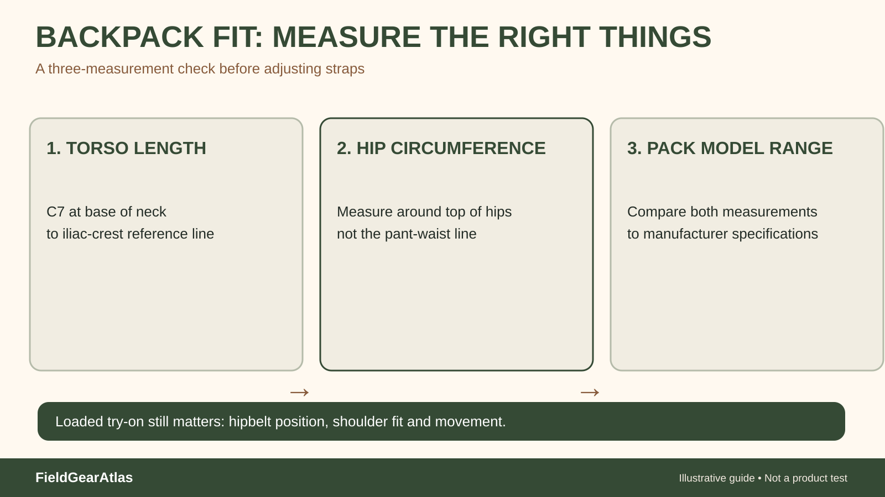

# How Should a Rucking Backpack Fit? Torso, Hipbelt and Strap Adjustments

*Conceptual diagram; no product claims are certified by the illustration.*

A rucking pack should feel stable without relying on painfully tight shoulder straps. For packs built with structured load-transfer suspension, **torso length and hipbelt fit** are more informative than the wearer's overall height. For small frameless packs, expect different load-transfer behavior; do not evaluate them as though they have a fitted backpacking frame.

## First determine what type of pack you have

A simple soft pack with padded shoulder straps may have no meaningful hipbelt load transfer. A framed pack designed to sit partly on the pelvis usually provides torso sizing, a hipbelt and a strap adjustment sequence. Check which system the manufacturer actually describes before copying fitting advice from a different pack design.

REI's backpack fitting guidance emphasizes torso length rather than stature. It also describes a hipbelt located over the top of the hip bones on appropriate framed packs. Adjust the pack **with a modest, safe sample load**, not an empty bag alone, so that shifting becomes apparent.

## A sensible fit sequence for a framed pack

1. Review the manufacturer's torso-size and hipbelt fit ranges.
2. Loosen all straps; add a stable, manageable sample load within the maker's permitted limits.
3. Put on the pack and set the hipbelt to contact the upper hip area, without pinching.
4. Snug shoulder straps so they follow the shoulders rather than pulling all weight onto them.
5. Adjust load lifters if the design includes them; do not over-tension until shoulder pain develops.
6. Use the sternum strap gently to organize strap placement, not compress the chest.
7. Walk, turn and climb a few stairs in a safe place. Observe sway, belt slip and pressure.

| Symptom | First check | Not a safe conclusion |
|---|---|---|
| Shoulder numbness | Torso length, hipbelt position, load | Pull shoulder straps harder |
| Hipbelt slides down | Belt fit and pack sizing | Entire pack must be defective |
| Pack swings while turning | Compression/load restraint | Higher advertised liters will fix it |
| Sternum strap causes discomfort | Strap height/tension | Cinch tighter for stability |
| Upper load pulls backward | Internal packing and load lifter function | MOLLE webbing ensures balance |

## Weight placement is a separate issue

Even a well-sized harness can feel unstable if a heavy object moves inside. Place dense items so they remain securely restrained and near the pack body, while respecting manufacturer limitations and access to essentials. There is no universal exact placement height that fits every frame, terrain and user.

**Hypothetical example:** A person with a small framed hiking pack and another with a large frameless tactical pack each carry an identical set of gear. The right adjustment procedure and comfort expectations differ. Comparing only external dimensions or MOLLE rows misses the most important structural distinction.

## How to verify without equipment testing claims

Write down the model, published torso-size range, pack length, hipbelt design and whether the manufacturer provides load limits. Then record your own fit observations. A short indoor walk is a fitting check, not certification that the pack is suitable for a demanding loaded march.

## What changes when a frame is absent

A small pack with a narrow webbing waist strap may control sway yet provide little meaningful weight transfer compared with a structural hipbelt on a framed backpack. The word “hipbelt” on a listing therefore requires inspection of its construction and fit, not just the existence of a buckle.

If a shoulder strap digs into one side, confirm that the internal load is not asymmetric. If the pack has no adjustable torso system, endlessly tightening its shoulder straps cannot invent a fit range the manufacturer did not design.

For long-term research notes, separate `torso_fit_range`, `suspension_type`, `hipbelt_load_transfer_claim`, and `published_load_limit`. A blank load-limit field should stay unknown rather than be inferred from pack volume or tactical webbing coverage.

## A repeatable torso-and-hip fit measurement

Before adjusting a framed rucksack, confirm its sizing system. Ask a helper to locate your **C7 vertebra** (the prominent bump at the base of the neck when looking down). Put your hands on the tops of the hip bones and imagine a horizontal line connecting the thumbs across your back. Measure the distance from C7 to that line: this is a practical torso-length estimate. Measure hip circumference around the top of the hip bones, not merely your trouser waistband. Compare *both* values with the **exact model and size's** published fit ranges. The REI fitting guide explains that torso length—not standing height—drives pack sizing and that hipbelt size requires a separate check.

Before adding weight, confirm basic sizing and that you can put on and remove the pack safely. Then repeat the adjustment process using a **manageable trial load within the maker's instructions**, indoors or in a safe short setting. Start with the hipbelt hugging the hip bones, adjust shoulder straps without dragging all the weight onto the shoulders, set load-lifters snugly if supplied, and position the sternum strap without restricting breathing. If a pack lacks a substantial hipbelt or adjustable suspension, do not pretend those adjustments exist. Stop and re-evaluate if you notice pain, restricted breathing or persistent one-sided pressure.

**Decision record:** `model / size`, `torso_length`, `hip_circumference`, `frame_type`, `hipbelt_design`, `observed_pressure_points`, `load_used_for_indoor_check`. These are user-noted measurements, not a proprietary FGA certification of pack fit.

## Fit record for comparing two packs

| Check | Pack A | Pack B |
|---|---|---|
| Exact model and harness size | ___ | ___ |
| Manufacturer torso-fit range | ___ | ___ |
| Hipbelt range / structural belt present | ___ | ___ |
| Your measured torso length | ___ | ___ |
| Your measured hip circumference | ___ | ___ |
| Trial load and pack-maker guidance | ___ | ___ |
| Heel-to-hipbelt / shoulder pressure notes | ___ | ___ |
| Sway, strap interference or restrictions | ___ | ___ |

If the pack has no torso adjustment or supportive hipbelt, write **not applicable**, not a fictitious fit measurement. Do not diagnose pressure-related numbness by tightening straps; stop the trial and seek an appropriate fitting assessment.

## Practical decision example: Comparing two packs in the same conditions

Pack A and Pack B both claim the same liter capacity, but only one allows the hipbelt to sit comfortably over the wearer’s iliac crest with its torso adjustment in range. Load both with the same familiar, securely packed items and compare shoulder pressure, belt contact and movement. If the frame geometry cannot match the torso, strap tightening will not transform it into the correct size.

**Write down before choosing:** Write down torso measurement, hipbelt range, actual carried load, adjustment limits and pressure points.

## FAQ

**Can I fit my pack based on height?** Height alone is a poor substitute for torso length when the pack uses a fitted suspension.

**Do all tactical packs transfer weight to the hips?** No. Check frame and belt construction rather than assuming from category names.

**Should the sternum strap be tight?** It should organize shoulder-strap placement comfortably; don't constrain breathing.

## Sources and boundaries

- [REI — How to size and fit a backpack](https://www.rei.com/learn/expert-advice/backpacks-adjusting-fit.html): torso, hipbelt, load lifters and sternum strap.
- [REI — How to choose a backpack](https://www.rei.com/learn/expert-advice/backpack.html): capacities and suspension fit.

This is a fit guide, not a numerical rucking weight recommendation or an assessment of specific commercial packs.
