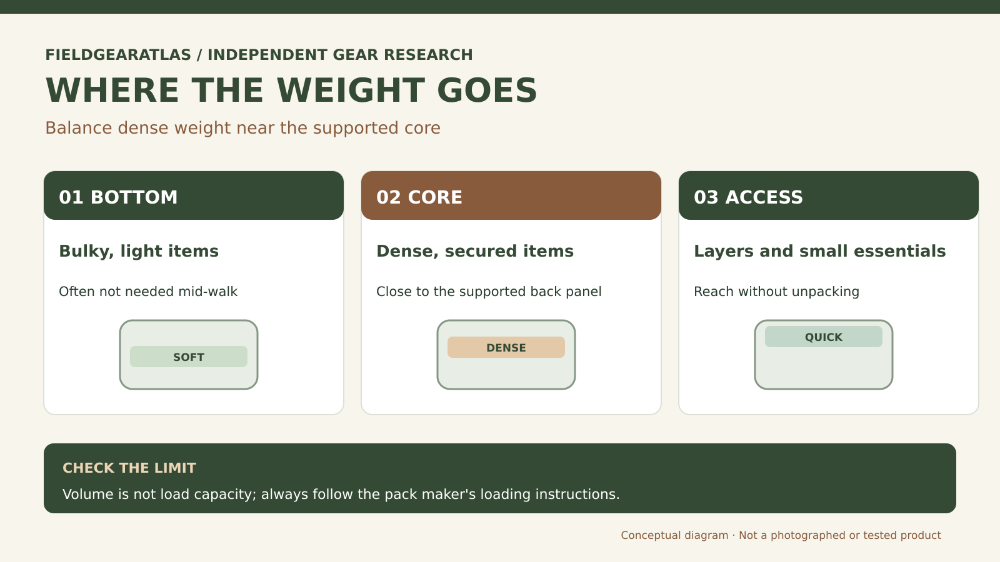

# Where to Put Weight in a Ruck: Packing for Stability

*Technical explanation diagram created for FieldGearAtlas. Not a photograph of a commercial product.*

**Quick answer:** Start with compact, dense items in the **central core of the pack, close to your back**. Keep the load balanced left-to-right and secure it so it cannot bounce. The ideal placement depends on suspension, route, load shape and manufacturer guidance; there is no universal "plate at exactly this height" rule.

A well-packed ruck is not simply a bag that holds all your equipment. It keeps the contents from moving independently of your body. If you feel your shoulders being pulled backward with every step, fixing the packing layout may matter more than adjusting another strap.

## The three zones: what belongs where?

| Zone | Typical contents | Why it belongs there |
|---|---|---|
| Bottom | Bulky, compressible items not needed during the walk | Creates a foundation without placing the densest mass too low |
| Middle / near back | Dense items such as a secured training weight, food or a filled water reservoir | Helps control leverage and side-to-side swing |
| Upper / accessible | Rain layer, navigation, snacks and small essentials | Avoids unloading the bag for items needed mid-route |

These are **starting placements**, adapted from general pack-loading principles—not a substitute for a ruck manufacturer's guidance. Unlike soft camping equipment, rigid training plates can create hard pressure points if the pack's dedicated plate compartment or frame is not used correctly.

## The difference between 'close to your back' and 'pressing on your back'

Dense weight should be stabilized near the pack's supported center. That does **not** mean placing an uncovered metal plate against the user's spine. Use a purpose-built sleeve or secure enclosure, protect against sharp corners and follow instructions on load orientation. An improvised heavy object can tear fabric, shift unexpectedly or produce concentrated pressure.

For a framed hiking pack, a hipbelt and adjustable suspension can distribute load differently than a soft-sided tactical daypack. A small daypack with shoulder straps alone may not be appropriate for a heavy training load even if it has the same external volume.

## Test the packing before leaving home

1. **Inventory:** put all intended contents on the floor. Remove items not needed for the route or its safety conditions.
2. **Balance:** load dense objects centrally; avoid one-sided pouches carrying significantly more mass than the opposite side.
3. **Secure:** use an internal sleeve, compression straps or padding only as permitted by the bag's design. Shake the pack gently; nothing heavy should slide.
4. **Fit:** adjust the harness with the pack loaded. Check whether the hipbelt, if designed for load transfer, sits correctly on the pelvis.
5. **Walk:** make a short controlled circuit, including gentle turns. Stop if something knocks, shifts or produces numbness or pain.

**Example (hypothetical):** Two people carry identical 20-liter packs. One uses the main pocket as a loose bucket for a rigid weight; the other has the same item retained in a padded sleeve. Their packs have the same nominal capacity, yet the first may sway badly. The decisive variable is *retention*, not liter count.

## Troubleshooting by symptom

| Symptom | First check | Do not assume |
|---|---|---|
| Pack tips backward | Dense load too far from back; incorrect strap adjustment | You need a heavier pack |
| Pack swings sideways | Unequal side loading or loose contents | Adding another pouch solves it |
| Hard spot on lower back | Unprotected weight or poor compartment placement | Pain is normal during adaptation |
| Neck or shoulder strain | Load amount, fit, frame, harness adjustment | Pulling all straps tight is the answer |

If the maker publishes a plate position, a maximum load or specific attachment instructions, treat those as higher-priority than generic advice here.

## Practical decision example: A balanced packing check

Pack two equally dense items in a backpack: place one close to the back and one far toward the outer pocket. Walk a few controlled steps in a safe setting and compare sway and shoulder tension, keeping the pack’s load guidance in mind. The nearer configuration may feel more stable, but do not put a hard object directly against your spine without cushioning.

**Write down before choosing:** Keep both sides balanced and secure loose items; manufacturer frame and load-placement instructions take precedence.

## Common questions

### Should ruck weight sit high or low?

Usually keep the dense mass near the supported center of your back rather than at the bottom or dangling far behind. Exact height depends on the pack's intended design and terrain. Start with the dedicated weight compartment if one exists.

### Can I put the weight in an outside pouch?

An outside pouch is not automatically rated for a training load. Confirm attachment strength and retention; otherwise keep dense contents in a designed compartment.

### Does compression reduce carried weight?

No. Compression can restrain volume and movement, but it does not change the load's mass or make an overloaded pack safe.

## Editorial scope

This guide is about **equipment arrangement**, not a prescription for training weight. FieldGearAtlas has not laboratory-tested a particular ruck, plate sleeve or harness. Record the pack model, actual load, stability and points of discomfort when comparing configurations.

## Research references

- [REI — How to Pack and Hoist a Backpack](https://www.rei.com/learn/expert-advice/loading-backpack.html)
- [REI — How to Size and Fit a Backpack](https://www.rei.com/learn/expert-advice/backpacks-adjusting-fit.html)
