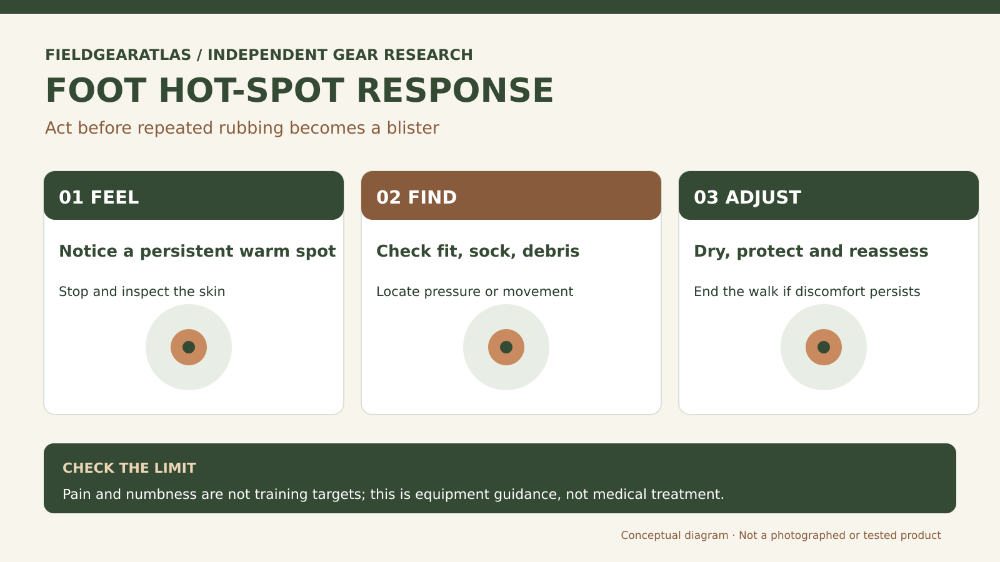

# Rucking Foot Care: Find Hot Spots Before They Become Blisters

*Technical explanation diagram created for FieldGearAtlas. Not a photograph of a commercial product.*

**Quick answer:** The most useful foot-care intervention is often the earliest: **stop when you feel a persistent hot spot**, identify the friction or pressure source and correct it before continuing. Footwear fit, sock moisture and small amounts of internal movement matter more than any miracle blister-prevention product.

A ruck can increase the duration and repetition of a minor rub. The result might be a heel blister, tender toe or compressed forefoot—even if the boots seemed tolerable on an indoor fitting.

## Read the location before changing equipment

| Location | Common equipment-related causes to check | First response |
|---|---|---|
| Back of heel | Heel slipping or boot stiffness | Pause, inspect skin and sock; revisit heel hold/lacing |
| Outer little toe | Forefoot shape or toe box contact | Check width and toe shape, not just overall length |
| Under ball of foot | Sock bunching, heat, grit or repeated shear | Remove debris; inspect sock fit and insole position |
| Top of foot | Tongue folds, overtight lacing, low instep volume | Relieve pressure and check lace tension |
| Between toes | Moisture, toe crowding, fabric folds | Dry and assess spacing/fit |

These are troubleshooting possibilities, not medical diagnoses. A foot with persistent numbness, severe pain, spreading redness or signs of infection needs appropriate medical attention rather than another gear experiment.

## Before the walk: a two-minute inspection

Try the same socks you intend to wear outside. Check for wrinkles at the toes and heel, then put on boots with your normal insoles. Stand, walk and descend a step under controlled conditions. If the heel repeatedly lifts or toes strike the front, do not plan to 'break that in' over a long route.

Trim nails appropriately, inspect seams or hard spots inside the boot, and remove any grit. Carry a dry spare pair of socks and a small foot-care kit suitable for your trip. If you choose preventive tape or blister pads, learn how to use them at home first.

## During the ruck: watch for moisture and friction

Hot, wet skin is more vulnerable to rubbing. On a longer outing, change into dry socks when needed and let feet dry during safe breaks. Sock thickness must match available boot volume: thicker isn't automatically better if it crowds the forefoot. Merino or synthetic hiking socks may manage moisture differently from everyday cotton socks; fit remains primary.

**Field scenario:** You notice a warm patch on the side of one big toe at the first rest stop. Simply walking faster to finish increases exposure. Instead, stop, dry the area, inspect whether the toe rubs a seam, and adjust your equipment. If painful rubbing persists, shorten or end the outing rather than pushing through.

## Make a reusable foot-care log

After each outing record *shoe model and size; sock brand and thickness; weather; time to first discomfort; exact location; adjustment; outcome*. If a different boot produces trouble on the same part of your foot, the underlying issue may be width or toe shape. If the issue appears only with one sock, the sock/volume combination deserves attention.

This log helps you avoid random purchases. It can also guide a qualified boot fitter if you cannot resolve persistent discomfort.

## Hot-spot response before a blister gets worse

Foot pain during a walk should not be a test of toughness. REI's hiking blister guide identifies **friction, pressure and moisture** as important contributors to common hiking blisters and recommends acting promptly when a hot spot appears. If you feel a repeated rub, pause somewhere safe, remove the boot and examine the sock and skin. Look for a bunched-up sock, a wet area, heel movement or local compression. Where appropriate, dry the area, correct the mechanical cause and use an appropriate protective dressing according to the product's instructions.

Keep a **fit diary by location**: `heel`, `side of forefoot`, `toe tip`, `instep` or `ankle`. If rubbing remains in the same place every walk, revisit size, width, toe shape or lace pressure rather than masking an ongoing poor fit. Socks may help with moisture management but cannot correct an undersized boot. Do not recommend puncturing blisters as a routine field fix. For spreading redness, fever, severe pain, or concerns related to circulation or diabetes, seek individualized medical care; this article is equipment guidance, not medical treatment advice.

## What to do when a hot spot appears on a short walk

REI identifies pressure, heat and moisture as important contributors to blisters and recommends attending to a hot spot before it develops into a blister. Fit, socks and reduction of friction are preventive variables. [REI — Blister Prevention and Care](https://www.rei.com/learn/expert-advice/blister-prevention-care.html).

**Low-risk decision sequence:** Stop and inspect the affected area; check for a sock wrinkle, rubbing seam, toe pressure or loose heel; relieve the cause before continuing. If the skin is already broken, showing infection signs or pain is escalating, follow appropriate wound-care/medical guidance, not a gear-selection article. The page is not a diagnostic or treatment substitute.

## Practical decision example: Log the first hot spot

During a short walk, a persistent rubbing point appears on one heel. Stop, record the location and check sock folds, heel motion and possible seam pressure. Make one adjustment and reassess; if pain or skin damage continues, do not continue the walk simply to finish the workout.

**Write down before choosing:** Record left/right foot, footwear model, socks, conditions and adjustment. The log is diagnostic, not medical treatment advice.

## FAQs

### Can a liner sock eliminate blisters?

No single sock system guarantees that. Some walkers find liners helpful, but added layers may make a tight boot tighter. Test the full combination.

### Should I drain a blister during a ruck?

Routine blister management is a health issue, not simply a gear choice. Avoid improvising invasive treatment; use established first-aid guidance and seek care for significant problems. This article does not provide a treatment procedure.

### Can I keep walking if a hot spot is small?

The safest first action is to stop and address the cause. Recheck comfort before proceeding; persistent pain or worsening skin damage is a reason to end the session.

## Evidence boundary

REI's blister guidance identifies friction, heat, moisture, fit and early hot-spot action as key considerations. FieldGearAtlas has not clinically tested blister products or measured incidence reduction for rucking.

## Research references

- [REI — Blister Prevention and Care](https://www.rei.com/learn/expert-advice/blister-prevention-care.html)
- [REI — How to Choose Socks](https://www.rei.com/learn/expert-advice/socks.html)
