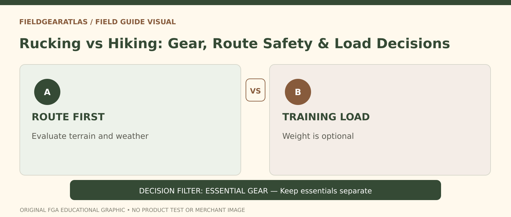

# Rucking vs Hiking: Which Gear and Route Approach Fits?

*Conceptual research graphic created for FieldGearAtlas. No specific commercial product or hands-on test is represented.*

**Quick answer:** Rucking is walking with a deliberate carried load, often as a training objective. Hiking is travel on a trail or route; you may carry very little or enough supplies for days. The categories overlap. A long hike with a heavy pack can resemble a ruck, but **the reason for carrying weight changes how you plan**. Choose an activity based on route conditions, distance, equipment and your ability to recover—not on the name printed on a backpack.

## Two trips that look alike but solve different problems

Imagine a two-mile neighborhood loop done with a pack carrying training ballast, versus a two-mile nature trail where the pack holds water, a rain layer and navigation supplies. Both involve walking under load. The first emphasizes a repeatable training stimulus; the second emphasizes safe travel and readiness for changes in weather or terrain. The weight in the second pack is driven by needs, not a training target.

The distinction becomes important when a beginner copies a rucking plan onto an unfamiliar trail. The [National Park Service hiking guidance](https://www.nps.gov/articles/hiking-safety.htm) calls for route planning, drinking water, weather awareness and emergency supplies. Those needs do not disappear because you call the outing a ruck.

## Compare by decision, not by label

| Question | Training-oriented ruck | Destination-oriented hike |
|---|---|---|
| Why carry weight? | A chosen load used as part of the session | Gear and supplies needed by the route |
| What sets the route? | Repeatability and safe surfaces | Terrain, access, weather, navigation |
| What determines success? | Controlled exertion and recovery | Safe completion and enjoyment |
| What changes your pack? | Fit, load placement, training objective | Essentials, trip duration and conditions |
| What is easiest to overlook? | Adding weight too quickly | Leaving necessary supplies behind |

A trail hike may also be your rucking workout. In that case you must satisfy **both** sets of requirements; training weight is not a substitute for shelter, water, weather protection or navigation.

## Choose your gear based on the load's job

For a short fitness walk on known ground, start by checking that the backpack does not bounce, the shoulder straps do not dig in and the load cannot swing unpredictably. You do not need military styling or PALS webbing to accomplish this. A regular well-fitting pack may be adequate at modest loads, depending on its published capabilities.

For uneven, long or exposed routes, the design of the harness, access to water, insulation and rain protection become more important than whether the bag looks tactical. REI's [backpack selection guide](https://www.rei.com/learn/expert-advice/backpack.html) explains that torso length and suspension design affect fit; visual appearance does not substitute for those dimensions.

Avoid assuming that a large liter rating proves a backpack is structurally suitable for heavy ballast. Capacity describes volume; the manufacturer's published carrying guidance and an actual fit check matter more for load suitability.

## A pre-trip decision sequence

1. **Define the objective.** Do you primarily want outdoor exploration, training, or both? Write it down before selecting extra weight.
2. **Choose the route.** Record the surface, elevation, expected conditions, turning points and a realistic return option.
3. **Pack the essentials.** Navigation, water, clothing and basic emergency readiness are independent of training goals. The [NPS Ten Essentials](https://www.nps.gov/articles/10essentials.htm) is a useful starting framework, adapted for location.
4. **Fit with realistic contents.** Adjust the pack after loading it, not while it is empty. A comfortable empty harness can behave differently with weight.
5. **Separate effort from discomfort.** Normal exertion is not the same as numbness, instability, sharp pain or rubbed skin. Stop to resolve equipment problems.
6. **Leave room for recovery.** A workout is not better simply because more weight was carried. Repeating manageable sessions lets you compare changes over time.

## Three situations and a useful choice

**City sidewalks before work:** You want controlled physical activity on a familiar loop, so a shorter rucking session or unloaded brisk walk is practical. Visibility and pedestrian safety still matter.

**Rocky day hike:** You expect variable footing and weather. Treat it as a hike first: check the forecast, trail advisories, water and route essentials; do not add training load merely to make the trip “count.”

**Group event with defined pack rules:** Follow the event's published criteria. Do not substitute a general article for the organizer's requirements, and verify which items count toward required weight.

## Comparison that survives the label

Two people may walk the **same route** yet have different equipment needs because one carries essential hiking supplies and the other adds a deliberately secured training load. 'Rucking' commonly emphasizes loaded walking; 'hiking' describes the outing and terrain. The labels do not define different biological benefits by themselves, and the same person may be doing both.

**Three separate decisions:** (1) Is the route suitable for the traveler's ability, weather and daylight? (2) Does the pack properly fit and retain everything carried, including any optional training load? (3) Can the traveler maintain control and comfort without unusual breathlessness or pain? The NPS guidance stresses choosing equipment for the actual route, while CDC materials explain that intensity varies with effort and individual fitness. A heavier pack is **not automatically a better workout or a substitute for safe progression**. Avoid numerical load recommendations without an appropriate individual training basis.

## Practical decision example: Same trail, different purpose

Two people share a short outdoor route. One is carrying essentials for a hike; the other adds deliberate training ballast to a ruck. Both still need route preparation, weather awareness and essentials. The training label does not remove ordinary hiking safety requirements, and the hiking label does not determine pack weight.

**Write down before choosing:** Plan for route hazards first; choose load and equipment by purpose, individual capacity and conditions.

## FAQ

### Can any hiking backpack be used for rucking?

Not automatically. A pack needs the right fit and construction for the load you intend to carry. Check its documentation; heavy loads and poor packing can exceed what a light trail pack was designed to manage.

### Is rucking better than hiking for fitness?

Neither term alone determines exercise value. Duration, intensity, terrain, load and individual conditioning matter. For exercise-intensity concepts, use the CDC's [talk test](https://www.cdc.gov/physical-activity-basics/measuring/index.html) as a general reference, not a load prescription.

## Research note

This is a route-and-equipment decision guide, not a prescribed exercise program or a product test. FieldGearAtlas has not measured the performance of specific backpacks for this article.

## References

- [National Park Service — Hike Smart](https://www.nps.gov/articles/hiking-safety.htm)
- [NPS — Ten Essentials](https://www.nps.gov/articles/10essentials.htm)
- [REI — How to Choose a Backpack](https://www.rei.com/learn/expert-advice/backpack.html)
- [CDC — Measuring Physical Activity Intensity](https://www.cdc.gov/physical-activity-basics/measuring/index.html)
