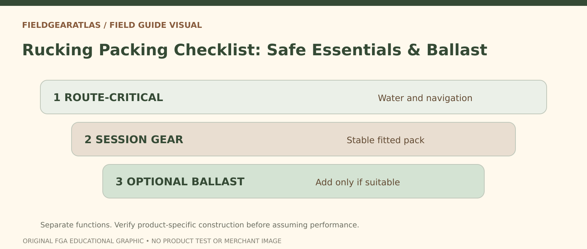

# Rucking Packing Checklist: Essentials Before Optional Weight

*Conceptual research graphic created for FieldGearAtlas. No specific commercial product or hands-on test is represented.*

**Quick answer:** A rucking packing list should distinguish **necessary safety gear**, items required for the session, and **optional ballast**. Packing only exercise weight can leave you without water or weather protection. Packing every accessory available can increase bulk, movement and fatigue without improving readiness.

## Start with a route description, not a shopping list

Write down where you are going, how long you expect to be out, the weather window, surface conditions and whether help or an easy exit is available. A known urban loop and a remote trail do not have identical equipment needs. The [National Park Service's Ten Essentials](https://www.nps.gov/articles/10essentials.htm) provides categories to consider, not a guarantee that every trip needs the same exact objects.

On a short accessible route, essentials still include suitable footwear, drinking water as appropriate, a means to communicate, weather-suitable clothing and awareness of the route. More remote and longer routes can justify navigation redundancy, insulation, illumination, first aid and additional supplies. Review park-specific advice rather than treating this guide as a universal wilderness list.

## Three layers of a useful packing checklist

| Layer | Purpose | Examples and decision rule |
|---|---|---|
| Route-critical | Keeps you equipped for actual conditions | Water, navigation, weather layer, emergency resources as relevant |
| Activity-critical | Lets the session work properly | Comfortable pack, stable internal weight, foot-care supplies when appropriate |
| Optional training weight | Creates a chosen load, not a survival requirement | Secured removable ballast consistent with the pack's capabilities |

**Important distinction:** An extra plate or sandbag is not automatically better than carrying the items required for safety. Never leave essential supplies behind simply to achieve a target weight.

## What goes where in the pack?

The basic packing objective is **stability and access**. Manufacturers such as [Osprey](https://www.osprey.com/eu/blog/post/how-to-pack-your-pack) describe keeping dense items close to the middle of the back while maintaining left-right balance. The exact layout still depends on frame design, specific load and manufacturer instructions.

Place compact and well-secured dense contents so they cannot fall to the bottom or strike your back. Use padding or internal sleeves if the pack is designed for them. Put items you might need promptly—water access, rain protection, appropriate safety items—where they can be reached without dismantling the entire load. Confirm nothing can swing or loosen when you walk.

**Do not** hang a heavy object from an arbitrary external loop because it looks sturdy. Webbing, PALS attachments and compression straps have different purposes and no universal safe external-load capacity.

## Example: two packing scenarios

**Neighborhood loop with reliable services nearby.** Pack appropriate water, a charged phone and clothing for the conditions; add secured training load only if planned and appropriate. Check pedestrian visibility. A full expedition-style first-aid and overnight kit is not automatically necessary, though individual needs may differ.

**Day outing on an unfamiliar trail.** Prepare according to trail guidance, weather, time, navigation and the NPS essentials. Reserve space and weight for safety items before adding optional ballast. If the full safe pack is already more demanding than planned, there is no requirement to add more weight.

These examples are planning illustrations, not minimum equipment specifications.

## Ten-minute equipment check before leaving

1. Lift and shake the fully packed bag gently: nothing dense should move inside.
2. Try the waist or hipbelt as specified by the pack maker; do not assume every pack has a load-bearing belt.
3. Walk, turn and negotiate one step while unloaded from other external hazards; observe swinging or unusual pressure.
4. Confirm water and frequently needed supplies remain reachable.
5. Confirm zippers, drawcords, buckles and strap tails are secured.
6. Check the forecast, route conditions, planned return and a way to change plans.
7. If training load causes pain or loss of balance, reduce it and reassess.

## Route-based pack audit: a completed example

**Illustrative scenario: a temperate-weather local day walk** (not a recommended military loadout). Before packing, consult current weather, route alerts and any site-specific restrictions. Set out navigation, sun protection, insulation, illumination, first aid, fire supplies where appropriate and lawful, repair items, food, water and emergency shelter: the **National Park Service's Ten Essentials** are categories to plan against rather than a universal fixed shopping list. For a short urban training walk, requirements differ from a remote day hike; neither case justifies carrying a weight plate merely to make the checklist look tactical.

Separate the items into **must remain reachable** (navigation, water, weather shell, lighting), **dense items requiring secure retention** and **soft/bulky items**. Consult the packmaker's loading guidance before positioning dense equipment. When the pack is closed, shake it gently and take a few steps in a safe space: if equipment shifts or straps interfere with breathing, repack. Confirm somebody knows your intended route and return window when appropriate. If an item is missing, record the gap instead of substituting an unsupported item or invented safety rating.

**Reader takeaway:** You are ready to pack once the route, weather, essential systems, actual mass and pack fit have all been checked—not when an arbitrary pouch count has been filled.

## Check readiness before adding training weight

The National Park Service presents the **Ten Essentials** as systems for navigation, sun protection, insulation, illumination, first aid, fire, repair, nutrition, hydration and emergency shelter. It also emphasizes adjusting equipment to the park, route, conditions and activity rather than copying one universal packing list. [NPS — Ten Essentials](https://www.nps.gov/articles/10essentials.htm).

Before adding optional exercise weight, use three questions: **What can go wrong on this route?** **Which essential systems address those risks?** **Can I carry/access those items without the weight shifting?** This does not mean every short urban walk needs every wilderness item; context and local guidance still govern.

## Practical decision example: Separate necessities from ballast

Place drinking water, navigation, weather layers and emergency supplies on the “necessary for this route” side of a checklist. Put an optional training plate or ballast in a separate section. If the only way to hit a target pack weight is to remove water or insulation, the plan needs revision.

**Write down before choosing:** Use a route-specific safety list, then secure any optional load; do not treat ballast as a substitute for essentials.

## FAQ

### What is the one item beginners most often overlook?

A stable, properly fitting **loaded** backpack. An empty pack can appear comfortable while its actual carried load shifts or creates pressure.

### Should the optional weight be at the bottom of the pack?

Not by default. Location and fixation matter; placing dense weight far from the back or where it slides can make control worse. Start with the pack manufacturer's packing guidance.

### Can a packing list replace trail-specific advice?

No. Local weather, water access, terrain, park alerts and trip duration determine which essentials are necessary.

## Research note and sources

This guide summarizes general gear-planning principles. No single pack's load rating or protective performance has been independently tested.

- [NPS — Ten Essentials](https://www.nps.gov/articles/10essentials.htm)
- [NPS — Hike Smart](https://www.nps.gov/articles/hiking-safety.htm)
- [Osprey — How to Pack Your Pack](https://www.osprey.com/eu/blog/post/how-to-pack-your-pack)
- [REI — Loading a Backpack](https://www.rei.com/learn/expert-advice/loading-backpack.html)
