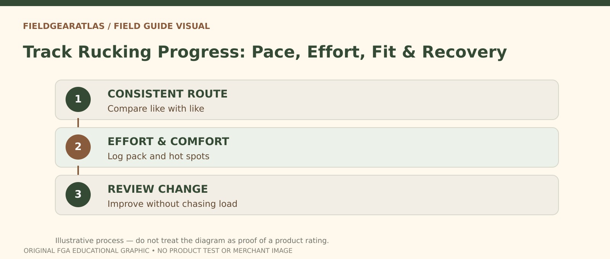

# How to Track Rucking Progress Without Chasing Weight

*Conceptual research graphic created for FieldGearAtlas. No specific commercial product or hands-on test is represented.*

**Quick answer:** Track rucking progress with **repeatable route, time, perceived effort, comfort and recovery notes**, not pack weight alone. Heavier is merely a different demand; it does not prove that your walking technique, conditioning or equipment fit has improved.

## Decide what you want to get better at

Someone preparing for a long walk, someone trying to build a consistent activity habit and someone practicing carrying a work pack do not need identical progress dashboards. Choose one primary outcome: completing a familiar route comfortably, reducing stops, maintaining steadier effort or managing a pack more reliably. Progress should be judged against that outcome rather than another person's load.

The CDC explains that physical activity intensity can be assessed in relative terms with a **talk test**: at moderate intensity, speaking is possible but singing becomes difficult. The test helps describe effort but is not a tactical-rucking threshold or a personalized training prescription. See [CDC's intensity guide](https://www.cdc.gov/physical-activity-basics/measuring/index.html).

## Your seven-field session log

| Record | Why it is worth noting |
|---|---|
| Date and route | Enables like-for-like comparisons |
| Distance and moving time | Shows the outing's extent, without pretending GPS is infallible |
| Terrain or incline | Uphill miles are not directly comparable with flat miles |
| Pack contents / approximate carried weight | Explains changes in the effort, not a score to maximize |
| Effort, using your own consistent scale | Documents perceived difficulty |
| Foot, shoulder and hip comfort | Surfaces equipment problems early |
| Recovery / next-day notes | Separates manageable practice from lingering trouble |

Write down unusual weather, changes in shoes or sock thickness, and whether the pack contents shifted. A new route with steep sections cannot fairly be compared to a level loop using pace alone.

## How to run a four-session comparison

Choose a short route you know is appropriate for your current ability. Record session one without deliberately chasing speed or pack weight. For the next three suitable outings, keep the route and pack arrangement broadly comparable so that changes in comfort and effort become easier to interpret. If weather, fatigue or schedule changes, note them instead of forcing a flawed comparison.

Here is a **fictional example** illustrating interpretation, not a training plan or user data:

| Session | Same familiar loop? | Noted effort | Main observation |
|---|---|---|---|
| A | Yes | Harder than expected | Pack swayed near the hips |
| B | Yes | Similar | Repacking reduced sway |
| C | Yes | Easier | Fewer pauses; same load |
| D | No, hillier | Hard | Not comparable to A–C |

The lesson is that fixing fit and obtaining steadier effort are meaningful improvements even without increasing the amount of ballast.

## Separate the load from the carrying system

If the shoulder straps rub or a weight shifts each time you turn, increasing load makes the experiment harder to interpret. Fix the pack configuration first. [Osprey's fitting guidance](https://www.osprey.com/eu/blog/post/how-to-fit-your-osprey-backpack) describes fitting the harness after putting weight in the pack; a properly adjusted empty bag says little about loaded comfort.

Track whether the load remains balanced, whether straps are repeatedly loosened and whether you develop pressure points. These are observations, not clinical diagnoses. Persistent pain, numbness, dizziness or other concerning symptoms deserve stopping the session and suitable professional advice.

## Avoid the comparison traps

**Trap: every outing needs more load.** More weight changes the task. It is not a universally necessary progression.

**Trap: every pace improvement is fitness.** Route difficulty, traffic lights, climate and GPS variation can explain a change.

**Trap: discomfort proves productive work.** A hot spot or repeated heel rubbing may indicate an equipment issue. It should not be treated as a milestone.

**Trap: app numbers are precise enough on their own.** Combine numeric records with actual field notes. A log you understand later is more valuable than an unexplained performance score.

## A log that measures more than pounds

Rather than making `ruck_weight` the only progress metric, record several independent variables for each outing:

| Record | Why it matters |
|---|---|
| Route and terrain | A steep loop changes exertion compared with flat walking |
| Distance or elapsed time | Makes sessions comparable only when context is similar |
| Pack mass and actual contents | Distinguishes equipment changes from fitness changes |
| Perceived effort and talk-test observation | Captures relative workload without a fabricated physiological score |
| Foot or shoulder pressure and recovery | Flags fit problems that speed alone can hide |

The CDC explains that the **talk test describes relative intensity**, not a universal workout grading scale. An outing where breathing is controlled and equipment is stable may represent better decision-making even if the training load did not increase. Do not recommend deliberately increasing weight on consecutive days merely to produce a rising chart. If pain or other warning signs occur, treat them as reasons to reassess and seek appropriate advice rather than as progress metrics.

## Practical decision example: A four-session comparison

To learn from four walks, keep the same route and approximate conditions as consistent as practical, logging time, effort, gear setup, foot comfort and recovery. Alter only one major variable when possible. If a new pack makes a walk feel worse, a faster time or heavier load alone cannot tell you whether fitness improved.

**Write down before choosing:** Treat the results as personal observations rather than an experimental proof of a boot or backpack’s performance.

## FAQ

### Is pace the best metric for rucking?

It is useful for repeated route comparisons but incomplete. Terrain, pack weight, duration and subjective effort all matter.

### Should I calculate calories burned?

Calorie estimates are uncertain and need additional personal information. This worksheet does not infer them from pack load or distance.

### What if I cannot complete the route?

Log why you stopped: conditions, time, pack instability or physical symptoms. Making the next outing more manageable can be a better next decision than setting a heavier goal.

## Sources and evidence limits

This guide is educational; it does not specify rehabilitation or medical training workloads. The example log is invented and explicitly labeled.

- [CDC — Physical Activity Intensity](https://www.cdc.gov/physical-activity-basics/measuring/index.html)
- [Osprey — Backpack Fitting](https://www.osprey.com/eu/blog/post/how-to-fit-your-osprey-backpack)
- [National Park Service — Hike Smart](https://www.nps.gov/articles/hiking-safety.htm)
