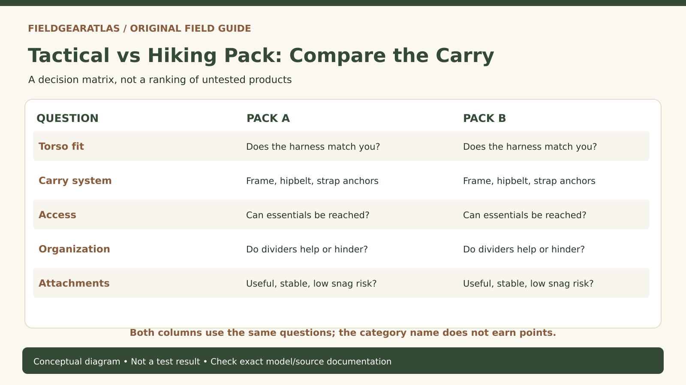

# Tactical Backpack vs Hiking Backpack: How to Compare Carry Systems

*Original conceptual infographic. Not a tested model or product performance result.*

**Quick answer:** Choose between individual packs by **fit, how the load is supported, access to essentials and planned use**. Tactical-style packs often prioritize modular external attachment and compartment organization; hiking backpacks often emphasize suspension adjustment, outdoor access and ventilation. Those are common design directions, not guarantees that every pack in either category will perform a particular way.

An olive pack with MOLLE-style webbing can be an excellent travel organizer and a poor fit for a long loaded walk. A streamlined hiking pack can carry comfortably for hours but make small tools harder to organize. The category name tells you almost nothing until the use case is known.

## Start with your actual load, not the product photograph

Lay out what you plan to carry: water, layers, shelter, electronics, tools and any special-purpose gear. Measure whether the bulky items fit the main compartment and whether frequently used items can be retrieved without unloading everything. A published capacity in liters expresses volume; it is not proof of comfortable or safe load-bearing performance.

For a commuting daypack, notebook access, security and compartment shape may dominate. For a long route, a stable fit, reachable water and an efficient way to carry weather layers can matter much more. For a short field exercise, external attachment and rugged access may genuinely be important. One design can serve more than one purpose, but it should earn that claim through features and fit rather than branding.

## The meaningful comparison matrix

| Dimension | Tactical-leaning question | Hiking-leaning question | What to test |
|---|---|---|---|
| Suspension | Does it have a real frame or hipbelt, or only shoulder straps? | Is torso sizing adjustable for this wearer? | Load pack and walk; inspect pressure distribution |
| Access | Can organizers be reached without removing every layer? | Is water, rain gear and food reachable? | Time a normal item retrieval, not a contrived race |
| External attachments | Do PALS/MOLLE rows support the intended pouches? | Are stretch pockets/attachment loops sufficient? | Check physical compatibility, snag risk and balance |
| Ventilation | What touches the back, and can sweat escape? | Is there a ventilated back panel or mesh suspension? | Assess comfort in the actual climate |
| Volume | Do compartment dividers consume usable space? | Does the main cavity match bulky sleep gear? | Pack the real objects and close the bag normally |
| Weather handling | Are materials and seams documented? | Is there a separate rain cover or liner solution? | Check manufacturer claims and the intended rain plan |

**Useful distinction:** MOLLE refers to a modular carrying system, while PALS describes the webbing arrangement commonly used to secure compatible attachments. Neither inherently proves the pack is more durable, comfortable or compliant with any particular requirement.

## Why torso length can matter more than the pack's advertised size

For framed packs with load-transfer hipbelts, the manufacturer's torso-length range is the critical measurement—not standing height alone. The hipbelt should align properly with the pelvis, while shoulder straps and load lifters work within the pack's designed geometry. Tightening every strap cannot solve a suspension sized for the wrong torso.

Small tactical daypacks without framed suspension should not be judged by the same load-transfer expectations as a fitted backpacking pack. Conversely, a large hiking pack with an adjustable suspension is not automatically easy to use in cramped environments. Evaluate the actual object at the actual load.

## External pockets: convenience or hidden complexity?

A pouch can improve access but add weight, snag points and asymmetry. During a fitting, mount the intended accessories, then walk through doorways, bend and check whether the pack catches or sways. If you repeatedly move the most-used item to an external pouch, ask whether a backpack with a better integrated pocket might be simpler.

**Hypothetical example:** A photographer and a trail walker both require around the same storage volume. The photographer may prefer a panel opening and modular internal organizers; the walker may care more about the fit of a hipbelt and access to water without removing the pack. Two identical liter ratings conceal very different design priorities.

## How to shop without guessing a weight limit

Check the exact model's advertised load rating, frame structure, size range and assembly instructions if supplied. If the manufacturer does not specify a load rating, **do not invent one from denier, MOLLE coverage or pack volume**. Heavy-looking fabric is not a complete load system: seams, strap anchors, frame, stitching and wearer fit matter as well.

Ask whether a return is possible after an indoor packing and walking test. Load at home within the manufacturer's permitted conditions; do not take an uncertain pack on a strenuous outing merely to prove it works.

## A buyer-side comparison without product hype

Use a **task-first comparison sheet** rather than treating 'tactical' and 'hiking' as quality grades:

| Actual task | Confirm on either kind of pack | Do not infer from appearance |
|---|---|---|
| Repeated walking with a planned load | Correct torso range, secure packing and a carrying system suitable for that load | MOLLE panels prove heavy-load comfort |
| Frequent access to small items | Pocket openings, zipper paths, access while worn | More pockets mean better organization |
| Awkward single large item | Main-compartment internal dimensions and opening size | Advertised liters guarantee it fits |
| Wet-day travel | Liner, raincover and documented material/closure details | Olive fabric or a 'tactical' label means waterproof |

**At-home comparison protocol:** Write down your real five largest items. Check which opening they pass through without force. Compare published pack sizing against your measured torso and hips. Load each suitable candidate within the maker's published conditions, walk and turn briefly, then note heel/hip/shoulder discomfort where relevant. This is an evaluation method—not a claim that FieldGearAtlas tested any brand. REI's general backpack guidance treats **capacity, features and fit** as independent selection dimensions, which is precisely why the exterior styling should come last.

## Practical decision example: Features rather than labels

One pack has modular exterior webbing; another has fewer attachment points but a better-fitting suspension and weather-resistant access. The word “tactical” does not decide which suits a particular trip. List what must be carried, how quickly it must be accessed, and whether the loaded pack fits the wearer.

**Write down before choosing:** Choose the construction and fit matching the use case; a category label is not an independently tested durability rating.

## FAQ

### Is a tactical backpack better for rucking?

Not inherently. The decisive factors are secure load placement, a suspension suited to the intended weight and a good fit for the wearer. A tactical aesthetic does not establish heavy-load comfort.

### Are MOLLE straps the same as compression straps?

No. Modular attachment webbing provides attachment locations; compression straps help restrain and stabilize pack volume. Some packs have both.

### Does a larger capacity mean a larger load rating?

No. Volume and load capacity are separate properties. Check the maker's model-specific claim and suspension design.

## Sources and editorial boundaries

- [REI — How to choose a backpack](https://www.rei.com/learn/expert-advice/backpack.html) — capacity, features and fit.
- [REI — How to size and fit a backpack](https://www.rei.com/learn/expert-advice/backpacks-adjusting-fit.html) — torso length and strap adjustments.
- [REI — Daypack selection](https://www.rei.com/learn/expert-advice/daypack.html) — category size and use case considerations.

This article synthesizes published fitting guidance and pack design concepts. FieldGearAtlas has not load-tested named commercial backpacks. Diagrams must be labeled as conceptual.
