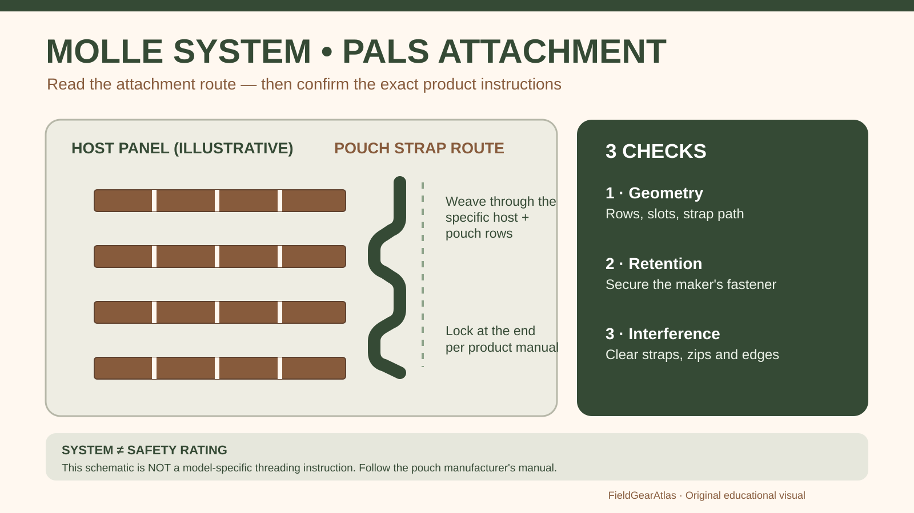

# MOLLE vs PALS: What the Webbing Actually Does

*Technical explanation diagram created for FieldGearAtlas. Not a photograph of a commercial product.*

**Quick answer:** **MOLLE** usually names a modular load-carrying equipment system; **PALS** is the repeating attachment webbing that makes many MOLLE-style pouches connect to vests, packs and platforms. In everyday shopping, sellers often say 'MOLLE webbing' when they mean the visible PALS grid.

That distinction prevents two common mistakes: assuming every stitched row takes every pouch, and assuming a backpack becomes a heavy-load ruck just because it has more attachment points.

## How a pouch actually attaches

A typical PALS panel has horizontal webbing rows and regularly spaced vertical stitching. A compatible pouch usually has attachment straps or a mounting mechanism designed to weave through **both the pouch and platform rows**. A correct attachment distributes retention through multiple rows. Merely pushing a strap behind one row may leave the pouch hanging loosely.

The [U.S. Army IOTV Gen III operator manual (TM 10-8470-210-10, WP 0005)](https://www.benning.army.mil/tenant/lrc/content/pdf/IOTV%20GEN%20III%20TM%2010-8470-210-10.pdf) specifies weaving pocket straps through the carrier's PALS and a pocket row, then securing the snap. This is a **documented example for that military system**—not a universal specification or assurance that civilian pouch dimensions, fabric or attachment strength are equivalent.

## Inspect compatibility in five places

| Inspect | What matters | Failure you are trying to avoid |
|---|---|---|
| Webbing spacing | Pouch attachment aligns with available rows | Attachment cannot weave fully |
| Panel height | Sufficient usable rows for the chosen pouch | Only one loose anchor row |
| Bar-tack stitching | Consistent, intact stitch points | Webbing may tear away under use |
| Pouch attachment | Straps, clips or buckles fully lock | Pouch dislodges on movement |
| Placement | Pouch clears straps, hips and access points | Snagging and interference |

Avoid claiming an exact load rating for PALS from the appearance of the stitching. Load rating depends on textile, stitching, construction, placement and the manufacturer's actual design.

## PALS is not the same as compression webbing

A horizontal strap used to pull a packbag closer together is a **compression strap**. A sewn ladder of rows for mounting a pouch is an **attachment interface**. Some tactical bags include both. Neither one replaces a well-designed frame, harness or hipbelt when moving a significant load.

An external utility pouch can improve access to a first-aid kit or gloves, but it also widens the pack and adds something to catch on brush or door frames. For close spaces and frequent travel, an internal organizer may be the better solution.

## Two ways to check a pouch before buying

**On paper:** Ask the seller for clear close-up images of the *back* of the pouch and the mounting platform, not just front product photography. Confirm the number of attachment straps, closure method, row height and whether the maker explicitly documents compatibility.

**In person:** Weave and lock the mount completely according to its instructions; tug gently and walk a short circuit with ordinary contents. Check sway, access, strap interference and protrusion. This is an inspection method, not an engineered load test.

## Compatibility walkthrough: webbing versus laser-cut slots

**Case A — Sewn PALS rows:** Obtain the pouch's rear view and the pack's close-up. Compare usable row count, strap routing, and where the locking fastener ends. If you have the actual parts, follow the **pouch maker's instructions**, weave and fasten completely, then perform a gentle unloaded fit check.

**Case B — Laser-cut slots:** Confirm that the specific panel maker supports the intended strap or clip system. A similar-looking slot pattern is **not** proof of equivalent durability, fit or safety rating.

**Case C — No documented fit:** Record *compatibility unknown*; do not rely on photographs, Army patterns or cosmetic product labels to claim that two items safely connect. For critical protective equipment use its dedicated technical instructions, not an FGA guide.

## Which term describes the system and which describes the attachment grid?

A published US Army history survey describes **MOLLE** as Modular Lightweight Load-Carrying Equipment and identifies **PALS** as its woven Pouch Attachment Ladder System webbing used for modular pouch attachment. The survey gives dimensions for the military pattern, but those historical descriptions are **not proof** that every commercially advertised “MOLLE-compatible” pouch conforms in stitching, strength or attachment geometry. [US Army Center of Military History — Survey of US Army Uniforms, Weapons and Accoutrements (PDF), p. 120](https://history.army.mil/html/museums/uniforms/survey_uwa.pdf).

For a buying decision, photograph the actual pack and pouch attachment points, check spacing and retention straps against the **maker's** specifications, then perform a low-load fit check. Do not infer official military approval from the presence of horizontal webbing.

## Practical decision example: A real compatibility question

A pouch is marketed as “MOLLE compatible” and a pack has a PALS-looking grid. Inspect spacing, attachment method, strap length, back panel and available clearance before buying; visible webbing alone does not prove a secure fit. Consult the pouch maker’s instructions and avoid improvising attachment for critical safety equipment.

**Write down before choosing:** A conceptual weave illustration is not a replacement for an equipment operator manual.

## FAQ

### Is PALS itself a type of backpack?

No. It is a webbing attachment pattern used on many kinds of load-carrying products.

### Are laser-cut panels automatically MOLLE-compatible?

Not necessarily. Laser-cut slots may be designed to accept standard attachment straps, but slot spacing, material and mounting method vary. Verify the exact platform and pouch.

### Is 'MOLLE compatible' a safety certification?

No. It is a compatibility description, not proof of safety, strength or government authorization.

## About this guide

Technical distinctions are based on the cited Army attachment instructions and commercial construction descriptions. The diagram is schematic and not a reproduction of a specific military-issued system.

## Research references

- [US Army — IOTV Gen III Operator Manual, PALS Attachment](https://www.benning.army.mil/tenant/lrc/content/pdf/IOTV%20GEN%20III%20TM%2010-8470-210-10.pdf)
- [U.S. Army — TM 10-8470-210-10, abbreviation table and WP 0005 PALS attachment instructions](https://www.benning.army.mil/tenant/lrc/content/pdf/IOTV%20GEN%20III%20TM%2010-8470-210-10.pdf)
