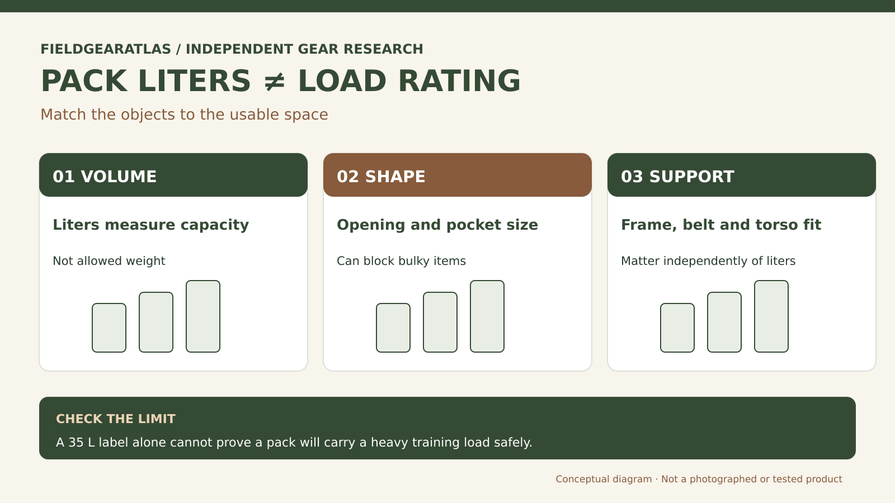

# Backpack Capacity in Liters: A Fit-and-Volume Guide

*Technical explanation diagram created for FieldGearAtlas. Not a photograph of a commercial product.*

**Quick answer:** Pack capacity in liters describes **how much interior volume a manufacturer claims**, not how many pounds the bag safely carries. Choose by packing actual objects first, then confirm the suspension is suitable for the intended mass and your torso.

A 35-liter pack can feel smaller than a 30-liter pack when its space is divided into many narrow compartments. Conversely, a single-cavity rucksack can accept bulky gear but make it harder to retrieve small items.

## Liters are volume, not a promise about your trip

One liter equals 1,000 cubic centimeters. Even that exact conversion does not tell you how a manufacturer measures pockets or compressible compartments. The pack's **shape** and zipper opening control which objects physically fit. A long sleeping pad, rigid case or laptop may fail to fit despite ample nominal volume.

Use these broad recreational examples as planning context—not rules for military loadouts:

| Advertised class | Common everyday / outdoor use | Test before purchase |
|---|---|---|
| Around 11–20 L | Compact day trips, light travel or commuting | Water, shell and essentials |
| Around 21–35 L | Day hikes with food, spare clothing and equipment | Bulkiest layer, opening width and pockets |
| Around 36–40 L | Gear-intensive day trips and some lightweight overnights | Actual gear volume and load support |
| Above 40 L | Larger loadouts; some designs are intended for overnights | Specific use case, fit, frame and published limits |

These are **illustrative recreational ranges**, adapted from [REI's updated daypack guidance (July 2026)](https://www.rei.com/learn/expert-advice/daypack.html)—not a standardized classification for tactical or military rucks. REI separately describes weekend backpacking packs around 30–50 L, which shows how intended activities and product design overlap. Do not treat pack capacity as an approved load weight.

## The 'shoebox test' for useful capacity

Instead of converting equipment volume into optimistic liters, make a packing mock-up: group all the gear by *dense items, compressible clothes, long rigid items and things needing quick access*. Compare the grouped dimensions against published interior pocket dimensions, not the bag's outside dimensions.

For online buying, verify the main compartment's opening. A pack that can theoretically hold an item might still have a zipper too narrow to insert it. Check whether listed dimensions belong to the entire bag or the usable main compartment.

## Volume versus carrying structure

A frameless soft-sided tactical pack may feel fine with everyday items but lack the load-transfer design required for longer heavily loaded walks. A framed pack with a matching torso range and hipbelt can behave differently at the same volume. Still, an internal frame alone does not guarantee comfort; design and fit matter.

**Illustrative comparison:** Imagine a 28-liter modular work bag and a 32-liter hiking daypack. The work bag has several small compartments; the hiking pack has one larger compartment and stretchy external pockets. Both can carry a jacket and water, but one may be much better for a rectangular tool case, while the other may swallow a compressible puffy layer.

## A five-item capacity selection record

Before deciding, write down:

1. The five bulkiest things you actually carry.
2. The items you must access without opening the main compartment.
3. The mass of the full load—including water.
4. The pack's frame/hipbelt and published sizing range.
5. Whether the loaded pack allows comfortable movement within its intended usage.

Treat empty-pocket count and MOLLE row count as features, not measures of volume or load tolerance.

## Two different capacity tests: liters and carrying load

A seller may list **35 L capacity** without publishing an equivalent safe weight limit. The first figure describes claimed storage volume; the second depends on frame, seams, harness, fit and use conditions. Check the **exact model's loading instructions** and ask whether its advertised volume includes external pockets. This avoids treating a larger bag as a safer weighted ruck by default.

**Make a capacity worksheet:** Record the gear that must be carried, its physical dimensions, its combined mass and whether it must be reached in motion. Then answer two independent questions: *Does it pass through the main opening and occupy the available compartments?* and *Can the pack carry that mass comfortably within the maker's guidance and your fit?* A 'yes' to the first is not evidence for the second.

REI's **daypack guidance** gives examples such as 11–20 L, 21–35 L and 36–40 L for different recreational outings. Those are broad planning categories, **not normative thresholds for military field packs or rucking**. When in doubt, measure your actual gear and check the pack model rather than converting liters to pounds.

## The pack that fits can be a different size from the pack that holds everything

REI treats **pack volume** and **pack fit** as separate decisions. Torso size (not overall body height) and hip measurement should be checked against the manufacturer's model-specific ranges. [REI — How to Choose a Backpack](https://www.rei.com/learn/expert-advice/backpack.html).

A two-column shopping note is more reliable than choosing solely by liters: in one column record the volume and packed dimensions of your actual gear; in the other record torso range, hipbelt range and rated load capacity **if published**. A pack can pass the first column but fail the second. No universal formula converts liters into safe kilograms.

## Printable pack-capacity decision record (copy before buying)

| Field | Your pack / your gear | Why it changes the decision |
|---|---|---|
| Largest rigid item (dimensions) | ______ | Must pass through the real opening |
| Largest compressible item | ______ | Needs usable compartment volume |
| Total carried mass, including water | ______ | Not determined by the liter rating |
| Model-specific load guidance | ______ / not published | Do not invent a rated limit |
| Torso and hipbelt fit range | ______ / not published | Comfort depends on body fit and suspension |
| Access priority | ______ | Exterior access differs from raw volume |

**Decision rule:** A candidate needs to pass **three separate tests**: *the items fit*, *the actual pack supports the intended load within the manufacturer's guidance*, and *the harness fits the wearer*. If any test is unknown, record it as unknown rather than assuming the larger liter number wins. This is an FGA decision worksheet, **not** a numerical pack-load certification.

## Practical decision example: Volume, load and fit are independent

Two packs may both be listed as 35 liters. That tells you about nominal internal capacity, not whether either can safely carry a dense training weight or fit your torso. Make a list of the actual items, consider their bulk, check the maker’s supported load, then try the harness with a realistic safe load.

**Write down before choosing:** Keep three separate fields in your worksheet: liters, maker-stated load guidance and your measured fit.

## FAQ

### Does a 30L backpack always fit more than a 25L pack?

The claimed volume is larger, but usable space for a particular object depends on shape, opening and how compartments are counted.

### How many liters do I need for rucking?

There is no reliable one-number answer. The intended weight, plate compartment, load retention and suspension can matter more than volume.

### Does more capacity mean more weight support?

No. Look for the manufacturer's explicit loading guidance and the actual suspension system.

## Sources and limits

REI's daypack and backpack-fitting material supports the volume-use distinctions. FieldGearAtlas has not measured the capacity of named commercial tactical models; all examples here are illustrative.

## Research references

- [REI — Daypacks: How to Choose](https://www.rei.com/learn/expert-advice/daypack)
- [REI — How to Choose a Backpack](https://www.rei.com/learn/expert-advice/backpack.html)

**Additional source used in editorial verification:** https://www.rei.com/learn/expert-advice/daypack.html
