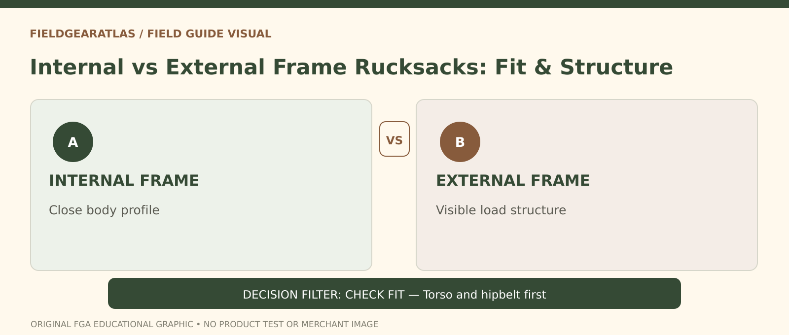

# Internal vs External Frame Rucksacks: A Practical Choice

*Conceptual research graphic created for FieldGearAtlas. No specific commercial product or hands-on test is represented.*

**Quick answer:** An **internal-frame rucksack** conceals structural support within or against its back panel and typically maintains a slimmer load profile. An **external-frame rucksack** puts the carrying structure outside the bag and can provide useful options for bulky, irregular equipment. Neither layout automatically carries more weight, fits everyone or performs better in every environment.

## Start with what a frame does

A pack frame resists collapse, shapes how a load sits on the body and helps connect the bag to a harness or hipbelt. A frame alone does not establish a manufacturer's load rating: belt geometry, suspension, stitching, materials, pack volume and fit are all part of the system. This is particularly important for tactical packs whose appearance can suggest heavy-duty performance without published carrying specifications.

REI's detailed [internal versus external frame overview](https://www.rei.com/blog/hike/whats-the-difference-between-an-external-frame-pack-and-an-internal-frame-pack) notes the streamlined profile of many internal-frame packs and the exposed mounting structure of external frames. These are typical design tendencies, not guarantees for every model.

## A comparison for actual carrying decisions

| Factor | Internal frame | External frame |
|---|---|---|
| Load shape | Bag often follows the back more closely | Visible structure can support irregular shapes |
| Snag exposure | Typically narrower outline | More external frame or lashing surfaces |
| Ventilation | Highly dependent on back-panel design | Separation can create an air gap |
| Fit adjustment | Many current models offer adjustable harnesses | Model-specific; inspect dimensions closely |
| Repair inspection | Stays may be internal or removable | Exposed parts can be easier to inspect |
| Typical drawback | Internal compartments may constrain odd items | Bulk and frame geometry may interfere in close terrain |

Avoid treating this table as a universal comparison of comfort, strength or injury risk. Those outcomes depend on the actual design and the wearer.

## Three examples where the structure matters

**Overgrown, narrow trail:** A slimmer internal-frame bag may catch on fewer branches. It will not solve poor packing; protruding bottles and external pouches can still snag.

**Repeated transport of awkward field equipment:** A purpose-designed external frame may accommodate an unusual bundle when attached according to the maker's method. Do not improvise by lashing heavy items to straps whose load rating is unknown.

**Long walk with ordinary overnight gear:** Both frame types might work. Start with torso dimensions, suspension fit and total carried volume before arguing about frame philosophy.

## Fit matters more than the visible frame

REI advises choosing backpack size primarily by torso length rather than height; [its pack fitting guidance](https://www.rei.com/learn/expert-advice/backpack.html) also explains why the hipbelt and shoulder harness must suit the wearer. Put representative weight into the pack before assessment. Adjust the hipbelt and shoulder harness as the maker directs, then walk and turn. Observe whether the bag pulls backward, slips at the hips or digs into the shoulders.

A belt that looks padded might not transfer substantial load if the frame and harness do not work together. Likewise, a particularly rigid external frame may be the wrong fit if its dimensions cannot be adjusted to your torso.

## Before buying: five useful questions

1. What is the exact frame material and construction?
2. What weight range does the manufacturer support for this specific model, if published?
3. What torso length and hipbelt sizes are compatible?
4. Are stays, buckles and frame components repairable or replaceable?
5. Will the packed bag fit through the routes and spaces where you intend to use it?

**Illustrative mistake:** A buyer selects an external frame for a larger volume rating and assumes this guarantees a higher safe load. A properly fitted internal pack with a published suspension specification might be a better solution for their ordinary gear. Volume and loading claims should be checked separately.

## The frame comparison people usually miss

An **external frame** is visible behind the bag and can provide convenient mounting points for unusually shaped loads. An **internal frame** is built into the pack and generally keeps the load closer to the body. REI's comparison describes external frames as useful for bulky attachments and well-maintained routes, while many modern internal-frame designs offer a closer, more agile carry. These are **design patterns**, not guarantees about the comfort, carrying strength or price of any specific pack.

Try a **terrain-and-gear matrix**: If you expect narrow overgrown routes or frequent turns, examine how far the loaded bag protrudes and where straps can snag. If the gear is large, rigid or awkwardly shaped, examine documented lashing points and restraint. If you expect repeated long walks, verify torso/hipbelt fit and practical access. Whichever frame you consider, separate `advertised_liters`, `empty_mass`, `published_load_limit`, `harness_adjustment_range` and `external_mounting_support` in your comparison notes.

**Common mistake:** Choosing an external frame because it looks 'military' or an internal frame because it looks 'modern'. Neither appearance establishes suitability. Seek model-specific instructions and a safe fitted test.

## Practical decision example: When frame geometry matters

If a walker carries bulky supplies, an external frame may offer attachment options while an internal frame can keep the load compact. Neither arrangement guarantees comfort. Compare actual fit, securement points and stability during walking, and check whether parts are serviceable or obsolete.

**Write down before choosing:** The right comparison is between two specific pack designs under the same permitted load, not “all external” versus “all internal” frames.

## FAQ

### Is an external-frame rucksack always heavier?

No. A frame style is not a numeric weight. Compare published empty weights of specific models and required accessories.

### Does an internal frame prevent sweat?

No. Ventilation depends on mesh, channel geometry, pack fit and conditions. Neither style keeps a back dry by definition.

### Is PALS webbing proof of a military-standard frame?

No. Modular attachment and load-bearing suspension are different aspects of a pack's design.

## Research note

No FieldGearAtlas hands-on frame testing or load-capacity testing was performed for this guide.

- [REI — Internal vs External Frames](https://www.rei.com/blog/hike/whats-the-difference-between-an-external-frame-pack-and-an-internal-frame-pack)
- [REI — Backpack Selection and Fit](https://www.rei.com/learn/expert-advice/backpack.html)
- [Osprey — Fit a Backpack](https://www.osprey.com/eu/blog/post/how-to-fit-your-osprey-backpack)
