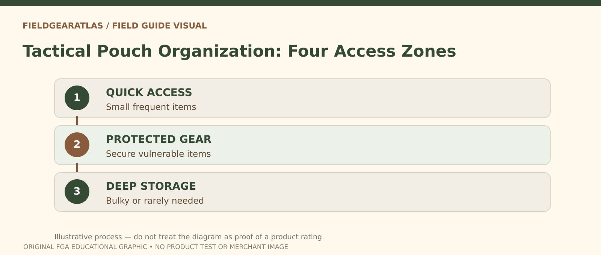

# Tactical Pouch Organization: Access and Retention

*Conceptual research graphic created for FieldGearAtlas. No specific commercial product or hands-on test is represented.*

**Quick answer:** Good tactical pouch organization starts with **access frequency, weight, attachment security and snag risk**, not with filling every available PALS row. A pouch improves organization only if you can reach its contents, identify them and keep the bag balanced while moving.

## Build a pouch map from tasks

List the objects you actually take on a trip, then mark when each is needed. A rain layer may be infrequent but time-sensitive; a notebook may be frequent but not urgent. An item can need quick access without needing to hang outside the pack. Side pockets, interior organizers, a belt pouch and a mounted PALS pouch each have different advantages.

For example, a large side-mounted utility pouch may look convenient until it collides with an arm swing, catches on a doorway or shifts the bag's balance. The question is **where the item can be reached reliably** with the least added complication.

## Four access zones

| Zone | Suitable contents | Risk to check |
|---|---|---|
| Immediate exterior | Small weather-tolerant items frequently used | Loss, snagging, unsecured closures |
| Protected quick-access pocket | Identification, maps, phone if appropriate | Moisture exposure, accidental opening |
| Organized main compartment | Items used at rest or checkpoints | Buried gear and time-consuming unpacking |
| Deep storage | Bulky or rarely needed equipment | Difficult access when conditions change |

An emergency item should be accessible in its intended situation, but it must also be stored according to its actual safety requirements. Do not treat a generic packing chart as instruction to place specialized or regulated equipment in any particular position.

## Check retention before layout aesthetics

The U.S. Army [IOTV Gen III operator manual](https://www.benning.army.mil/tenant/lrc/content/pdf/IOTV%20GEN%20III%20TM%2010-8470-210-10.pdf) describes weaving PALS attachment straps through compatible rows on both the pouch and its carrier. This establishes an important principle: **pouch retention depends on complete compatible attachment**, not just placing a strap behind one piece of webbing. Third-party laser-cut panels and attachment clips must be checked against their own maker's instructions.

For a routine inspection, confirm the mount does not partly detach when you turn or crouch, that closures cannot open unexpectedly, and that nothing hangs over zippers you need. This is a usability check, not a certified strength or drop test.

## A practical packing exercise

Put all candidate contents on a table. Make three piles: **frequent**, **urgent but occasional**, **rare**. Position each pile in an access zone, then load the pack and walk a short safe route indoors. Try retrieving a water bottle, rain shell and navigation note. If you must remove three other pouches to reach one item, revise the layout.

Recheck the pack's **left-to-right balance**. Osprey's [packing instructions](https://www.osprey.com/eu/blog/post/how-to-pack-your-pack) emphasize balanced loading and reducing unnecessary external attachments. Adding multiple small objects to one side can create asymmetry even when each feels light individually.

## When a pouch should be removed

Remove or relocate a pouch when it blocks an access flap, rubs against your arm or hip, makes the bag exceed a transportation dimension, catches on obstacles, or cannot be mounted securely. A modular system is valuable partly because you can **take components off** instead of always adding more.

Consider an interior zip pouch for small items if exterior access is not essential. A weather-resistant pouch does not make its contents waterproof unless the manufacturer's construction, closure and relevant use conditions support that claim.

## Buyer questions for product pages

- Is the panel PALS-compatible, laser-cut, proprietary, or merely decorative?
- What do the rear mounting straps look like, and do they come with the pouch?
- Does the maker publish dimensions of the pouch *and* usable interior opening?
- Does the pouch interfere with the harness when mounted where you need it?
- Is there a stated weight/load limitation for the attachment? If absent, do not invent one.

## Build an access map before adding a pouch

List your actual tasks in order of frequency. Put **frequently needed, light items** in reachable locations that do not interfere with the harness. Store **weather gear and backup essentials** where you can retrieve them without unpacking the entire bag. Keep **dense items** inside the main load zone as directed by the bag maker rather than automatically hanging them off a far-forward pouch row. Test closures and retention while standing still before using the arrangement on a walk.

A useful **three-pass test**: first try to access water and navigation items; second, put on or adjust the loaded pack and check for straps rubbing against added pouches; third, remove one external pouch and ask whether anything becomes harder to use. If the answer is no, the pouch may be needless bulk. The approach is an **editorial organization exercise** aligned with REI's packing/access principles, not a tested performance rating for a particular mounting system.

For manufacturer feeds, record `mounting_mechanism`, `usable_opening_size`, `closure_type`, `weight_guidance` and `access_conflict` separately. Never treat the word 'tactical' as a specification.

## Practical decision example: Design an access test

Put urgent but ordinary items such as a map or small first-aid supplies where they can be reached without emptying the bag; put seldom-used clothing deeper inside. Perform a dry-run while stationary, then note which pockets snag, bounce or require removing the pack.

**Write down before choosing:** Do not place heavy unsecured objects in external pouches merely because they are easy to reach.

## FAQ

### Do more external pouches make a tactical backpack better?

No. They can create organization or create snagging and imbalance. Their value depends on actual tasks.

### Can a pouch be compatible without MOLLE branding?

Possibly. Look for explicit mounting specifications rather than a marketing label alone.

## Source note

This is an organization and inspection guide, not a load test of any specific pouch or mounting system.

- [U.S. Army — IOTV Gen III Manual](https://www.benning.army.mil/tenant/lrc/content/pdf/IOTV%20GEN%20III%20TM%2010-8470-210-10.pdf)
- [Osprey — How to Pack Your Pack](https://www.osprey.com/eu/blog/post/how-to-pack-your-pack)
- [REI — How to Load a Backpack](https://www.rei.com/learn/expert-advice/loading-backpack.html)
