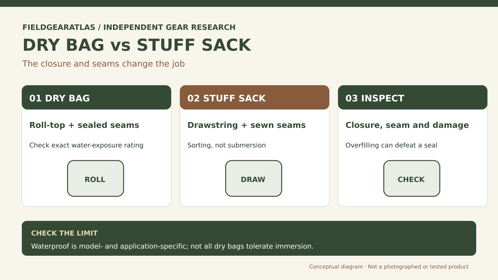

# Dry Bag vs Stuff Sack: Which One Protects Your Gear?

*Technical explanation diagram created for FieldGearAtlas. Not a photograph of a commercial product.*

**Quick answer:** A **dry bag** is designed to provide water protection appropriate to its construction and intended use, often through sealed seams and a roll-top closure. A **stuff sack** is primarily an organizer or compression container; a drawstring opening and ordinary seams are not waterproof barriers.

The most common mistake is assuming that a light, coated nylon sack will keep a sleeping bag dry simply because raindrops bead on its fabric. Water can enter via the closure or needle holes even when the material itself resists wetting.

## What each closure means

| Detail | Roll-top dry bag | Traditional stuff sack |
|---|---|---|
| Main purpose | Water protection and organization | Containment and quick sorting |
| Typical closure | Folded/rolled top with buckles | Drawcord/cinch |
| Seams | Often taped or welded | Often conventional sewn seams |
| Waterproof guarantee | Depends on exact model and closure procedure | Usually not intended for submersion |
| Frequent opening | Slower when properly rolled | Often quicker |

Sea to Summit makes this distinction in its own support documentation. Importantly, **not all dry bags are rated for submersion**; some are intended only for splash, rain or internal pack protection. Avoid translating 'dry bag' on a product label into 'safe to drop in a river.'

## Three use cases—and what changes

**1. Keeping insulating layers dry inside a rucksack.** A correctly sealed lightweight dry bag or appropriately used waterproof pack liner can protect critical insulation from a wet packbag. A stuff sack may still be useful inside that protected layer for sorting, but it should not be the outer water barrier.

**2. Sorting a cooking kit.** If the contents can tolerate moisture, a stuff sack might give faster access and less complicated closure. Protect sharp objects that could puncture an expensive waterproof liner.

**3. Water travel or exposure to splashes.** Check the manufacturer's immersion/splash guidance and any IP rating if provided. A roll-top organizer suited to an internal backpack is not necessarily appropriate for kayak exterior attachment.

## Roll-top closure: one manufacturer's example, not a universal rule

Sea to Summit instructs users of the **relevant roll-top models** to inspect the fabric and inner coating, squeeze out excess air, fold over the closure strip, roll at least two further turns, then clip the buckle. Their guidance also warns that a soft dry bag is **not guaranteed to keep electronics safe during heavy submersion**. Other brands and models may have different instructions. [Sea to Summit — correct roll-top closure](https://support.seatosummit.com/hc/en-us/articles/19361653630996-How-should-I-correctly-close-a-dry-bag-roll-top-closure).

An overfilled mouth, trapped strap, puncture or aged coating can defeat intended protection. Before a wet trip, inspect the actual bag and follow its documented use limitations. Do not treat a correctly rolled closure as a waterproof certification for every setting.

## Where compression fits into this decision

Compression straps reduce occupied volume by squeezing compressible contents; they do not prove the container is watertight. A heavily compressed down or synthetic insulation item may fit in less space, but allowing recovery time is important for its loft. A sack designed for compression still needs separate water protection unless the maker specifically says otherwise.

**Shopping test:** Ask for the exact product's seam type, closure procedure, intended exposure, puncture resistance, and whether the seller describes *rain protection* or *submersion protection*. Those statements are not interchangeable.

## Three real-world packing decisions

| What is inside? | Main risk | Choose by evidence, not the name alone |
|---|---|---|
| Cooking utensils or a cord kit | Losing small items | Stuff sack may suffice if contents can get damp |
| Spare dry insulation in a wet rucksack | Water entering through the pack | Purpose-appropriate dry bag or waterproof liner, closed as instructed |
| Phone, documents or camera in boating conditions | Possible immersion and equipment damage | Check an appropriate dedicated case's immersion protection; a generic soft dry bag may not suffice |

**At-home acceptance check:** Put noncritical test paper or cloth inside, close the product as instructed, and inspect the seal and seams under the level of exposure the maker explicitly permits. This is a **screen for obvious defects**, not an immersion certification. Never test by submerging a product unless the manufacturer says that is an appropriate use, and do not risk electronics or essential medication.

## Practical decision example: Keep waterproof claims bounded

A roll-top dry bag used inside a backpack can provide a further moisture barrier for clothing. A basic stuff sack reduces bulk or organizes gear but may not resist rain. Follow the exact bag maker’s closure instructions; do not treat an untested rolled opening as approved for submersion.

**Write down before choosing:** For high-consequence items such as electronics, verify the specific product’s protection claims and add appropriate redundancy.

## FAQ

### Is 'water-resistant' enough for a sleeping bag?

Not when failure would leave the sleeping bag wet in serious conditions. Use a purpose-suited waterproof system and inspect it.

### Can a stuff sack be used inside a dry bag?

Yes; that can help organize gear. Account for the additional fabric and space taken by nested containers.

### Are all roll-top bags waterproof?

No. Material, seams, closure method, wear and stated application determine protection.

## Source boundary

Construction distinctions are derived from Sea to Summit support documentation, not from a laboratory test of named dry bags. The graphic is an original generic comparison.

## Research references

- [Sea to Summit — Dry Bags vs Stuff Sacks](https://support.seatosummit.com/hc/en-us/articles/44648652621588-What-are-the-differences-between-Stuff-Sacks-and-Dry-Bags)
- [Sea to Summit — Correctly Closing a Roll-Top Dry Bag](https://support.seatosummit.com/hc/en-us/articles/19361653630996-How-should-I-correctly-close-a-dry-bag-roll-top-closure)
- [REI — How to Pack and Hoist a Backpack](https://www.rei.com/learn/expert-advice/loading-backpack.html)

