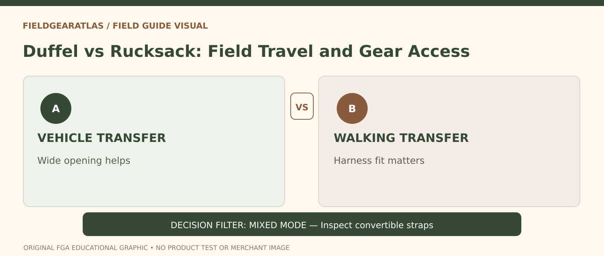

# Duffel Bag vs Rucksack for Field Travel

*Conceptual research graphic created for FieldGearAtlas. No specific commercial product or hands-on test is represented.*

**Quick answer:** Choose a **duffel** when the trip centers on vehicle loading, wide-open access and irregular equipment. Choose a **rucksack** when you must carry the load comfortably across distance, uneven ground or multiple transfers. The best choice depends less on capacity and more on the route from storage to destination.

## Trace your actual travel chain

Suppose you pack at home, drive to a training site, unload gear at a parking lot and walk a short distance to a room. A broad-opening duffel can make boots, clothing and protective layers easy to see. Change that trip to a mile on foot with stairs, gravel and a need for both hands: a well-fitted backpack becomes more appealing.

This is why a feature comparison alone is incomplete. Ask where the bag will rest, who will carry it and how frequently you need to access contents. A bag that is convenient in the trunk may feel awkward after several blocks.

## Side-by-side: what is fundamentally different?

| Practical question | Duffel bag | Rucksack/backpack |
|---|---|---|
| How do you access clothing and bulky gear? | Often wide zip opening | Varies: top, panel or multiple compartments |
| How do you carry over distance? | Usually hands or shoulder; some convertible | Usually shoulder harness, possibly frame and hipbelt |
| Does it hold irregular objects? | A flexible cavity can be forgiving | Internal shape and padding can constrain objects |
| How will it behave on rough terrain? | Often less convenient while carried by hand | Designed carry system may be easier to control |
| Is it airline compliant? | Must verify packed exterior dimensions | Also must verify actual dimensions |

A 60-liter number alone cannot tell you how accessible the corners are or whether the bag can be carried comfortably. Compare dimensions, harness design and loading method, not just liters.

## Decide by equipment rather than bag marketing

**Clothing and footwear:** A large zipper opening is useful if you need to locate specific garments quickly. A rucksack can also offer front-panel access; inspect the actual layout instead of assuming all backpacks are top loaders.

**Dense training equipment:** An ordinary duffel may be easy to lift into a vehicle but uncomfortable to carry for long periods. A purpose-designed backpack with the right suspension may offer better body control, within its published design limits. Convertible duffel straps are not automatically equivalent to a fitted load-bearing ruck.

**Rain or dirt exposure:** Examine fabric, seam design and closures. “Water-resistant” is not the same as watertight. Packing a dry bag inside either can add protection when its sealing instructions are followed.

## An inspection worksheet for the store

1. Pack a plausible set of items rather than testing the empty bag only.
2. Open and close it repeatedly with the bag on a floor or bench. Can you see and reach what you need?
3. Carry it by the intended method over a short controlled distance. Where does the load pull?
4. Look for stress at handles, anchors, zippers and strap attachment points.
5. Measure its stuffed exterior dimensions if transport limits apply.
6. Consider where wet, dirty or sharp-edged items will go; internal dividers are only useful if they match your contents.

The [National Park Service hiking guidance](https://www.nps.gov/articles/hiking-safety.htm) is useful when the travel chain includes an actual hike: essential supplies, weather and route conditions matter regardless of bag form. For long-distance backpack fit, see [REI's pack fitting guidance](https://www.rei.com/learn/expert-advice/backpack.html).

## Three clear choices

**Road trip with large gear:** Choose the bag offering the easiest safe loading and access. Duffel is often practical.

**Frequent transit and long walks:** Prioritize harness fit, back comfort and hands-free movement. A backpack usually deserves a closer look.

**Mixed mode:** A convertible duffel could work if its shoulder straps, anchor points and padded contact areas suit the weight; test those features instead of trusting the word “convertible.”

## Which carrying format matches each part of the trip?

Write the travel sequence as **vehicle → short carry → repeated walking → storage** rather than choosing from the bag's label.

| Travel pattern | What to inspect | Likely problem if ignored |
|---|---|---|
| Load directly into a vehicle and carry a short distance | Duffel handle anchors, zipper opening and bag dimensions | Large single-cavity bag becomes hard to manage |
| Walk repeatedly with the load | Pack torso fit, hipbelt, harness and allowable mass | Shoulder and back discomfort despite good storage volume |
| Mixed travel with short occasional carries | Convertible strap construction and comfort with loaded gear | Thin stowaway straps marketed as all-day carrying support |

REI recommends evaluating both **pack fit** and **travel-luggage use case**. A duffel can be easy to pack with odd-shaped objects, but it is not inherently more durable than a comparable rucksack. A rucksack puts the load on the body in a different way, yet a poor fit or overloaded suspension can still be unsuitable. Use a short, safe trial with realistic gear and check the maker's instructions rather than assuming either is universally best.

## Practical decision example: The walk-to-vehicle test

A duffel may be convenient for packing and finding clothing at a fixed destination, but awkward on a longer foot approach. A rucksack may carry more comfortably on the back yet make deep items slower to retrieve. Define the longest carrying segment and the access needs before comparing bags.

**Write down before choosing:** Try each packed option using the actual carrying method; do not infer safe load from the advertised number of liters.

## FAQ

### Is a tactical duffel stronger than an outdoor backpack?

Not from the word tactical. Strength depends on construction and supported loads.

### Is a duffel's capacity more usable?

Sometimes its single cavity accommodates awkward objects well, but useable geometry is model-dependent. Test with actual gear.

### Does a backpack always protect your back?

No. Proper fit, total load and carrying technique still matter, and a poorly fitted pack can be uncomfortable.

## Evidence limits

These are format-level comparisons, not laboratory claims about individual bags.

- [REI — How to Choose a Backpack](https://www.rei.com/learn/expert-advice/backpack.html)
- [National Park Service — Hike Smart](https://www.nps.gov/articles/hiking-safety.htm)
- [Osprey — How to Fit a Backpack](https://www.osprey.com/eu/blog/post/how-to-fit-your-osprey-backpack)

**Additional source used in editorial verification:** https://www.rei.com/learn/expert-advice/luggage-packs.html
