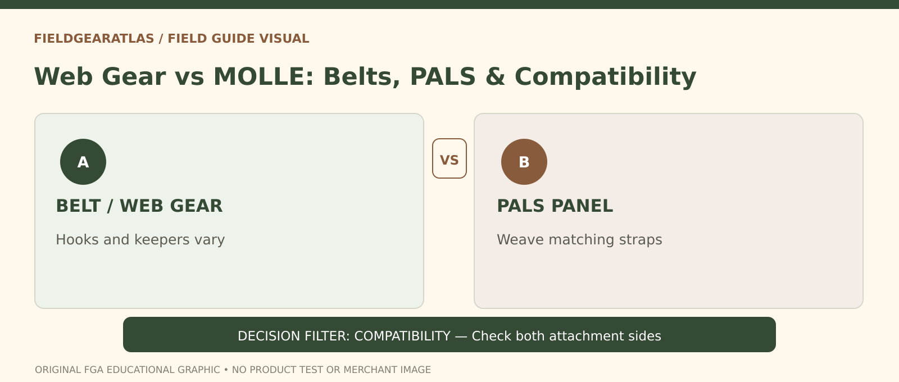

# Web Gear vs MOLLE: Understand Attachment Differences

*Conceptual research graphic created for FieldGearAtlas. No specific commercial product or hands-on test is represented.*

**Quick answer:** “Web gear” typically refers to load-carrying belts, straps, suspenders and pouches, often associated with older field equipment arrangements. **MOLLE** describes a modular load-carriage system, while the **PALS grid** is its familiar pouch-attachment interface. The key difference for a buyer is **how the equipment mounts, fits and distributes its contents**, not that one system must be better or more authentic.

## First, separate three terms

A belt-supported arrangement can hold pouches along the waist, sometimes with suspenders. A modular vest or backpack may carry pouches on webbing panels distributed across the torso or bag. Some systems combine both concepts. The phrase “web gear” is used loosely in surplus listings; it is not a guarantee of a particular issuing era or standardized set.

The modern PALS grid uses repeated sewn rows to create an attachment interface. The [U.S. Army IOTV Gen III manual](https://www.benning.army.mil/tenant/lrc/content/pdf/IOTV%20GEN%20III%20TM%2010-8470-210-10.pdf) demonstrates compatible pouches being secured by weaving attachment straps through panel and pouch. That proves a documented method of attachment—not universal compatibility between every third-party product or laser-cut panel.

## Compare the questions the designs answer

| Decision | Belt/web gear arrangement | PALS/MOLLE arrangement |
|---|---|---|
| Where are pouches anchored? | Along belt, harness or system-specific clips | On compatible webbing or modular panels |
| Can pouches move between surfaces? | Depends on original attachment interface | Possible when panel/pouch dimensions match |
| Does it avoid shoulder load? | Not necessarily; suspenders may distribute load | Not necessarily; vest or backpack design matters |
| Can you mix components? | Check clip/keeper type and mounting geometry | Check straps, row spacing, closures and dimensions |
| Does appearance prove issuance? | No | No |

Historical pieces may have worn labels, replaced buckles or mixed-era accessories. Never claim a specific item was military-issued based solely on olive fabric or the letters “US” in a listing.

## An example of a compatibility mistake

A collector buys a pouch described as “MOLLE” and expects it to mount securely on an older belt with metal eyelets. Its attachment straps may have no compatible grid or keeper. Conversely, a vintage belt pouch may have a wire hanger designed for holes that a modern laser-cut panel lacks. These interfaces are not interchangeable by name.

**Better approach:** Ask for clear photographs of the pouch **back**, the belt or platform, and the attachment hardware. Check the complete method of mounting before purchase. If a seller cannot show the rear of a pouch, the compatibility claim remains unverified.

## For walking, assess body movement and access

Wear a representative load and test walking, sitting and reaching in a safe setting. Belt-mounted items can compete with a rucksack hipbelt or interfere with arm swing; chest-mounted items may obstruct access to straps or clothing pockets. A load carriage layout should reflect the activity and items, not merely available attachment points.

Avoid treating either system as a certified load rating. Hardware and stitching can fail, particularly on aged surplus. The presence of a steel clasp or double-stitched loop is not proof of a tested safe load.

## Evidence checklist for surplus collectors

1. Identify the actual object: belt, harness, pouch, pack or vest.
2. Record visible manufacturer marks, contract labels and hardware type.
3. Compare the *specific* fastening method rather than color or era shorthand.
4. Inspect wear, rust, stitching, tears and modifications.
5. Confirm whether any claimed military designation is supported by a reliable document.
6. Treat an NSN as an identification aid where relevant, not proof this individual item was issued to a service member.

For the identification distinction, consult a reliable NSN versus manufacturer part-number reference. Link to the FieldGearAtlas guide only after its canonical URL is published.

## Identification check: modular webbing versus older load-carriage hardware

Before calling a surplus belt 'MOLLE' or a modern pouch 'compatible,' describe the **actual interface**. A PALS panel commonly uses repeated webbing rows with a defined threading path for compatible straps. Older web-belt systems can instead employ **eyelets, metal clips, suspenders or proprietary connectors**. The presence of a belt or a pouch alone does not establish mechanical interchangeability.

**Photo-free evaluation worksheet:** (1) record the belt or panel material; (2) note rows, slots or eyelets visible; (3) identify the pouch's rear attachment hardware; (4) seek manufacturer or issued instructions for that combination; (5) record whether an adapter is documented. Label the outcome **verified by instructions**, **appears compatible—unverified**, or **not supported by available evidence**. Avoid inventing a compatibility standard for unknown vintage items.

For provenance, use NSN, part number and CAGE as **identification clues** where relevant. DLA's PUB LOG supports cross-reference research; it does not by itself prove that an individual belt or pouch was issued, nor does it establish its present material condition. Keep compatibility research and authenticity research separate.

## Practical decision example: Inspect both sides of a modular system

A vintage belt and a modern PALS pouch may both be called “military web gear,” but their attachments can use entirely different hardware and geometries. Check the receiving surface and the pouch’s fastening route rather than shopping only by keyword.

**Write down before choosing:** If an adapter is required, verify the maker’s instructions and the added bulk before using the setup.

## FAQ

### Is PALS the same as MOLLE?

No. MOLLE refers to a modular equipment system; PALS refers specifically to the attachment webbing arrangement frequently associated with it.

### Are old web belts compatible with MOLLE pouches?

Only when a documented adapter or compatible hardware setup provides a secure mounting method. Do not assume it.

### Is surplus equipment automatically authentic because it looks military?

No. Look for verifiable part and contract markings and consistent construction; beware of later reproductions.

## Source and scope

This article discusses identification and compatibility concepts without suggesting that a commercial item has government approval.

- [U.S. Army — IOTV Gen III Operator Manual](https://www.benning.army.mil/tenant/lrc/content/pdf/IOTV%20GEN%20III%20TM%2010-8470-210-10.pdf)
- [Defense Logistics Agency — PUB LOG](https://www.dla.mil/Information-Operations/Services/Applications/PUB-LOG/)
