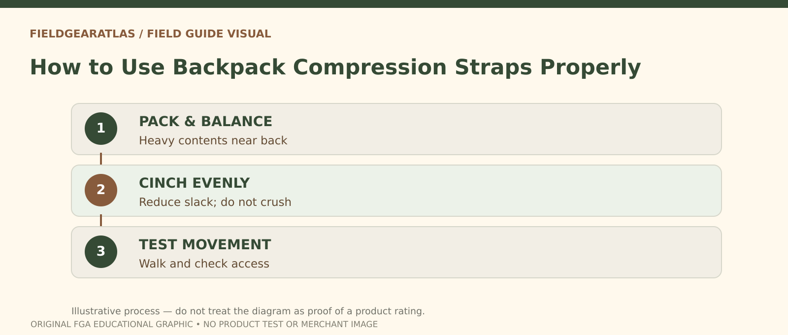

# How to Use Backpack Compression Straps

*Conceptual research graphic created for FieldGearAtlas. No specific commercial product or hands-on test is represented.*

**Quick answer:** Backpack compression straps help **reduce slack, stabilize a partly filled bag and limit internal shifting**. They are not a substitute for a correctly fitted frame and harness, nor are they automatically rated to carry heavy objects strapped to the outside of a pack.

## Identify the strap before pulling it

Side compression straps generally run across the sides of the pack body. Some styles have upper and lower sets; some cross a bottle pocket or connect around the main bag. Other straps are designed for sleeping-pad attachment, bottom lash points or internal load control. If the maker supplies instructions, follow those instead of assuming every buckle serves the same purpose.

[Osprey's packing guide](https://www.osprey.com/eu/blog/post/how-to-pack-your-pack) describes reducing a short, wide load and maintaining side-to-side balance. [REI's backpack loading guide](https://www.rei.com/learn/expert-advice/loading-backpack.html) also describes tightening compression straps after loading to keep contents from moving. Neither source suggests that overtightening fixes poor weight placement.

## A six-step adjustment routine

1. **Open the bag and release the compression straps.** This makes the loading space accessible and stops the outer webbing from prematurely distorting the shape.
2. **Arrange dense gear near the supported back panel** within the maker's guidance. Keep heavy objects from settling in an unsupported outer pocket.
3. **Balance the sides.** A full water bottle or pouch only on one side may pull the pack off center even before you tighten anything.
4. **Close the main compartment completely.** Confirm zippers and drawcords are not caught under a strap.
5. **Tighten each side gradually.** Pull until excess slack decreases and contents no longer shift easily. Do not crush fragile equipment or create a warped back panel.
6. **Fit the harness with the loaded bag on.** Adjust belt, shoulders and other straps according to manufacturer instructions, then walk and turn.

A secure result feels integrated rather than tightly cinched at one narrow point with loose bulges above and below.

## What is the strap failing to solve?

| What you observe | Likely problem | Better first step |
|---|---|---|
| Bag still sways | Dense contents too far out or unsecured | Repack before tightening again |
| One side bulges | Asymmetric contents | Rebalance left-right |
| Side pocket collapses | Straps routed across the pocket | Check model's pocket strap routing |
| Harness digs into shoulders | Fit or load issue | Adjust suspension, not side compression |
| Rain shell trapped underneath | Access planning error | Move quick-access gear |

Do not claim strap tension or safe external carry in pounds without manufacturer data. Appearance alone cannot reveal the webbing and anchor point capacity.

## Can compression straps hold extra gear?

Some packs specifically provide compression/carry straps for items such as a folded sleeping pad or jacket. Other packs expect these straps only to control the pack body. Check the manual, secure the object with appropriate hardware and ensure it cannot fall or obstruct movement. The [Osprey Escapist manual](https://www.osprey.com/gb/media/user_manuals/OM_Escapist_S15_ENG.pdf) is an example of manufacturer-documented side-compression features on particular models; it is **not** a specification for every backpack.

Long items and equipment protruding from the pack can catch on branches or doorways. When possible, contain loose items inside rather than improvising multiple exterior loops.

## A quick field test

With ordinary gear in the bag, stand, turn slowly and take several steps in a safe open area. Have someone look from behind: does the bag remain centered, or does one side wobble? Then try accessing water or a rain layer. If stabilization prevents normal access, move the item or revise the strap routing. Repeat when contents change substantially during the day.

## Compression adjustment: distinguish restraint from support

Before pulling a strap, identify whether it is a **side compression strap**, **top or bottom load-restraint strap** or a **carry/harness adjustment**. They do different jobs. A typical side compression strap draws bag fabric closer to its contents and can help reduce unwanted shifting when partly packed, but it does not increase frame strength, create a new load rating or substitute for a correctly fitted hipbelt.

**Repeatable check:** Pack normal gear, close the bag, then tighten symmetric compression straps just enough to restrain the contents without crushing them. Observe whether fabric is trapped by buckles, whether a side pocket or zipper is blocked and whether the pack remains centered on the wearer. If an exterior item is tied beneath a strap, verify the manufacturer intended that type of attachment and that it cannot dislodge. Recheck after taking equipment out, because a reduced internal volume may need readjustment.

This is an **inspection routine**, not a strap breaking-strength test. The exact use of each buckle and strap is determined by the packmaker's manual. A webbing strap is not proof that a pack is suitable for heavy rucking.

## Practical decision example: What compression straps can and cannot do

Compression straps can stabilize partially filled soft contents, but cannot raise a manufacturer’s safe load capacity. Cinch the pack in a way that avoids crushing fragile objects or obstructing the main closure, then walk briefly to check sway.

**Write down before choosing:** Do not route straps over zippers, fragile gear or emergency-release paths contrary to the pack maker’s guidance.

## FAQ

### Should compression straps be pulled as tight as possible?

No. Pull only enough to control the load as intended. Crushing gear or distorting the pack may make the carry worse.

### Do compression straps replace a hipbelt?

No. They control packbag shape; suspension supports carrying on the body.

### Can I clip a heavy pouch to a compression strap?

Only if the manufacturer supports that use and the mounting is secured appropriately. A general compression strap is not a universal attachment rating.

## Research note

This is an instructional outline based on packmaker guidance, not a stress test of straps or buckles.

- [REI — How to Load a Backpack](https://www.rei.com/learn/expert-advice/loading-backpack.html)
- [Osprey — How to Pack Your Pack](https://www.osprey.com/eu/blog/post/how-to-pack-your-pack)
- [Osprey — Escapist Series Manual](https://www.osprey.com/gb/media/user_manuals/OM_Escapist_S15_ENG.pdf)
