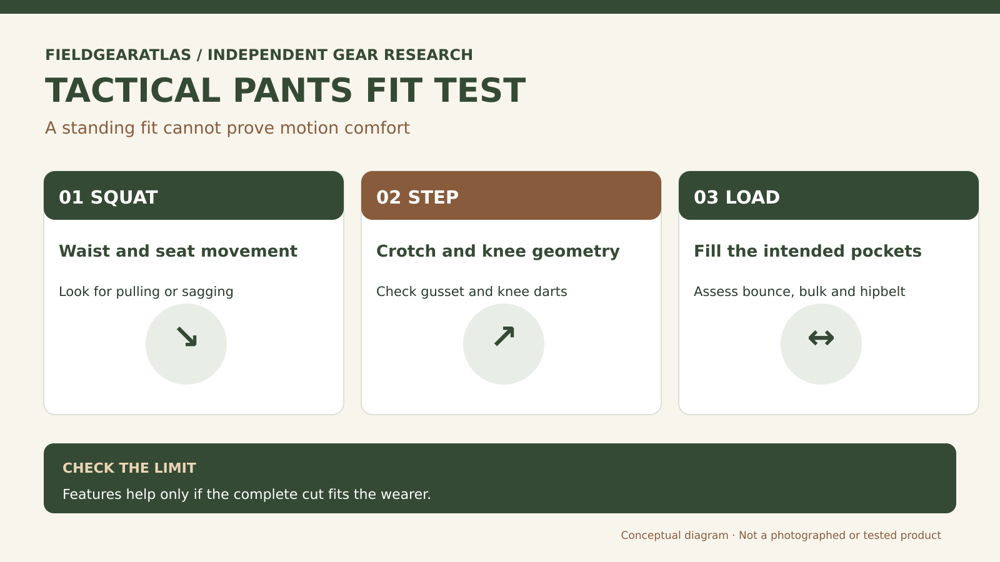

# Tactical Pants Fit Guide: Movement, Rise and Pocket Load

*Technical explanation diagram created for FieldGearAtlas. Not a photograph of a commercial product.*

**Quick answer:** Tactical pants should be assessed **while moving and carrying what you actually use**, not just standing in front of a mirror. Check rise, seat room, thigh clearance, knee design, waist stability and the effect of filled pockets. 'Tactical fit' is not a standardized cut.

A pair that feels roomy while standing may pull tightly across the seat when you crouch. Another pair with many pockets may ride down when loaded with phone, keys and small tools. These are functional fit problems, not cosmetic preferences.

## Five moves that reveal a poor fit

1. **Deep bend or controlled squat:** Look for waistband movement, seam strain and a pulling sensation across the hips.
2. **High step:** Put one foot onto a safe, low step and check the crotch and thigh fabric for resistance.
3. **Kneel carefully:** See whether articulated knees line up with your actual knees, not just the pant's seams.
4. **Sit:** Check whether your phone or pocket contents press into your thigh or hip.
5. **Walk with the pockets loaded:** Inspect sagging, rubbing, noise and repeated adjustment needs.

You do not need to perform strenuous movement in a fitting room. The point is to try the body positions the garment is meant to accommodate.

## Rise and waist are different dimensions

Waist circumference alone cannot predict where the waistband will sit. **Rise** affects the distance between the waistband and crotch, which changes comfort when crouching or wearing a belt and backpack hipbelt. A low rise can pull during high steps; a very high rise might bunch under other equipment. Compare model-specific measurement diagrams whenever possible.

## Design features and what they really do

| Feature | Potential benefit | Limitation to test |
|---|---|---|
| Gusseted crotch | Redistributes seam stress and permits motion | Cannot fix a waistband that is too tight |
| Articulated knees | Adds shaped room for bending | May be placed incorrectly for your leg length |
| Stretch panel | Helps localized movement | Does not guarantee abrasion resistance or easy drying |
| Reinforced seat/knees | Additional material where wear occurs | May add heat, thickness or stiffness |
| Cargo pockets | Equipment organization | Can swing, sag or conflict with a harness |

REI's guide to hiking pants describes gussets, knee darts and fabric stretch as movement-related design choices; the same mechanics can be evaluated in tactical-style pants without asserting that any one model performs best.

## Test pocket layout with realistic items

A pocket that fits a smartphone lying flat on a desk may not work while kneeling. Put the actual objects in every pocket you plan to use. Consider whether a zipper pull catches a jacket hem, a cargo pocket collides with a knee, or a rear pocket sits under a loaded hipbelt. If the waistband sags, tightening the belt may only mask the mismatch.

**Hypothetical field comparison:** Pants A use stretchy material but narrow thighs. Pants B use a less-stretchy weave with an articulated knee and generous gusset. For one wearer, B may provide more useful range of motion even though its fabric contains less elastane. Evaluate the garment's entire cut.

## What clothing labels cannot tell you

Denier is a yarn-related specification, not a universal durability score. 'Ripstop' names a weave feature, not a guarantee the garment will survive a particular abrasion test. 'Water-resistant' is not the same as waterproof. Without a specified test method and result, such terms are useful descriptors but poor performance comparisons.

## Five movements that expose a misleading size label

The stated waist size is only the beginning. When trying on tactical pants, perform the motions you expect during use **without forcing your joints**: sit normally, bend into a comfortable squat, take a controlled high step, kneel if appropriate, and walk wearing your usual belt or pack hipbelt. Watch whether the rise pulls, fabric binds over the thigh, knees become exposed by cuffs riding up, or the waistband chafes against the pack. Those observations are more useful than deciding that all tactical pants should be loose.

REI's outdoor-pants fitting guidance distinguishes **straight, tapered and wider-leg silhouettes** and notes that gussets, knee darts and stretch can affect mobility. But no feature name guarantees that a particular pant will move well on every body. Record the actual garment model, waist/length, fabric blend, rise, and observed motions. When buying online, review the maker's measurements and return policy; FGA has not independently compared garment patterns or abrasion resistance.

## Practical decision example: A movement-based pants fitting

Try a squat, stair step and kneel in ordinary safe conditions while wearing a belt and items you actually carry. Note tension at the rise, thigh, knee and pocket openings. Choosing a larger waist may reduce thigh tension but create belt bunching—look for a different cut rather than assuming a single numerical size fixes every dimension.

**Write down before choosing:** Do not equate “tactical” branding with verified abrasion or flame resistance.

## FAQ

### Should tactical pants fit loose?

Not necessarily. They should permit the required range of motion without restrictive pulling or excess material catching on equipment.

### Should I choose a larger waist for cargo pockets?

Don't treat extra waist circumference as the fix for poorly distributed pocket load. Check the cut, belt compatibility and actual contents.

### Does a gusset mean the pants are stronger?

It can change how stress is distributed, but material, seams, workmanship and testing govern durability.

## Editorial note

This is a general fitting method, not a hands-on comparison of particular trousers. Check the maker's measurements and exchange policy for the exact version and generation.

## Research references

- [REI — How to Choose Hiking Pants](https://www.rei.com/learn/expert-advice/hiking-pants.html)
- [REI — How to Choose Outdoor Clothing](https://www.rei.com/learn/expert-advice/how-to-choose-hiking-clothes.html)
