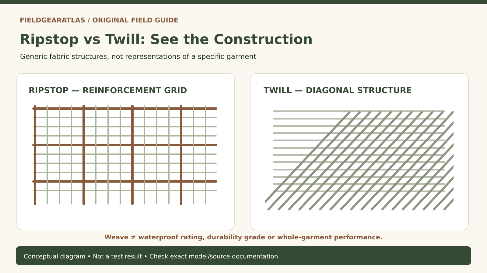

# Ripstop vs Twill Tactical Pants: What the Weave Does—and Does Not—Tell You

*Original conceptual infographic. Not a tested model or product performance result.*

**Quick answer:** Ripstop uses reinforcement yarns arranged in a grid to help limit the spread of a tear. Twill has a recognizable diagonal weave and is common in trousers and workwear. Neither word by itself proves that one pair of pants is more durable, cooler, more water-resistant or better for a particular job: fiber blend, yarn, fabric weight, finish, construction and testing also matter.

A pants listing may promote 'ripstop' as if the word were an all-purpose durability score. Another may praise twill for toughness. Both are incomplete claims. Fabric architecture is one part of a finished garment, and a wearer's actual failure mode—snags, abrasion, restricted movement or drying time—determines what to compare.

## Identify the two constructions without marketing language

A typical ripstop fabric shows a faint or obvious crosshatch grid. The reinforcing yarns interrupt tear propagation after a snag or puncture; they do not make the cloth impossible to cut or puncture. Ripstop can use different fibers and base weaves, so two 'ripstop' pants may feel completely different.

Twill is one of the basic woven structures. Its staggered interlacing produces a diagonal line or rib (a wale). Denim, chinos and certain uniform fabrics are familiar twill examples. Twill may be dense, light, soft, stiff, cotton-rich or synthetic; the label alone does not establish weight or drying behavior.

## Compare the properties actually relevant to tactical pants

| Concern | What the weave description can suggest | What you must check separately |
|---|---|---|
| Snags and small tears | Ripstop grid may help limit tear growth | Manufacturer tear testing, yarn/fiber and fabric condition |
| Knees rubbing against rough surfaces | No universal winner from weave name | Abrasion data, knee reinforcement, fabric thickness |
| Heat and drying | Cannot be inferred from ripstop vs twill alone | Fiber blend, fabric weight, finish, garment ventilation |
| Stretch and range of motion | Neither weave guarantees stretch | Elastane percentage, mechanical stretch, articulated knees, gusset |
| Rain | Weave name is not a waterproof rating | DWR/coating/membrane and seam construction |
| Workday comfort | Touch and drape vary | Fit at waist, hip, thigh and knee; movement while loaded |

In particular, **ripstop does not equal waterproof**. A reinforcing grid addresses mechanical tearing, whereas weather protection depends on different treatments and constructions.

## An in-store fitting test with more value than a spec-sheet score

Wear the pockets with the sort of objects you actually carry, then sit, climb one stable step and kneel carefully if practical. Do the thigh seams pull when you squat? Can the pocket opening be accessed while sitting? Does the waistband shift when a belt is worn? For a pair of work or field pants, garment pattern and seam placement may dominate the difference between two otherwise similar fabrics.

Inspect seams, bar tacks and pocket corners. A high-quality fabric can still fail where poorly reinforced stitching concentrates force. Reinforced knee panels may protect a high-wear area, but they can also add stiffness and drying time. These are conditional tradeoffs, not defects that apply to every pant.

## Three buying scenarios

**Hot, humid walking:** Compare garment weight, blend, ventilation and drying instructions. A heavy cotton-blend ripstop pant is not necessarily cooler than a lightweight twill; the reverse may also be true.

**Frequent kneeling and abrasion:** Prioritize construction at knee and seat, reinforcement, fit and known wear-test information instead of assuming a grid weave will outperform a dense twill.

**Snag-prone brush:** Tear propagation may be a relevant feature; ask whether the fabric has actual tear-test information and inspect exposed pocket flaps, loops and closures that can catch vegetation.

None of these examples describes a FieldGearAtlas field test. They are decision frameworks for comparing manufacturer documentation and trying a garment safely.

## Reading a fabric label without treating the weave as a lab result

**Twill** describes a woven construction with diagonal ribs formed by its interlacing pattern. **Ripstop** describes a reinforcement pattern intended to help resist a tear's propagation; a visible grid alone does not tell you the fabric's actual strength. These terms are not complete material specifications: fiber composition, yarn size, density, finishing, stretch fibers and seam construction can dominate how finished pants feel and wear.

The Pratt Textile Research Lab explains the structural meaning of twill weaving. REI's pants guidance separately shows that nylon, polyester, cotton and spandex have different properties and may be blended. **No test result follows from the weave name alone.** When comparing two garments, request the stated fiber blend, fabric weight, claimed stretch and relevant verified test method if performance is important. Try the pants while seated, crouched and walking. Do not use 'ripstop' as a stand-in for guaranteed puncture, flame or abrasion protection.

## Practical decision example: Compare construction, not fabric names

A ripstop grid may limit propagation of some tears in a specified textile, while twill describes a weave structure; neither term alone specifies fiber, coating, denier or completed-garment strength. Compare fabric composition, care instructions, reinforcement and an applicable test report if durability matters.

**Write down before choosing:** Never translate “ripstop” into an unsupported claim that the fabric cannot tear.

## Frequently asked questions

### Are ripstop pants always lighter?

No. The final weight depends on the fibers, yarns, reinforcement grid, finish and garment pattern. Compare the stated fabric mass when manufacturers publish it.

### Are twill pants always more abrasion resistant?

No. Twill is a weave, not a standard abrasion rating. Without comparable test methods or direct observations, declaring a winner from the label would be misleading.

### Is a visible grid enough to authenticate tactical fabric?

No. A visible pattern does not reveal fiber composition, construction quality or certified performance. Use source-specific specifications and the actual care label.

## Sources and reporting limits

- [Propper — Ripstop vs Twill Fabric](https://www.propper.com/blog/ripstop-vs-twill-fabric) — manufacturer's educational explanation of weave differences. Claims are presented as manufacturer guidance, not independent lab validation.
- [Première Vision — Basic Textile Weaves](https://www.premierevision.com/en/articles/b452b2cb-76fa-ef11-90cb-00224888722c) — technical explanation of twill diagonal structure.
- [GORE-TEX — DWR and product construction](https://www.gore-tex.com/support/frequently-asked-questions) — illustrates why water protection involves a different mechanism from fabric weave alone.

We have not conducted comparable tear, abrasion, thermal or waterproof tests. Technical diagrams should show generic fabric constructions rather than an unlicensed merchant's product image.

**Additional source used in editorial verification:** https://textileresearchlab.pratt.edu/construction/wovens
