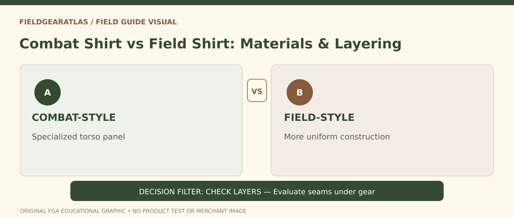

# Combat Shirt vs Field Shirt: Function Before Styling

*Conceptual research graphic created for FieldGearAtlas. No specific commercial product or hands-on test is represented.*

**Quick answer:** A **combat shirt** is commonly designed with a relatively light or breathable torso and more durable sleeves for particular equipment or layering needs. A **field shirt** is a broader term for a uniform or outdoor top designed to be worn on its own or as part of a clothing system. These are not universal specifications: the maker and model determine fabric, protection and suitability.

## Why the difference matters

In photographs, a combat shirt and a field shirt can look like two variations of the same olive garment. Their construction can be different because they were designed for different wearing conditions. The U.S. Army describes the [Army Combat Shirt (ACS)](https://cpeground.army.mil/Portals/53/files/PEO%20Portfolio%20pages-2018.pdf) as a garment intended for use with body armor, with a moisture-managing torso and sleeves selected for other requirements. That description applies to the **specific ACS system**, not every product sold as a “combat shirt.”

A typical uniform-style field shirt may have a similar fabric across the torso and sleeves, with pockets and closures that remain useful when worn without a carrier. Modern civilian field shirts vary widely; some resemble workwear more than formal uniform garments.

## Construction differences to inspect

| Construction point | Combat-shirt style | Field-shirt style |
|---|---|---|
| Torso fabric | Often selected for breathability under equipment | May use a single fabric across the shirt |
| Sleeves | Can emphasize abrasion resistance or dedicated features | Often follow general shirt fabric and pockets |
| Chest pockets | Sometimes absent or reduced under a carrier | Often retained for everyday access |
| Best context to examine | With your actual outer equipment | Worn independently or with outer layers |
| What label cannot prove | Flame resistance or military approval | Authorized uniform status or weather protection |

**Crucial caution:** Do not infer flame resistance, protective certification or authorized uniform compliance simply because a garment has camouflage sleeves. The Army's published ACS characteristics are not transferred automatically to unrelated civilian products.

## Test the clothing system, not the isolated shirt

If you intend to wear an outer vest, compatible pack or jacket, put the complete equipment combination on for a fitting check. A chest zipper or stiff pocket edge can sit directly under a shoulder strap; a seam comfortable alone can irritate when loaded. Reach forward and overhead, then bend and turn to see whether fabric pulls or the hem lifts.

For use without outer gear, inspect chest pocket placement, cuff adjustment, ventilation options and collar comfort. A shirt intended for occasional work, hiking or travel may benefit more from reachable pockets than from a specialized torso panel designed to sit beneath another layer.

## Heat management does not mean “always cooler”

A lighter torso panel can make sense under some equipment. But total comfort depends on climate, exertion, airflow, outer layers and the fabric's actual construction. A breathable area trapped under impermeable equipment cannot be judged in the same way as fabric exposed directly to moving air.

For cold or wet conditions, think about a **system of layers** rather than expecting either shirt to provide all insulation or weather protection. The [National Park Service cold-weather guidance](https://www.nps.gov/articles/winterweather.htm) explains the role of insulating and wind/weather-resistant layers. It does not endorse a particular combat or field shirt.

## Before buying: five checks

1. Verify the exact composition of the torso *and* sleeves; do not assume they are the same.
2. Check whether protective claims cite a specific documented standard or are only marketing language.
3. Look at seam locations with the carrier or backpack you actually use.
4. Test collar, cuffs, shoulder reach and hem length with layers.
5. Separate fashion/historical military styling from any current uniform requirement.

**Illustrative example:** A person buys a combat-style top for ordinary urban walking because the torso looks breathable. If the person never wears a carrier and needs chest-pocket access, a field-style top could be more practical. The opposite may hold for someone whose selected gear places constant contact across the torso. Neither outcome can be guaranteed from garment class alone.

## Practical decision example: Body armor changes the garment question

A combat shirt designed for use under armor may use different torso and sleeve fabrics for heat management and friction. That does not mean an ordinary commercial imitation has documented flame resistance or official approval. Inspect the product-level garment label and applicable standards, especially when the intended job has protective requirements.

**Write down before choosing:** Treat military program descriptions as explanations of a specific design—not certifications for retail lookalikes.

## FAQ

### Does a combat shirt require body armor?

No. People may wear the style separately, but certain named designs were specifically developed for use with protective gear. Check the product's stated purpose.

### Is a field shirt waterproof?

Not automatically. A field shirt is not a rain-shell category; confirm waterproof design and seam construction separately if relevant.

### Can a civilian combat shirt be called Army-approved?

Not without evidence appropriate to the exact garment, context and current requirements. Style resemblance is not authorization.

## Evidence limits

No specific civilian shirt was tested. Source descriptions of the Army ACS are clearly attributed to that military model.

- [U.S. Army PEO Soldier — Army Combat Shirt](https://cpeground.army.mil/Portals/53/files/PEO%20Portfolio%20pages-2018.pdf)
- [NPS — Be Winter Ready](https://www.nps.gov/articles/winterweather.htm)
