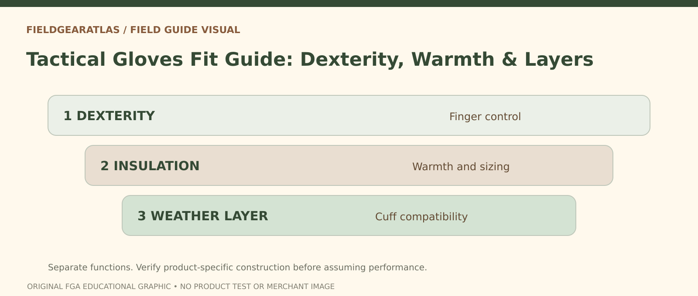

# Military-Style Gloves: Choose Fit and Layers for Tasks

*Conceptual research graphic created for FieldGearAtlas. No specific commercial product or hands-on test is represented.*

**Quick answer:** Choose military-style or tactical gloves around the actual **task and weather**, not the number of reinforced panels. A glove that provides warmth may reduce fine-finger control, while a thin dexterity glove may be unsuitable for prolonged cold or wet conditions. “Tactical” is a style label, not a performance or protective certification.

## Define your highest-priority task

Are you opening buckles, handling rope, walking with trekking poles, repairing equipment, driving, or simply keeping warm outdoors? Each activity places contact and friction in different areas. A glove that feels dexterous while scrolling a phone can still bunch at the fingertips when grasping a narrow tool. Conversely, heavy insulation can be welcome during a long stationary interval but frustrating during repetitive small movements.

[Outdoor Research's glove guide](https://www.outdoorresearch.com/pages/winter-glove-guide) discusses modular liner and shell arrangements, reflecting a useful general principle: warmth, weather protection and dexterity can be balanced through different layers. It does **not** establish that one glove format works for every person or temperature.

## The glove fit check you can do without special tools

1. **Fingertip position:** Open and close your hand fully. Fingers should reach the glove tips without being forced against them; large empty folds also interfere with handling.
2. **Palm tension:** Grip a bottle, buckle or intended equipment. Look for a palm pulled tightly across the knuckles or fabric bunching into folds.
3. **Thumb movement:** Move your thumb across your palm and toward each fingertip. Some thick seams restrict pinch motion.
4. **Cuff overlap:** Put on the actual jacket. Cuffs should fit together without leaving an unnecessary draft gap or blocking wrist flexion.
5. **Layer pairing:** If you expect a thin liner under an outer shell, verify fit with both layers. A shell sized for bare hands may be too tight with insulation.

An indoor trial cannot prove wet-weather durability or abrasion resistance. Labels and certification documents are needed for any specific protection claim.

**Military-authorization warning:** The U.S. Army's public equipment FAQ describes authorization processes for certain protective-equipment categories, including an authorized flame-resistant combat-glove list in its program discussion. That is not a general approval for gloves marketed as “tactical.” The FAQ also contains historical program information, so it should not be treated as a current product approval roster. If flame or impact protection is essential, obtain the presently applicable approved list or current procurement/workplace requirement and verify the exact model.

## Materials and construction: what to examine

| Feature | What it might help | What it does not guarantee |
|---|---|---|
| Synthetic or leather palm | Grip and wear resistance, design-dependent | Standardized abrasion protection without testing |
| Stretch-back panel | Range of finger and hand motion | Weather sealing |
| Insulation | Warmth when properly sized and kept suitable for conditions | Fine dexterity |
| Waterproof membrane | Water-barrier capability under specified conditions | Dry skin during heavy sweating |
| Extended gauntlet | Layer overlap and snow/rain entry control | Universal waterproofness |
| Touchscreen fingertips | Phone interaction with compatible device | High manual precision for all tasks |

You cannot reliably judge specific protective performance from a manufacturer photograph. Seek declared test methods or standards if the intended work makes that necessary.

## Working in cold and wet conditions

A liner can add flexibility when conditions shift, while an outer glove may address wind or precipitation. For more extreme cold, a warmer mitten system can reduce finger dexterity but may offer a different insulation arrangement. The [National Park Service](https://www.nps.gov/articles/000/winterhikingtips.htm) recommends suitable warm and weather-protective clothing for winter hikes; select glove layers as part of that wider system, not as a single miracle item.

Avoid choosing a tight glove hoping it will stretch enough to fit a thicker liner. Compression can make layering uncomfortable. Bring a dry spare where exposure and the trip warrant it.

## Two buyer scenarios

**Fast-moving day hike in mild conditions:** Grippy lightweight gloves, if required, can prioritize hand movement and pole comfort. Check the weather instead of buying heavy insulation by default.

**Cold, wet outdoor work:** Weather coverage, spare gloves and compatible cuffs may deserve more attention. The exact protective standard depends on the job; a generic fashion tactical glove may be inappropriate.

## Practical decision example: Glove fit must be task-specific

A glove that feels warm and comfortable while standing may become awkward when gripping handles or opening a zipper. Compare fingertip reach, palm bunching, cuff overlap and manipulation of the ordinary tools relevant to the activity. If protection from cuts, impacts or heat is required, look for appropriate model-level test evidence.

**Write down before choosing:** A general glove sizing chart does not certify PPE performance.

## FAQ

### Are knuckle guards evidence of impact protection?

No. They are a design feature. Meaningful claims need suitable product-specific testing information.

### Will waterproof gloves always feel dry?

Not necessarily. Sweat, cuff entry and seam design can influence perceived moisture.

### How do I choose size online?

Use the exact brand's hand-measurement chart and verify finger length and fit with intended layers. Do not infer size from “one size fits most.”

## Evidence and sources

This article provides decision guidance, not PPE certification advice. No glove was independently tested.

- [Outdoor Research — Winter Glove Guide](https://www.outdoorresearch.com/pages/winter-glove-guide)
- [Outdoor Research — Warmth, Dexterity and Protection](https://www.outdoorresearch.com/blogs/stories/or-gloves-aligning-warmth-dexterity-and-weather-protection)
- [NPS — Winter Hiking Tips](https://www.nps.gov/articles/000/winterhikingtips.htm)

### Additional reference for evidence scope

- [U.S. Army FAQ — historical protective-equipment certification context](https://cpeground.army.mil/Resources/Frequently-Asked-Questions/). This reference is used for the limited claim described above, not as independent authentication of any product.
