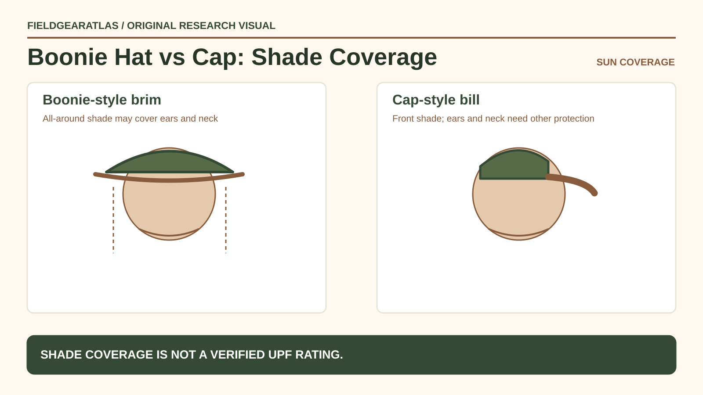

# Boonie Hat vs Tactical Cap: Compare Actual Sun Coverage

*Conceptual research graphic created for FieldGearAtlas. No specific commercial product or hands-on test is represented.*

**Quick answer:** A **boonie-style hat** can shade the face, ears and portions of the neck because it has a brim around the head. A **tactical cap** or baseball-style cap mainly shades the front, so exposed ears and neck usually need additional protection. The better choice also depends on wind, fit, heat and how you use your equipment.

## Sun coverage is the first distinction

The [CDC sun-safety guidance](https://www.cdc.gov/skin-cancer/sun-safety/) advises a brim around the entire head to shade the face, ears and back of the neck. It cautions that baseball caps leave areas exposed and recommends combining protective clothing, sunscreen or shade when needed. This does not mean that every boonie hat provides the same measured UV protection: fabric weave, holes, brim geometry and fit still matter.

A cap can be more convenient when a full brim gets in the way of movement or gear; it simply should not be treated as all-around sun coverage by itself.

## Compare the decision factors

| Criterion | Boonie-style hat | Brimmed tactical cap |
|---|---|---|
| Sun coverage | Brim around head can shade more directions | Primary visor shade toward the front |
| Wind behavior | Wide brim may flutter or catch wind | Smaller profile typically easier to manage |
| Ear/neck coverage | Often better if brim is wide enough | Requires separate protection for exposed areas |
| Under outer equipment | May interfere depending on brim | Often smaller profile, still fit-dependent |
| Storage | Many flexible brim styles can pack flat | Structured front panels may not pack as easily |
| What it doesn't prove | UPF rating or waterproofness | UV protection for uncovered skin |

These are common geometric tendencies, not ratings of individual products. A tightly woven hat may offer more practical protection than a loose, perforated hat with a seemingly larger brim.

## How to inspect the hat in person

**Check the shade:** Stand in normal outdoor light (not direct eye-damaging glare) and notice whether your ears and nape are actually shaded. A narrow floppy brim may offer less useful coverage than its product listing suggests.

**Check the fit:** Turn your head, bend forward and look upward. The hat should stay in position without blocking your vision. If there is a chin cord, adjust it according to the manufacturer instructions; be alert to snag and entanglement hazards in brush or equipment.

**Check ventilation:** Mesh panels and eyelets can help airflow but may also create openings for UV, rain or insects. Do not equate ventilation with measured protection.

**Check compatibility:** Try the intended eyewear, pack and outerwear. Hat brims may contact the collar or rain hood when you move your head.

## Choose by the actual outing

**Open sunny trail:** Sun coverage is a central issue. Consider a suitable all-around brim, protective clothing, sunglasses and sunscreen, guided by forecast and exposure. The CDC emphasizes a combination of protections rather than relying on one accessory.

**Urban commute with occasional sun:** A cap may be convenient, but protect ears and neck through other means when UV is significant.

**Windy exposed ridge:** A wide brim can become difficult to manage. Fit and secure handling become important, and some clothing arrangements may provide more reliable coverage.

**Wet forest:** A brim can divert some drops, but neither style should replace a rain hood or the waterproof construction needed in persistent precipitation.

## Coverage is visible; rated UV protection must be documented

A boonie hat may shade more of the ears and neck than a close-fitting cap because of its **brim geometry**, but actual protection also depends on sun position, the brim's size and fit, garment fabric and any other sun protection used. A model with a floppy brim may provide less stable shade in wind. For a cap, plan additional protection for exposed ears and neck during extended sun exposure.

**Important evidence distinction:** *UPF* refers to the measured UV protection of fabric under applicable testing; the word 'tactical,' a camouflage print or a dark color is not itself a verified UPF number. REI's published UPF guidance recommends looking for a garment's lab-tested rating when available. Compare `brim_dimensions`, `coverage_when_moving`, `retention`, `ventilation`, and `documented_UPF` as separate fields. For exposed skin, follow relevant sunscreen and shade advice; do not promise that a hat alone prevents UV injury.

## Practical decision example: Wind exposure changes headwear value

A wide-brim boonie can provide more shade over the face and neck than a minimal cap in calm conditions; wind may make its brim less stable, depending on construction. Evaluate retention, brim behavior and compatibility with other gear rather than choosing solely on style.

**Write down before choosing:** No hat alone replaces other sun-protection measures; check product-specific UPF claims before repeating them.

## FAQ

### Are all boonie hats UPF-rated?

No. UPF is a specific fabric performance claim, not a standard consequence of the hat's silhouette. Check independently documented ratings where offered.

### Does a darker hat provide better sun protection?

Fabric structure, coverage and tested protection matter. The CDC notes that tightly woven clothing is important; color alone is not sufficient to assign a rating.

### Is a boonie hat military-approved?

A civilian boonie-style hat is not automatically authorized as uniform headwear. Verify any organization-specific requirements separately.

## Evidence limits

No individual hat has been laboratory-tested by FieldGearAtlas. The table explains physical coverage and practical fitting checks, not model-specific UV ratings.

- [CDC — Sun Safety Facts](https://www.cdc.gov/skin-cancer/sun-safety/)
- [CDC — Preventing Sunburn](https://www.cdc.gov/skin-cancer/prevention/sunburn.html)
- [NPS — Ten Essentials (Sun Protection)](https://www.nps.gov/articles/10essentials.htm)

**Additional source used in editorial verification:** https://www.rei.com/learn/expert-advice/sun-protection.html
