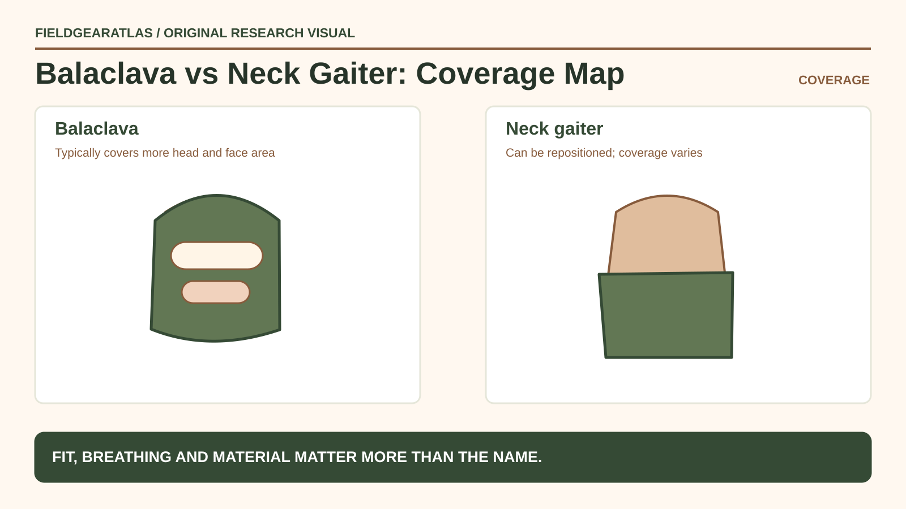

# Balaclava vs Neck Gaiter: Choose Coverage by Climate

*Conceptual research graphic created for FieldGearAtlas. No specific commercial product or hands-on test is represented.*

**Quick answer:** A **balaclava** is generally a shaped head-and-neck covering with an opening for the face or eyes; a **neck gaiter** is a tube worn around the neck that may be pulled over the lower face. Choose based on the coverage you need, how the layer fits with hats and hoods, and whether it stays comfortable as your activity and weather change.

## Coverage first: which parts need protection?

Balaclavas can cover the scalp, neck, ears and sometimes much of the face, depending on opening design. Gaiters most directly cover the neck and can extend upward over the mouth and nose in some uses. Neither is automatically a substitute for a weatherproof hood, a protective face covering certified for a specific task, or appropriate insulated headwear.

A winter hiking plan should consider the **entire clothing system**. The [National Park Service's winter recommendations](https://www.nps.gov/articles/000/winterhikingtips.htm) include warm layers and suitable protection for changing conditions. That is more reliable than choosing an item solely because its label contains “tactical,” “polar” or “thermal.”

## Key differences in a layering system

| What you need | Balaclava | Neck gaiter |
|---|---|---|
| Ear and scalp coverage | Often built in | Requires repositioning or other headwear |
| Adjustable neck-only wear | May be less convenient | Usually straightforward |
| Under a fitted hood | Check seam and crown bulk | Can avoid extra crown layers |
| Face coverage | Depends on designed opening | Can pull up on many designs; may slide |
| Size issue | Face opening and crown fit | Tube diameter and stretch recovery |

There is no universal winner for all temperatures. The fabric, moisture management, wind exposure and layering combination have more relevance than product name alone.

## A fit check with your actual outer layers

Put on the head or neck covering, then add your jacket hood, hat or other clothing you expect to use. Turn your head fully left and right, look down, look up and bend at the neck. Confirm the fabric does not block peripheral vision or interfere with breathing. Check whether the back of the neck remains covered when you lean forward; some gaiters ride down unexpectedly.

If the garment becomes damp from perspiration or breath, consider how it will dry and whether you have a spare. Wet cold-weather clothing can be uncomfortable; [NPS cold-weather guidance](https://www.nps.gov/articles/winterweather.htm) recommends suitable moisture-managing materials and extra dry layers when conditions warrant.

## Practical scenarios

**Cool and breezy day walk:** A thin gaiter may be enough for adjustable neck coverage, alongside other weather-appropriate clothing.

**Windy cold outing:** A balaclava may give more predictable ear/head coverage under a compatible hood, but check breathability, vision and comfort rather than assuming thicker is always better.

**Active uphill walking:** If you overheat easily, a removable neck layer can be easier to regulate. A heavy balaclava may be too much for exertion even if welcome while standing still.

**Travel with multiple climate changes:** A gaiter can be packed and adjusted quickly; carrying a second layer may help when conditions become colder.

## What not to assume

- **No medical guarantee:** Covering the neck and face does not, by itself, prevent cold injury. Dress for actual conditions and seek appropriate guidance for exposure risk.
- **No filtration guarantee:** A face covering made for warmth is not a certified respirator or protective filter.
- **No automatic flame resistance:** “Tactical” or “military-style” does not establish protective properties.
- **No one-size promise:** Tube stretch and face-opening geometry can affect comfort and security.

## A buying checklist

Inspect fabric composition, fabric thickness, seam placement, whether labels state verified wind or weather performance, how the covering sits under outer layers and whether laundering guidance suits field use. Look for model-specific sizing and return terms. Do not interpret product photography as proof of a rating.

## Practical decision example: Coverage is not the same as insulation

A balaclava can cover more skin surfaces, while a neck gaiter can be repositioned; material weight, fit and moisture handling determine comfort in a particular setting. Compare mouth and nose coverage, helmet or hood fit and whether the fabric interferes with normal breathing or hearing.

**Write down before choosing:** Neither product should be called protective PPE without appropriate specific evidence.

## FAQ

### Can a neck gaiter replace a balaclava?

Sometimes, for adjustable neck or partial-face coverage. It typically does not give the same secure shaped coverage around the scalp and ears without additional garments.

### Is a balaclava always warmer?

Not necessarily. Insulation, wind resistance, fabric and fit vary; coverage alone is not a temperature rating.

### Should I wear one under a helmet?

Only if it is compatible with the helmet and the relevant equipment instructions. Excess bulk can affect intended fit; do not improvise with safety equipment.

## Sources and limitations

No FieldGearAtlas thermal, filtration or protective equipment testing has been performed. This article explains common garment geometry and layering considerations.

- [NPS — Winter Hiking Tips](https://www.nps.gov/articles/000/winterhikingtips.htm)
- [NPS — Be Winter Ready](https://www.nps.gov/articles/winterweather.htm)
- [NPS — Ten Essentials](https://www.nps.gov/articles/10essentials.htm)
