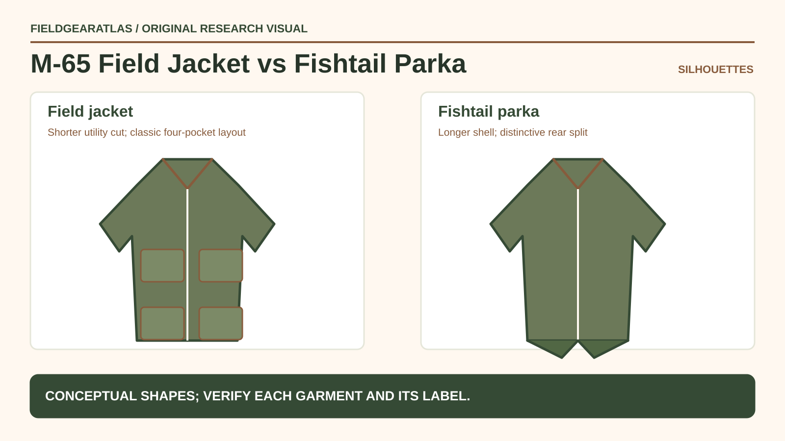

# M-65 Field Jacket vs Fishtail Parka: The Real Differences

*Conceptual research graphic created for FieldGearAtlas. No specific commercial product or hands-on test is represented.*

**Quick answer:** The **M-65 field jacket** and **M-65 fishtail parka** share a designation but not the same cut or layering role. A field jacket is shorter, with a four-pocket utility layout; the fishtail parka is a longer outer shell with a distinctive split rear hem intended to accommodate layers. A listing that calls both “M65” without a full garment description may conceal a major difference.

**Naming and dating caution:** “M-65” in a retail listing is not a unique identifier. Alpha Industries identifies 1965 as the year of its initial government field-coat contract, but that establishes a manufacturer history point, not a production year for a jacket listed for sale. A field-jacket label cannot be used to authenticate a fishtail parka, and a shared designation alone does not prove a specific military contract.

## Why the shared name causes confusion

The year-style designation became familiar across more than one garment. [Alpha Industries' field-jacket history](https://www.alphaindustries.com/blogs/military/the-history-of-the-m65-field-jacket) describes the M-65 jacket's stand collar, concealed hood and four front pockets. The [historical overview from Heddels](https://www.heddels.com/2015/01/history-fishtail-parka/) documents the distinct long fishtail parka silhouette and removable hood/liner arrangements found in many period examples. Those sources help identify styles; they do not authenticate any individual surplus garment sold today.

## Distinguish the garments by construction

| Detail | M-65 field jacket | M-65 fishtail parka |
|---|---|---|
| Overall length | Shorter utility-jacket body | Longer parka shape |
| Front appearance | Characteristic four front pockets | Outer-shell styling differs by contract and reproduction |
| Hood arrangement | Concealed in the stand collar on classic field jacket | Often a separately attached hood on military-style parka variants |
| Hem | Standard jacket hem | Split or fishtail rear extension |
| Layering | Can take associated removable liner in compatible models | Often intended as roomy external shell with separate insulated components |

Do not infer temperature protection from a shell's name alone. Original assemblies, later reproductions and mixed components can use different insulation, fabrics and finishes.

## How to inspect an online listing

**Ask for a back view first.** The fishtail rear is easier to spot from the back than from a cropped front-only product shot. Next request a clear view of the internal label, collar construction, zipper and the liner/hood attachment points. A seller saying “hood included” may mean a loose aftermarket replacement rather than an original matching component.

**Measure the garment.** Chest width, length from collar seam, sleeve length and shoulder proportions matter more than an S/M/L tag whose sizing system may vary by maker and era. For a long parka, measure the overall back length and intended coat layering space.

**Separate three claims:** (1) it resembles an M-65; (2) it is made to a particular model specification; (3) this physical garment was government-issued. Those statements need increasingly specific evidence. A garment can be well-made and useful without the third claim being true.

## Which one suits common civilian use cases?

**Frequent access to pockets and moderate layering:** A shorter field jacket can be easier around a bag waistbelt and while seated, subject to actual dimensions.

**Longer coverage over clothing:** A parka's extended hem can shield more of the lower body from direct exposure, but fit, closures and the material's actual weather performance must be checked.

**Collector or reenactment research:** Choose based on construction documentation, contract or maker details, and whether a complete matched assembly matters. Mixing an original shell with an unrelated liner may change both authenticity claims and fit.

## A simple inspection decision tree

1. Is the back cut long with a split tail? If yes, examine it as a fishtail-style parka first.
2. Does it have the recognizable shorter four-pocket jacket geometry? If yes, investigate the field-jacket family.
3. Does the seller provide actual measurements and component photographs? If no, identity remains uncertain.
4. Is there a verifiable label or contract reference? If yes, confirm it against trustworthy period records; do not rely on visual similarity.

## Practical decision example: Identify the silhouette before trusting the label

Ask the seller for front, back, collar, label and liner-attachment photographs. A shorter four-pocket field jacket is not interchangeable with a long fishtail parka merely because both listings contain “M-65”. Measure the actual garment and confirm which pieces are included.

**Write down before choosing:** A company timeline or NSN can help investigate a style; it does not authenticate this physical coat without matching evidence.

## FAQ

### Are M-65 field jacket liners interchangeable with fishtail parkas?

Do not assume so. Connection points, sizing and original garment systems can differ. Verify exact component compatibility.

### Is the long parka automatically waterproof?

No. Shell material and construction determine weather performance; military styling alone is not a waterproof rating.

## Research limits

No vintage garment has been handled or authenticated by FieldGearAtlas for this guide. Historical descriptions are attributed to the sources below.

- [Alpha Industries — History of M-65 Field Jacket](https://www.alphaindustries.com/blogs/military/the-history-of-the-m65-field-jacket)
- [Heddels — History of the Fishtail Parka](https://www.heddels.com/2015/01/history-fishtail-parka/)

### Additional reference for evidence scope

- [Alpha Industries company contract history — not garment authentication](https://www.alphaindustries.com/pages/history-of-alpha). This reference is used for the limited claim described above, not as independent authentication of any product.
