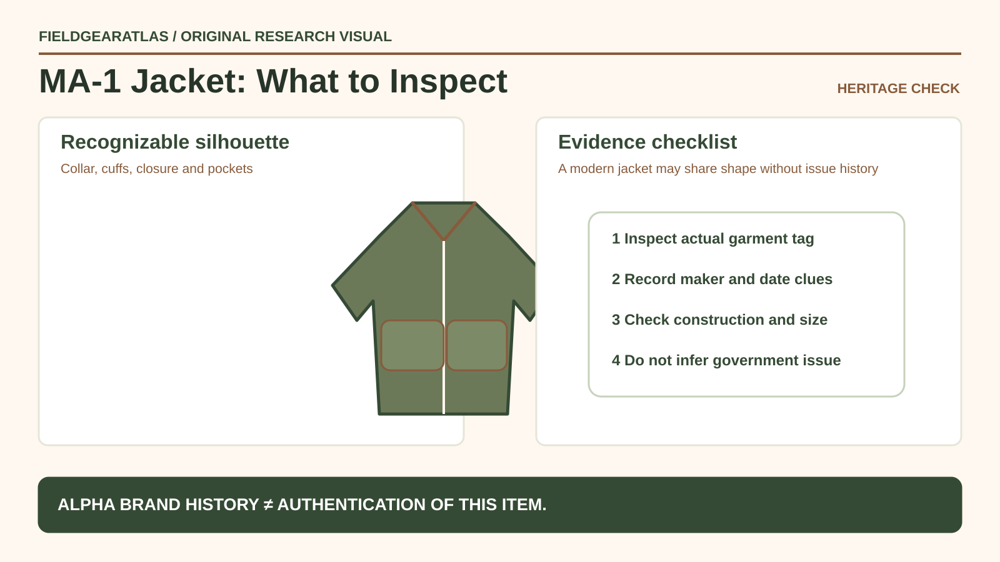

# MA-1 Flight Jacket: Identify Construction and Provenance

*Conceptual research graphic created for FieldGearAtlas. No specific commercial product or hands-on test is represented.*

**Quick answer:** If you are researching an **MA-1 flight jacket**, inspect its silhouette, shell and lining materials, collar/cuffs, closures, pockets and maker labels. Those details help distinguish styles and later reproductions, but **no single orange lining, sleeve pocket or tag proves military issuance**.

## Start with the actual question: style, construction or provenance?

Buyers sometimes use “authentic MA-1” to mean three different things: a convincing classic look, a garment produced under a documented specification, or a specific issued vintage example. They require different evidence. A modern commercial MA-1-inspired jacket can be perfectly legitimate as clothing without being a piece of historical government equipment.

[Alpha Industries' heritage material](https://www.alphaindustries.com/pages/fw26-heritage) describes the MA-1's recognizable jet-era design vocabulary, while its [current slim-fit MA-1 page](https://www.alphaindustries.com/collections/men-flight-and-bomber-jackets/products/mjm44530c1-mens-ma-1-slim-fit-bomber-jacket) illustrates that modern fit, materials and branding can depart from an older pattern. These are manufacturer descriptions, not independent certification of historical examples.

## Six components worth inspecting

| Area | What to check | Why the detail matters |
|---|---|---|
| Silhouette | Short, gathered waist and sleeve shape | Helps identify the bomber-jacket family |
| Collar/cuffs/hem | Rib material and elasticity | Affects closure, condition and fit |
| Shell and lining | Fiber content, condition, finish | Determines care needs; appearance alone proves little |
| Closure | Zipper function, flap and wear | Affects comfort and garment condition |
| Pockets | Location, opening size and stitching | Supports construction comparison, not provenance by itself |
| Label | Maker, style, fabric, care and any contract data | Needed before claims about exact model/era |

Reversible orange lining is often associated with MA-1 heritage styling, but it is not universal across all commercial variants and is not a proof of military issuance. Modern jackets may have patches or proprietary branding added for fashion.

**Do not confuse design origins with one manufacturer's contract date.** Alpha Industries' official company timeline says it won MA-1 contracts in **1963**; its brand history also describes the broader MA-1 design lineage beginning earlier. “MA-1 from the 1950s” is therefore not evidence that a particular garment was made by Alpha in that decade. A brand heritage page is not independent proof of issue or an individual garment's year of manufacture.

## Fit is part of authenticity research, too

A vintage-looking jacket with dramatically altered sizing can be a modern interpretation. Record actual chest, body and sleeve measurements rather than assuming an “original fit” marketing term has a standardized dimension. Try the jacket with intended layers; the short hem can lift when reaching overhead or while wearing a backpack hipbelt.

For practical use, evaluate whether cuffs are too tight over gloves and whether the front closure can move freely when seated. A fragile vintage knit cuff may matter more to a buyer than the exact shade of olive on the shell.

## Check a listing without relying on the hero image

1. Request clear front, back, label, lining, pocket and zipper photographs.
2. Ask for a ruler or measurements, not just “fits like medium.”
3. Find out whether the garment is contemporary production, vintage commercial stock or claimed government issue.
4. If issued status is claimed, ask for reliable contract documentation and assess consistency with the garment.
5. Treat condition comments separately: repairs and replaced zippers do not automatically make a jacket worthless, but should be disclosed.

## A common buying error

A listing shows a sleeve zip pocket and bright lining, calls the garment “US Air Force MA-1 original,” and offers no legible label. Those features establish only a **style resemblance**. A sensible next step is requesting the label and garment history, not inventing an issuing unit or production date from the photograph.

## Read contract dates as supplier history, not as the jacket’s birth certificate

Alpha Industries says it received its first Department of Defense contracts for the **MA-1** and **N-2B** in **1963**, while its first N-3B contracts are dated **1959** in the company's timeline. Those dates document **Alpha's contracts**, not the first creation date of every jacket design or the manufacture date of a garment sold as “MA-1.” [Alpha Industries — Company History](https://www.alphaindustries.com/pages/history-of-alpha).

For a jacket listing, record the exact wording on the label, construction differences and seller provenance separately. A modern fashion jacket sharing a design code should not inherit a government-issue claim solely from the original silhouette.

## Practical decision example: Use maker dates precisely

When comparing MA-1 descriptions, distinguish a style’s historical development from the year a particular brand began making it, and from the manufacturing date of a specific jacket. Examine label, zipper, pocket layout and maker evidence rather than dating the garment from a modern marketing page.

**Write down before choosing:** Civilian reproductions can be useful clothing without being authenticated military-issued examples.

## FAQ

### Is every MA-1 jacket reversible?

No. Reversible design depends on the model. Verify closure, pocket placement and manufacturer's instructions.

### Can I use MA-1 styling as cold-weather protective equipment?

Do not assume fashion or heritage styling supplies a certified thermal, flame-resistant or flight-safety function. Check product-specific claims.

### Does a manufacturer heritage page authenticate a thrift-store jacket?

No. It explains a design lineage but is not a certificate for a particular physical garment.

## Sources and limitation

This is an identification framework. No specific jacket was examined or dated by FieldGearAtlas.

- [Alpha Industries — Heritage](https://www.alphaindustries.com/pages/fw26-heritage)
- [Alpha Industries — Contemporary MA-1 Product Construction](https://www.alphaindustries.com/collections/men-flight-and-bomber-jackets/products/mjm44530c1-mens-ma-1-slim-fit-bomber-jacket)

### Additional reference for evidence scope

- [Alpha Industries company contract history — 1963 MA-1 award](https://www.alphaindustries.com/pages/history-of-alpha). This reference is used for the limited claim described above, not as independent authentication of any product.
