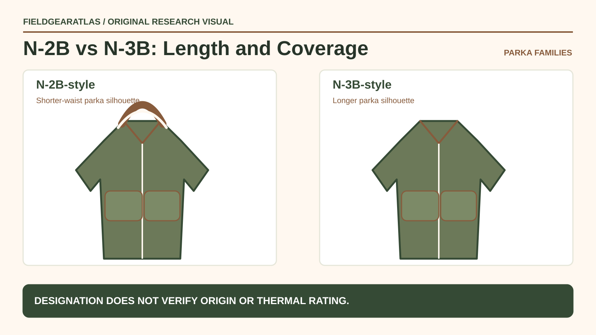

# N-3B vs N-2B Parka: Length and Layering Differences

*Conceptual research graphic created for FieldGearAtlas. No specific commercial product or hands-on test is represented.*

**Quick answer:** The **N-3B** is commonly associated with a long “snorkel parka” shape, while the **N-2B** uses a shorter, waist-length outerwear silhouette. Both draw on cold-weather flight-clothing heritage, but a modern jacket's actual warmth depends on its fill, construction and fit—not on the code in its product name.

**Historical attribution matters:** The short N-2B silhouette predates Alpha Industries' 1963 N-2B contract according to the company's own historical account. The date of a maker's award is not necessarily the invention date of the garment pattern. For a secondhand jacket, compare its period label and contract documentation rather than dating it from the style designation.

## Why length is more important than the similar names

The [Alpha Industries heritage timeline](https://www.alphaindustries.com/pages/fw26-heritage) presents the N-3B as a long cold-weather parka and the N-2B as a short-waist parka design with a distinctive hood. The manufacturer's current fashion products may reinterpret those details. Treat this history as context, not certification of every jacket marketed under either designation.

## Compare the most visible construction choices

| Question | N-3B-style parka | N-2B-style jacket |
|---|---|---|
| Body coverage | Longer, extending below the waist | Cropped or waist-oriented |
| Hem arrangement | Longer parka body | Shorter gathered waist on many models |
| Hood | Prominent cold-weather silhouette | Hood arrangement varies by model/version |
| Sitting and vehicle access | Longer coat can bunch when seated | Shorter length may interfere less |
| Areas to measure | Overall back length, chest, hood and sleeve | Waist band, chest, hood and sleeve |
| Protection claim to verify | Actual insulation and weather resistance | Actual insulation and weather resistance |

A short jacket can be comfortable for moving in and out of vehicles, but it does not shield the thighs as a longer garment might. Conversely, a long parka may feel cumbersome under certain backpack belts. The actual fit matters.

## Inspect the hood carefully

A hood can be a major factor in comfort, field of view and neck movement. Try looking left and right with the hood raised. Check whether fur-like trim, drawcords or detachable elements obstruct sight, catch on nearby equipment or cannot be secured safely. A decorative “snorkel” appearance is not evidence of tested cold protection.

Inspect how the hood and collar interact. If a jacket is second-hand, ask whether trim or lining pieces are original, replaced or missing. Compare the component to maker instructions before claiming a particular production version.

## Check warmth by system, not nostalgia

[REI's layering guide](https://www.rei.com/learn/expert-advice/layering-basics.html) separates moisture-managing base layers, insulating middle layers and weather-blocking shells. A long vintage-style parka may have insulation and shell functions combined; that does not negate the need to evaluate moisture, wind and the clothing worn underneath.

A thick-looking coat is not automatically waterproof or suitable for all subzero conditions. Ask the seller for material specification, fill information and any legitimate test data. Leave unverified temperature claims out of the buying decision.

## Three reader scenarios

**Walking and waiting outdoors:** Long coverage may be desirable, provided the shell is comfortable and the hood can be adjusted without blocking vision.

**Frequent vehicle travel:** A shorter N-2B-style silhouette may be easier around seats and belt lines, although this varies with body shape.

**Vintage collection:** Label consistency, construction, hardware, liner and trim history matter more than an unverified “original military” label in a listing.

## A purchase inspection checklist

- Photograph or request the entire coat laid flat, front and back.
- Measure body length and hood opening as well as chest/sleeve.
- Check zipper function, cuff/waist elasticity, lining attachment and wear.
- Inspect claims about material composition and waterproofing separately.
- If buying surplus, distinguish a period style from documented issued provenance.

## Check the supplier-history date before dating the jacket

Alpha Industries dates its first **N-3B** Department of Defense contracts to **1959** and states it was awarded an **N-2B** contract in **1963**. That provides defensible manufacturer-history context for the two designs; it does not establish that an individual jacket was made in either year. [Alpha Industries — Company History](https://www.alphaindustries.com/pages/history-of-alpha).

A seller's “1963 N-2B” label should trigger a **label/provenance request**, not a conclusion based on style. Ask for both faces of any tags, readable contract wording and measurements of the actual garment. Do not present design-code history as independent authentication.

## Practical decision example: Two lengths, two use cases

A shorter N-2B-style design and longer N-3B-style design can differ in coverage when seated or layered. Measure a specific garment instead of assuming every reproduction matches period specifications. Inspect hood design, cuff details, actual insulation and condition before making warmth claims.

**Write down before choosing:** Manufacturer history is not a thermal certification or a guarantee of official issue.

## FAQ

### Is N-3B always warmer than N-2B?

No universal temperature comparison follows from the name alone. Insulation, fit and fabric vary across versions and modern manufacturers.

### Does the shorter N-2B automatically fit better for active use?

Not for everyone. Hem length is one variable among sleeve mobility, layers and wearer proportions.

## Evidence note

Descriptions concern general silhouettes and manufacturer-published history. FieldGearAtlas has not tested these garments or verified individual surplus examples.

- [Alpha Industries — Heritage Timeline](https://www.alphaindustries.com/pages/fw26-heritage)
- [REI — Layering Basics](https://www.rei.com/learn/expert-advice/layering-basics.html)

### Additional reference for evidence scope

- [Alpha Industries N-2B heritage account](https://www.alphaindustries.com/blogs/military/history-of-alpha-jackets). This reference is used for the limited claim described above, not as independent authentication of any product.
