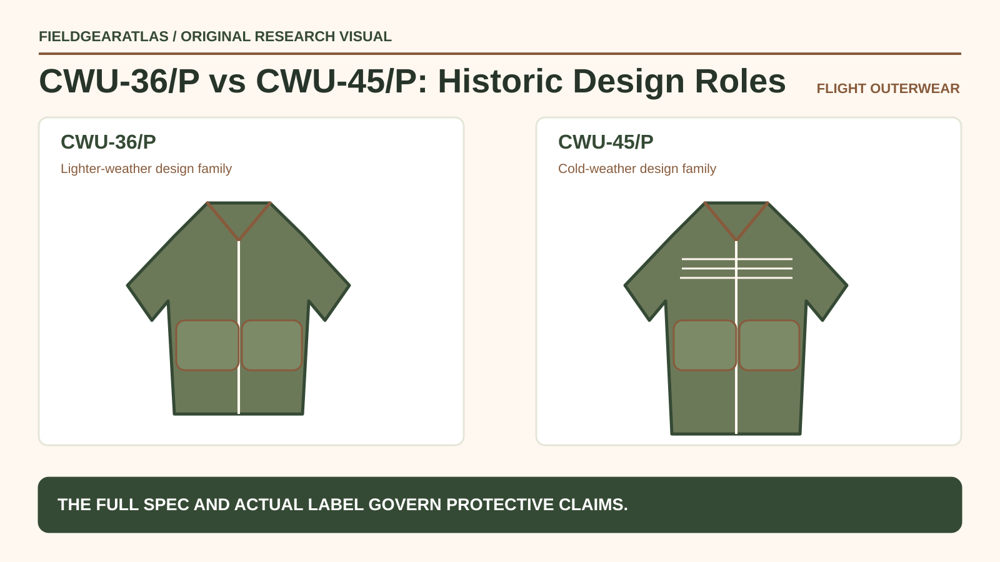

# CWU-45/P vs CWU-36/P: Insulation and Label Checks

*Conceptual research graphic created for FieldGearAtlas. No specific commercial product or hands-on test is represented.*

**Quick answer:** The **CWU-45/P** and **CWU-36/P** share a recognizable flight-jacket family, but historically the 45/P is associated with a more insulated cold-weather arrangement while the 36/P is a lighter-weather variant. The differences are not proof that every modern commercial reproduction uses the same protective fabric or is authorized for aviation work.

## What the designations help explain

Flight-jacket designations carry more meaning when tied to an actual period specification and garment label. A retailer may sell a “CWU-45 inspired” jacket made from ordinary synthetic fashion fabrics rather than the fibers associated with particular military flight-clothing specifications.

**Contract chronology is not individual authenticity:** Alpha Industries' company timeline describes a **1980** Defense Department contract for CWU-36/P and CWU-45/P Nomex jackets. That manufacturer-specific date does not establish the age or specifications of every garment carrying either label. Flame resistance is a **material- and construction-specific performance claim**; a civilian “heritage” version should not be assumed to have the documented properties of a qualifying military article. That can be a legitimate streetwear product, but it is not automatically equivalent to the original protective garment.

The [Alpha Industries heritage timeline](https://www.alphaindustries.com/pages/fw26-heritage) describes the 45/P's position in flight-jacket history. DLA QuickSearch lists the [MIL-J-83382 specification for the CWU-36/P summer flight jacket](https://quicksearch.dla.mil/qsDocDetails.aspx?ident_number=33675) and [MIL-J-83388 for the CWU-45/P cold-weather jacket](https://quicksearch.dla.mil/qsDocDetails.aspx?ident_number=33686). These are separate specification records, not evidence that a particular retail garment complies with either document. For any professional aviation or protective use, inspect the applicable full technical requirements and actual garment documentation.

## Compare the inspection priorities

| Area | CWU-45/P family | CWU-36/P family |
|---|---|---|
| Historic insulation emphasis | More insulated variant | Lighter-weather variant |
| Outer styling | Similar family with pockets and collar | Similar family with pockets and collar |
| Main difference to inspect | Interior quilting/fill and label | Lighter lining and label |
| Safety claims | Require exact garment and standard evidence | Same requirement |
| Civilian availability | Reproductions vary widely | Reproductions vary widely |

**Do not confuse lower insulation with poor quality.** A lighter-weight version serves a different thermal design objective. For ordinary walking, fit and clothing layers may matter more than matching a period flight uniform.

## How to review a product listing

First, distinguish **original issue**, **contract reproduction**, and **style-inspired civilian jacket**. An item may use the CWU-45/P name even if its fiber content, fit and construction depart from period military garments. Request readable photographs of the actual tag and interior—not just a catalog photograph of the outer shape.

Check the composition of shell, lining and fill. Verify whether flame-resistant claims are documented for that exact product and use case. A label such as “Nomex-style” does not constitute material certification. Some current garments use visual design cues with no aviation safety claim at all.

Second, record measurements. Chest, sleeve, shoulder and body length can differ between issue-style and modern slim silhouettes. Compare actual dimensions with a garment you wear comfortably over intended layers.

## A safe way to assess fit

Wear a normal base or midlayer and close the jacket. Reach overhead, turn and sit. Check whether knit cuffs remain comfortable and pockets stay accessible. For layering decisions, [REI's clothing-system guide](https://www.rei.com/learn/expert-advice/layering-basics.html) distinguishes moisture management, insulation and weather protection; no single flight-jacket designation completes that whole system.

## Collector scenario: the missing label

A used jacket is advertised as a “real CWU flight jacket” based on two front pockets and a short collar. Its tag is missing. You may describe it as **CWU-style** based on silhouette, but cannot establish issue provenance or fiber certification from those features alone. A seller should provide separate documents if stronger claims are made.

## Practical decision example: Treat designation and provenance separately

For a CWU-36/P versus CWU-45/P comparison, distinguish original specification or documented component designation from later retail styling. If protective properties matter, request label and garment-specific documentation rather than inferring them from “CWU” in the title.

**Write down before choosing:** A photograph of a green flight jacket is insufficient to prove original material, flame resistance or issue history.

## FAQ

### Which is the warmer historical design?

Generally the CWU-45/P family has the more insulated historical arrangement, but compare the *specific garment's* construction before making a use decision.

### Is every CWU 36/P or 45/P flame resistant?

No. The name used in a retail listing is not a certification. Verify material and appropriate documentation.

### Do both jackets fit identically?

No guarantee. Sizing, pattern and revisions differ among manufacturers and reproductions.

## Research transparency

No fabric testing, garment dating or protective certification was performed by FieldGearAtlas. Historical and merchant claims are attributed rather than independently proven.

- [Alpha Industries — Heritage](https://www.alphaindustries.com/pages/fw26-heritage)
- [DLA — CWU-36/P summer flight jacket specification](https://quicksearch.dla.mil/qsDocDetails.aspx?ident_number=33675)
- [DLA — CWU-45/P cold-weather jacket specification](https://quicksearch.dla.mil/qsDocDetails.aspx?ident_number=33686)
- [REI — Layering Basics](https://www.rei.com/learn/expert-advice/layering-basics.html)

### Additional reference for evidence scope

- [Alpha Industries company timeline — CWU contract chronology](https://www.alphaindustries.com/pages/history-of-alpha). This reference is used for the limited claim described above, not as independent authentication of any product.
