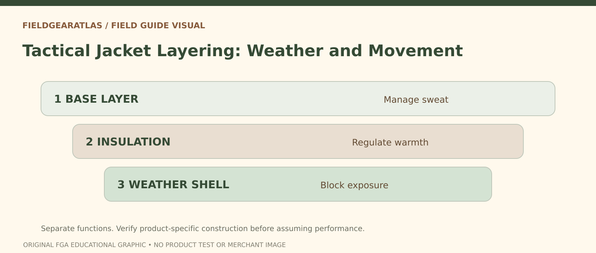

# Tactical Jacket Layering: Base, Insulation and Shell

*Conceptual research graphic created for FieldGearAtlas. No specific commercial product or hands-on test is represented.*

**Quick answer:** Effective tactical or outdoor jacket layering separates **moisture management, insulation and weather protection**. You do not always need three jackets. You need a combination that can be changed as movement, wind, precipitation and temperature change. A heavy-looking shell is not a substitute for an insulating layer, and a warm fleece is not necessarily windproof.

## Assign each layer one primary job

[REI's layering guidance](https://www.rei.com/learn/expert-advice/layering-basics.html) describes a next-to-skin layer that helps manage moisture, a middle layer that retains warmth and an outer shell that helps resist wind or rain. Some garments combine roles, so count **functions** rather than pieces of clothing.

For example, someone walking uphill may need less insulation while moving than during a stop. Wearing all available layers from the start can create excess perspiration, which changes comfort when activity slows.

## The layer matrix

| Layer or function | Main question | What a label doesn't prove |
|---|---|---|
| Base | Does fabric work next to damp skin? | “Performance” without fiber and drying information |
| Insulation | How much warmth for expected activity? | That thick always means better |
| Wind barrier | Does fabric reduce convective cooling? | That it is waterproof |
| Rain shell | Are fabric and construction designed for wet weather? | That any DWR finish makes it fully waterproof |
| Ventilation | Can heat and moisture escape? | That zippers alone prevent overheating |

Water resistance, waterproof claims, membrane construction and seam sealing are separate details. Avoid presenting a manufacturer's waterproof rating as an independent test unless the test and product applicability are documented.

## Three common scenarios

**Mild, active walking:** A moisture-managing base and light wind layer may be enough, depending on conditions. Carry another suitable layer if the forecast and route justify it.

**Cold start, sustained effort:** Begin with adaptable insulation; remove or vent before overheating. [NPS winter guidance](https://www.nps.gov/articles/winterweather.htm) specifically encourages removable layers rather than staying in the same clothing throughout a trip.

**Cool rain with frequent stops:** A weather shell and accessible insulation are valuable, but ensure outer layers have room for the insulation beneath and that cuffs and hem remain comfortable while moving.

These examples guide decisions; they are not temperature prescriptions.

## Test the complete arrangement

Put on the intended base, middle and outer layers together. Reach overhead, crouch and wear your backpack. Check whether the shell squeezes the insulation, whether shoulder seams collect under straps, whether cuffs overlap gloves properly and whether you can reach ventilation zips while carrying the pack.

If the jacket is used around a work harness or issued equipment, follow the equipment provider's requirements. A civilian layering article cannot certify compatibility with protective systems.

## Mistakes that matter more than jacket branding

- **Using cotton next to skin for prolonged wet cold without accounting for moisture.** NPS recommends suitable wool/synthetic layers in cold, wet conditions; material choice should match the activity.
- **Buying a shell too small for its planned middle layer.** Restriction and compressed insulation can reduce the system's practical value.
- **Confusing waterproof fabric with waterproof garment construction.** Seams, zippers and hood fit matter.
- **Ignoring rest stops.** A jacket system should be adjustable when exertion changes.
- **Assuming military-style equals regulation-approved.** Fit, weather properties and authorization are separate claims.

## Three-layer systems are roles, not a uniform rule

For outdoor clothing, **base layer** primarily manages moisture near skin, **midlayer** primarily contributes insulation, and **shell** primarily controls exposure to wind or precipitation. REI's layering guidance is explicit that clothing selection depends on *conditions, effort and the individual*, not a permanent three-garment recipe. A waterproof shell worn during high output can still feel clammy if the system cannot shed enough moisture.

**Decision example:** On a cool dry walk, the base and a light outer layer may be enough. At a cold rest stop, an insulating midlayer may become important. When rain arrives, a weather-resistant shell suited to the expected precipitation may matter more than adding another warm layer. The task is to **adjust layers as conditions change**, not to claim that every 'tactical' jacket belongs to a fixed order in every climate. Check model-specific care instructions and avoid making unsupported flame-resistance or protective-equipment claims.

## Practical decision example: Build for activity, not a fixed layer count

A strenuous walk in mild rain may require different ventilation than standing still in wind. Assign a moisture-management role to the base layer, insulation to a midlayer if needed, and wind/rain protection to the outer shell. Carry enough protection for foreseeable conditions without claiming one jacket combination is universally warm.

**Write down before choosing:** Keep fabric, ventilation and weather limits specific to the products actually used.

## FAQ

### Should insulation go outside the rain jacket?

Usually a normal layering system places insulation inside an outer weather shell, but follow your garments' specific design and environmental requirements. Specialized systems vary.

### Does a windbreaker make a raincoat unnecessary?

No. Wind resistance and sustained rain protection require different construction claims.

### Is three-layer clothing always better?

No. The number of garments is not the goal; adaptable moisture, warmth and weather control is.

## Source and testing statement

This guide provides a clothing-system framework. No jacket has been field-tested by FieldGearAtlas for this article.

- [REI — Layering Basics](https://www.rei.com/learn/expert-advice/layering-basics.html)
- [NPS — Be Winter Ready](https://www.nps.gov/articles/winterweather.htm)
- [NPS — Winter Hiking Tips](https://www.nps.gov/articles/000/winterhikingtips.htm)
