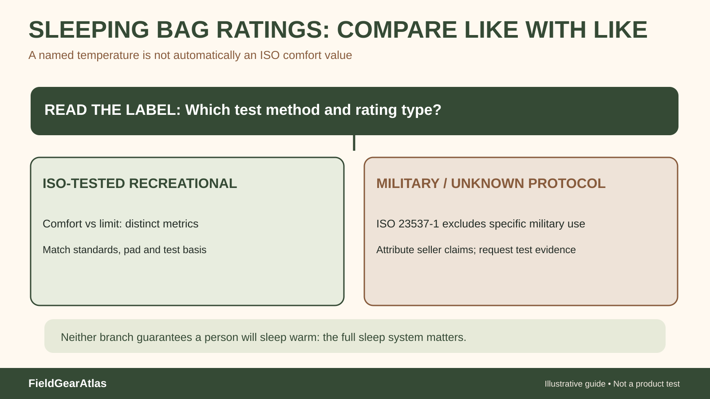

# Sleeping Bag Temperature Ratings: Comfort, Limit and Military-System Exceptions

*Original conceptual infographic. Not a tested model or product performance result.*

**Quick answer:** For an adult recreational sleeping bag with a valid ISO/EN test label, the **comfort** rating and **limit** rating describe different standardized thermal reference points. Neither promises that a particular person will sleep comfortably at the stated temperature. The bag works together with a sleeping pad, clothing, shelter and sleeper. Most importantly for military-gear shoppers: the scope of ISO 23537-1:2022 specifically **excludes sleeping bags intended for particular military uses**, so do not automatically read a military modular sleep system's claimed temperature like an ISO-tested recreational bag.

A common buying mistake is treating one number printed on a stuff sack as a weather forecast. A temperature rating is a testing or manufacturer claim, not a warranty against cold, and two products may publish numbers using different methods.

## First identify what kind of rating you are reading

| Label or statement | What it can mean | What to verify |
|---|---|---|
| ISO 23537-1 comfort | Standardized adult recreational-bag test reference aimed at comfort | Exact standard/version, model and stated comfort value |
| ISO/EN limit | A different reference point under the standard, not the same as comfort | Whether the number shown is limit rather than comfort |
| 'Rated to 20°F' with no method | May be a manufacturer estimate | Ask for test method, assumptions and conditions |
| Military modular system temperature claim | May describe a combination of components, specific clothing or an operational scenario | System documents, compatible layers and manufacturer's limitations |
| 'Extreme' or 'survival' label | Not interchangeable with comfort | Never use as a routine comfortable-sleep target |

The **presence of a number** does not prove it was tested to ISO. Check the label wording and the manufacturer's published documentation. Temperature claims about a combined system also cannot be transferred to one component in isolation.

## What ISO 23537 actually covers

ISO 23537-1:2022 specifies labeling and test methods for adult recreational sleeping bags in its scope, including thermal, dimensional and mass requirements for bags intended for limit temperatures at or above −20°C. The standard states it does not apply to sleeping bags intended for specific purposes such as military use or extreme-climate expeditions. This is an especially important distinction for FieldGearAtlas because users encounter both civilian camping bags and military surplus sleep components.

A military bag might still have useful manufacturer or government specifications, but those must be evaluated under the correct document, not silently converted into an ISO comfort number.

**Scope check before any temperature table:** ISO 23537-1:2022 explicitly describes adult recreational sleeping bags intended for specified limit temperatures and **excludes bags designed for military-specific use or extreme climate-zone expeditions**. If a military sleep-system vendor quotes a comfort or limit number without its actual test regime, report it as an attributed seller/manufacturer claim—not as an ISO-derived rating. Do not compare it numerically as if it came from the same protocol as a tested recreational bag. A surplus item's damaged insulation, missing components or age also affects what can reasonably be inferred from an original specification.

## Your sleeping pad is part of the insulation system

Warmth is not determined by the bag alone. Lying on the ground compresses the insulation underneath the body; a sleeping pad slows heat transfer to the ground. A pad's **R-value** represents resistance to heat flow; within comparable tested methods, higher R-values offer more insulation. It is not a numerical temperature guarantee and should not be converted into a personal warmth prediction without further assumptions.

REI's consumer guidance describes the sleeping system as the bag, pad and sleeper's clothing. When comparing bags, note the pad used for testing or recommended by the maker. A warm-looking bag on an inadequately insulated pad can still be uncomfortable in cold conditions.

## A five-part comparison before a trip

1. **Confirm test method.** Identify whether comfort or limit is stated and whether the product is within that standard's scope.
2. **Check your pad.** Record the pad's tested R-value rather than using its thickness or color as a warmth estimate.
3. **Account for your sleep tendencies.** People have different comfort thresholds. Treat a rating as comparison information, not a personalized prediction.
4. **Inspect the whole system.** Look at draft collar, hood, zipper closure, ground moisture control and suitable shelter conditions.
5. **Plan conservatively.** Use conditions, escape options and a backup layer suited to the route. Do not plan around 'extreme' survival numbers.

For a military modular system, confirm which bag, patrol layer, intermediate layer, bivy and pad are included, because seller listings may omit pieces. The fact that parts attach together does not validate a new combined rating.

## Worked hypothetical example

A shopper compares a recreational bag labeled '20°F limit' with another labeled '20°F comfort.' Those labels describe different test reference points; a direct same-number comparison is not like-for-like. A separate military surplus bag advertised as '20°F' without test evidence cannot automatically join the comparison table as equivalent. The safe conclusion is **not enough comparable information**, rather than a forced ranking.

## Practical decision example: Check the label before comparing temperatures

A retailer lists two bags at the same number of degrees, but one says “comfort” and the other gives a generic marketing temperature. You cannot compare them as equivalent ratings without the test method and rating type. For a recreational ISO-rated bag, distinguish comfort and limit; for a military-specific system, seek its own documentation.

**Write down before choosing:** A sleeping pad and shelter matter too; no number guarantees a safe night for every sleeper.

## Common questions

### Is the comfort rating always the temperature I will feel comfortable at?

No. It is a standardized reference point within the applicable test framework. Individual warmth depends on the sleeper and system.

### Can two sleeping pads' R-values be added?

Stacking pads can increase total resistance, and consumer guidance often treats comparable R-values as additive approximations. Actual performance can depend on fit, placement and construction. Avoid presenting a calculated value as laboratory verification of a particular pairing.

### Can I use ISO comfort ratings for military surplus sleeping bags?

Only if there is applicable documented testing for the particular product. ISO 23537-1 expressly excludes sleeping bags intended for specific military uses from its scope; do not assume compliance from marketing language.

## The standards decision in one example

A recreational sleeping bag sold with an **ISO 23537-1:2022** comfort figure can be compared on that defined basis with a similarly documented recreational bag. The same standard's **scope expressly excludes sleeping bags intended for specific military uses**. [ISO — 23537-1:2022](https://www.iso.org/standard/82789.html). REI explains that pad insulation, clothing and individual differences also affect real-world comfort. [REI — Sleeping Bag Temperature Ratings](https://www.rei.com/learn/expert-advice/understanding-sleeping-bag-temperature-ratings.html).

**Decision:** Do not put a surplus “rated to 20°F” claim in the same comparison column as an ISO comfort value without the surplus product's actual test method. Label the former *manufacturer/seller claim, test protocol unknown* until evidence is supplied. Neither rating promises personal safety in severe cold.

## Primary sources and editorial boundary

- [ISO 23537-1:2022 scope and abstract](https://www.iso.org/standard/82789.html) — the standard's scope and exclusions.
- [REI — How to choose a backpacking sleeping bag](https://www.rei.com/learn/expert-advice/sleeping-bag-backpacking.html) — interpretation of comfort and limit for consumer products.
- [REI — Sleeping pad R-value](https://www.rei.com/learn/expert-advice/sleeping-pads.html) — pad insulation and sleep system considerations.

**Transparency:** FieldGearAtlas has not performed a sleep-lab test or military qualification test. This guide explains documented rating conventions and their limitations; it does not give individual cold-exposure or survival advice.
