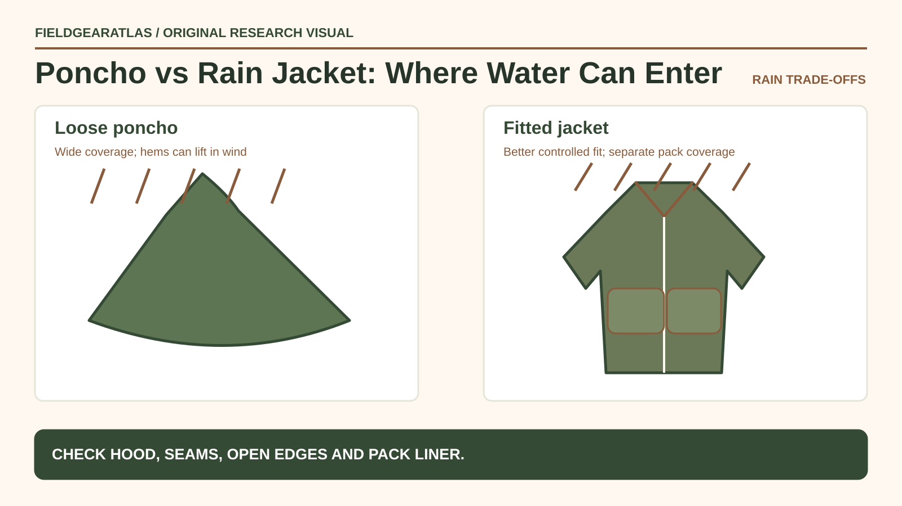

# Poncho vs Rain Jacket: Which Works Better in Wind and Rain?

*Technical explanation diagram created for FieldGearAtlas. Not a photograph of a commercial product.*

**Quick answer:** A **poncho** can offer generous draped coverage and a simple way to shelter part of a backpack, but loose fabric is vulnerable to wind and can interfere with movement. A **fitted rain jacket** generally secures better in wind and allows more deliberate venting, while normally leaving the lower body and backpack needing separate protection.

Neither garment is a magic solution to staying dry. Some wetness is external rain; some is condensation or sweat accumulating inside a poor ventilation setup.

## Compare the coverage paths, not just 'waterproof' labels

| Situation | Poncho question | Jacket question |
|---|---|---|
| Windy exposed trail | Can the hem be secured without restricting safe movement? | Does the hood seal and remain usable while turning the head? |
| Rucksack or daypack | Does the cut truly cover the *loaded* bag? | Is there a pack cover or liner for gear? |
| Humid uphill travel | Does open ventilation offset loose flapping? | Are pit zips and front venting accessible? |
| Stops and shelter | Can it serve as quick broad overhead cover as designed? | Is it easier to keep on during frequent movement? |
| Brush and tight spaces | Will loose fabric snag? | Does the close fit reduce snagging? |

REI notes that many basic waterproof ponchos are not highly breathable and can be less effective in wind. Meanwhile, waterproof/breathable jacket fabrics still require managing perspiration; a membrane does not make heat and sweat disappear.

## The exposed edge test

Imagine rain arriving from the side rather than falling straight down. A loose poncho hem can lift, exposing the wearer or the bag. A properly fitting rain jacket shields the torso but allows water to run toward pants, gloves and pack straps. Inspect cuffs, hood fit, hem length and direction of runoff before deciding what your system protects.

A pack can also change the effective coverage: a rain poncho sized for a person alone may ride up when draped over a tall backpack. Test with the full pack indoors rather than relying on a folded product photo.

## Ventilation is a whole-system question

Waterproof fabrics resist liquid water to varying degrees, but comfortable movement depends on vapor transfer, vents, activity and weather. If wetness collects on the inside after hard exertion, it may be sweat or condensation rather than a leaking fabric. A rain jacket with pit zips might permit deliberate airflow; an open poncho may allow strong convection on a calm walk but flap dramatically in wind.

**Example (illustrative):** For a gentle walk along a sheltered campsite, a broad poncho may be convenient. For a long exposed climb in crosswind, a fitted jacket and separate pack waterproofing may be easier to control. Both conclusions assume actual product construction and fit are appropriate.

## What to confirm before buying

Check seam sealing, fabric claims, hood adjustment, actual hem coverage and packed dimensions. If the manufacturer quotes hydrostatic-head or breathability figures, verify the test method—different claims are not always directly comparable.

Try the gear over the layers and backpack you plan to use. Walk, raise your arms, turn and simulate reaching for your phone or map. Check that the poncho doesn't obstruct your footing or that the jacket doesn't ride up under shoulder straps.

## Practical decision example: Follow the water paths

A loose poncho may cover part of a pack but expose openings to gusting wind; a fitted jacket may stay in place better but leave the backpack needing separate protection. Examine cuffs, hood, side openings and how water can flow toward your clothing during the activity.

**Write down before choosing:** Choose by weather, motion and coverage needs; neither garment name guarantees waterproof fabric or seams.

## FAQ

### Does a poncho keep a backpack waterproof?

Not automatically. The design must cover the actual pack, and wind can expose fabric edges. A pack liner may still be warranted for critical dry items.

### Is every rain jacket breathable?

No. Some are waterproof but effectively nonbreathable, while other systems use membranes or coatings and ventilation features.

### Can I use a rain poncho as a shelter?

Only when the specific model is designed and properly equipped for that use; do not assume every rain poncho has suitable tie-outs or structural strength.

## Sources and transparency

The guide explains equipment-design tradeoffs drawn from REI's rainwear education. No waterproofing tests of commercial ponchos or jackets were performed by FieldGearAtlas.

## Research references

- [REI — How to Choose Rainwear](https://www.rei.com/learn/expert-advice/rainwear.html)
- [REI — How Rain Gear Works](https://www.rei.com/learn/expert-advice/rainwear-how-it-works.html)
