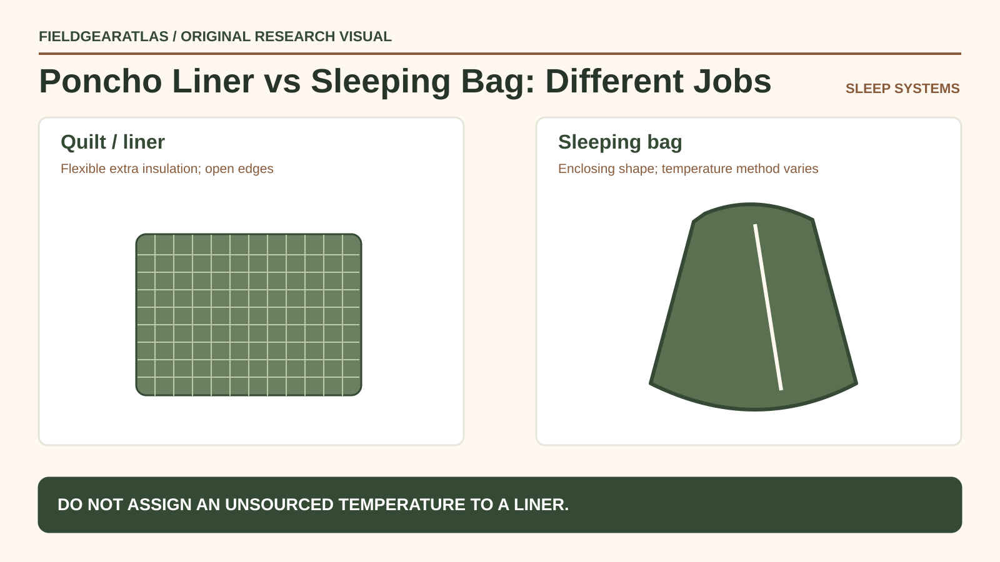

# Poncho Liner / Woobie: Uses and Limits

*Conceptual research graphic created for FieldGearAtlas. No specific commercial product or hands-on test is represented.*

**Quick answer:** A **poncho liner**, often nicknamed a *woobie*, is a lightweight quilted insulating piece commonly associated with military field equipment. It can provide adaptable comfort as a wrap or supplemental layer, but it is **not automatically a waterproof shelter, temperature-rated sleeping bag or complete cold-weather sleep system**.

## Why the name causes misuse

A poncho liner may be shown tucked inside a poncho, draped over gear or used as a blanket. These uses create a mistaken expectation that any item with that name will be a rugged all-in-one rain and sleeping solution. In reality, important properties depend on the liner's fiber, fill, stitching, edge finish, tie points and specific design. Modern commercial “woobie blankets” vary widely and may not match older government designs.

A separate poncho is usually an outer rain-protection garment or shelter component; a quilted liner mainly addresses a different function: insulation or comfort. Do not treat fabric photographs as proof of waterproofness.

## A function-by-function check

| Needed function | Is a liner alone enough? | What to verify |
|---|---|---|
| Light warmth while resting | It may help | Fill, size and actual conditions |
| Rain barrier | Do not assume | Published waterproof construction of separate shelter layer |
| Overnight sleeping insulation | Usually insufficient to classify alone | Complete bag/pad system and temperature context |
| Wind blocking | Design-dependent | Fabric construction and gaps when worn |
| Ground insulation | No substitute for a suitable pad | Sleeping pad and ground conditions |

Temperature numbers circulating on seller pages may have unclear methods or refer to combinations of products. A generic liner cannot honestly inherit a standardized sleeping-bag temperature rating.

**System-matching check:** Distinguish a standalone poncho liner/blanket from a specific military modular sleeping system. An insulation item named “woobie” is not automatically an interchangeable patrol bag, nor can the rating of a complete bag-plus-bivy system be assigned to a loose liner. Confirm the product label, exact components and applicable test evidence before presenting any cold-weather performance number.

## How to compare commercial versions

Inspect quilt spacing and whether fill migrates or clumps. Ask for overall dimensions, approximate manufacturer-reported weight, edge binding and attachment-point locations. A liner without the ties or fasteners required by a planned poncho arrangement may be much less practical than an equivalent blanket despite similar fabric.

Material labels such as “ripstop” tell you about weave configuration, not a universally measured tear strength or warmth level. Seek model-specific construction claims and avoid assuming one manufacturer uses another's dimensions.

## A sensible field setup

For a short rest on a dry mild-weather outing, a liner can be an easy comfort item. For an actual overnight trip, choose the sleeping pad, sleeping bag or insulation and weather shelter based on conditions. The [National Park Service's overnight hiking guidance](https://www.nps.gov/articles/hiking-safety.htm) includes a proper bag and pad among trip-dependent equipment; it does not position a poncho liner as a universal substitute.

The [REI layering guide](https://www.rei.com/learn/expert-advice/layering-basics.html) also helps explain the distinct roles of moisture management, insulation and an outer protective layer. The same conceptual separation applies when evaluating a loose quilt-like item outdoors.

## Four common mistakes

1. **Calling it waterproof:** Confirm the exact textile and construction; “water-resistant” and waterproof are not interchangeable.
2. **Assuming a temperature rating:** A blanket-like liner is not necessarily tested under a sleeping bag standard.
3. **Leaving the pad out:** Ground heat loss can remain significant regardless of the layer draped over the sleeper.
4. **Treating “military” as provenance:** A civilian clone or modern commercial variation is not evidence of a particular issued article.

## Practical decision example: Use a liner for the right job

A quilted poncho liner can serve as a flexible extra comfort layer, but its lack of a closed sleeping-bag shape makes it a poor substitute for a temperature-rated overnight system in uncertain cold conditions. Inspect fill, seams, attachment points and care instructions without inventing temperature claims.

**Write down before choosing:** “Woobie” is an informal name and not a standardized performance rating.

## FAQ

### Can I sleep in a woobie without a sleeping bag?

Conditions determine whether doing so is sensible; the liner alone should not be promoted as a temperature-rated sleep system. Consider shelter, pad, clothing and forecast.

### Does a poncho liner keep rain out?

Not by name. A compatible rain poncho or shelter layer may address water resistance, but attachment and waterproof claims need checking.

### Are all woobies the same size?

No. Verify the maker's dimensions and attachment points rather than trusting a generic term.

## Evidence note

This is a function and risk guide. FieldGearAtlas has not performed temperature, drying or water-entry tests on a commercial liner.

- [NPS — Hiking Safety](https://www.nps.gov/articles/hiking-safety.htm)
- [NPS — Ten Essentials](https://www.nps.gov/articles/10essentials.htm)
- [REI — Layering Basics](https://www.rei.com/learn/expert-advice/layering-basics.html)

### Additional reference for evidence scope

- [ISO 23537-1:2022 — limits of recreational sleeping bag ratings](https://www.iso.org/standard/82789.html). This reference is used for the limited claim described above, not as independent authentication of any product.
