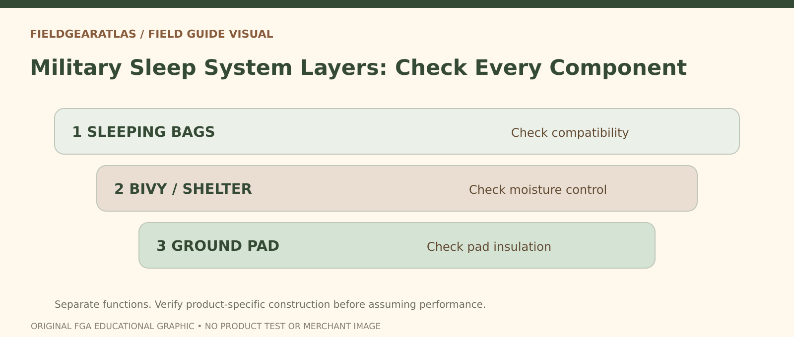

# Military Sleep System: Bags, Pad, Bivy and Fit

*Conceptual research graphic created for FieldGearAtlas. No specific commercial product or hands-on test is represented.*

**Quick answer:** A military-style modular sleeping system should be evaluated as **several components working together**: sleeping bag or bags, a suitable sleeping pad, an optional protective bivy/shell, and the shelter/environment. It is not enough to assume a “modular” set has one trustworthy temperature figure, especially when surplus components may be mismatched or missing.

**A documented reference configuration:** A U.S. Army equipment portfolio describes a particular Modular Sleep System assembly as a patrol sleeping bag, an intermediate cold-weather sleeping bag, a protective bivy cover and a compression storage sack. That **identifies a referenced configuration**, not every product called “military modular.” Other generations and listings may differ, and the ground-insulating pad may be separate from the bag set. Verify inventory against the exact system/version rather than silently promising four pieces with every “MSS” listing.

## Start with the actual documented system

The Defense Logistics Agency's [A-A-55262 Sleeping Bag, Modular description](https://quicksearch.dla.mil/qsDocDetails.aspx?ident_number=115790) outlines a specified modular system involving a patrol sleeping bag, an intermediate cold-weather sleeping bag and a compression stuff sack. That document is evidence for **that specification and its versions**, not a blanket claim about every product sold as “MSS” or “military sleep system.”

Commercial sets and surplus assortments can include differing bivy shells, pads, snaps, zipper layouts and generations. Before interpreting a rating, identify the actual components and whether they were designed to be used together.

## Four separate jobs in the system

| Component | Main function | Buyer question |
|---|---|---|
| Inner/patrol bag | Insulation for one range of conditions | Model, size, condition, intended layering |
| Additional insulated bag | More insulation when used compatibly | How do zippers and dimensions integrate? |
| Bivy or outer protective shell | Additional environmental barrier in specified configurations | Breathability, closure, fabric and condensation concerns |
| Sleeping pad | Insulation between sleeper and ground | Published R-value and width/length suitability |

Never treat a bivy shell as a substitute for ground insulation. A protective outer fabric may also trap moisture if ventilation and weather conditions are ignored.

## A compatibility inspection

Lay every component out and check garment or bag labels individually. Record its name, maker, size, reference or stock number where present, and observed condition. Confirm that zippers mate without forcing them, that inner and outer lengths are compatible, and that a sleeping bag is not jammed into a tight outer shell causing excessive compression.

If a listing shows only a compression sack, it does not prove that all named components are present. Request photographs of the complete unfolded assembly, closures, labels and repair areas. For used systems, inspect insulation migration, holes, odors, coatings and compromised zippers.

## Temperature labels require context

The interpretation of sleeping-bag temperature ratings depends on the test regime and scope. Standardized recreational ratings do not automatically apply to older military components or mixed surplus sets. A comparison must account for the complete arrangement, including pad and clothing. Consult the separate FieldGearAtlas Sleeping Bag Temperature Ratings guide once that article has been published.

Do not calculate a combined safe temperature by simply adding or subtracting published temperatures of two separate bags. Layering can change thermal behavior, but no universal arithmetic conversion follows from the names.

## Three scenarios

**Warm-weather sheltered camping:** One suitable bag and pad may be enough, depending on forecast and user needs. A complete multi-bag kit could add unnecessary bulk.

**Changing conditions:** Modular options may let a prepared user change layers. This only works if sizes and closures are truly compatible and the system has been inspected beforehand.

**Second-hand purchase:** Provenance, missing pieces and repair condition deserve more attention than the seller's unsupported lowest-temperature claim.

## Practical decision example: Inventory each physical sleep-system component

Before buying a military-style modular sleep kit, ask whether it includes the expected bags, bivy cover, closures, and a compatible pad. Photograph and label every component; check zippers, seams and evidence of damage individually. Two kits with similar names may have different components and condition.

**Write down before choosing:** A retailer description of “MSS” is not proof that the kit is complete or retains original performance.

## FAQ

### Does MSS mean the set has a bivy bag?

Not necessarily. Check the exact listing and documentation; “modular” can be used loosely in retail descriptions.

### Is an NSN proof an item was issued?

No. A stock number identifies a cataloged item of supply; it does not prove a specific physical example's service history.

### Can a military sleeping bag replace a pad?

No. The pad serves a distinct ground-insulation function and should be selected for conditions.

## Evidence limits

No sleep-system temperature testing has been carried out. Only the named DLA description is treated as documented specification evidence.

- [DLA ASSIST Quick Search — A-A-55262](https://quicksearch.dla.mil/qsDocDetails.aspx?ident_number=115790)
- [NPS — Hike Smart Overnight Equipment](https://www.nps.gov/articles/hiking-safety.htm)
- [REI — Layering Basics](https://www.rei.com/learn/expert-advice/layering-basics.html)

### Additional reference for evidence scope

- [U.S. Army — Modular Sleep System component description](https://cpeground.army.mil/Portals/53/files/PEO%20Portfolio%20pages-2018.pdf). This reference is used for the limited claim described above, not as independent authentication of any product.
