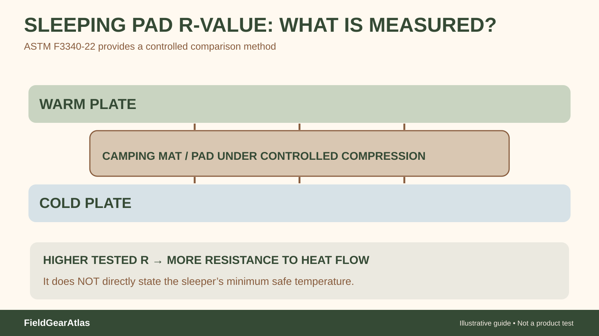

# Sleeping Pad R-Value: What the Number Really Tells You

*Technical explanation diagram created for FieldGearAtlas. Not a photograph of a commercial product.*

**Quick answer:** An R-value describes **resistance to heat flow through a sleeping pad**; a higher value generally indicates greater insulation against heat loss to the ground. It is *not* an air-temperature rating, a promise of comfort by itself or an interchangeable substitute for an insulated sleeping bag.

When cold ground pulls heat away from you, a high-loft sleeping bag compressed beneath your body cannot supply the same effective insulation as its uncompressed upper layers. A pad helps address that ground-contact pathway.

## What ASTM F3340 adds

ASTM **F3340-22** is a published test method for measuring thermal resistance of camping mattresses using a guarded hot plate. It helps make pad insulation claims more comparable when products are tested under the same method.

**Do not convert an R-value into guaranteed sleep temperature.** The cited test method addresses thermal resistance of camping mattresses, not the full user's cold-weather comfort. REI's sleeping-pad guidance explains the pad must be evaluated together with the bag, clothing and conditions; numeric climate bands are rough shopping guidance rather than a field promise. A hypothetical stack of pads must not be marketed as a verified model-level system test. The standard's own scope cautions that real-world heat transfer and the lab value may not correspond exactly, because posture, compression and other losses vary.

This matters for shopping: two manufacturers can advertise comfort in cold conditions, but if only one discloses a tested R-value with a named method, the evidence is not equal. Ask whether a number was measured using the stated standard, and check any conditions or exclusions.

## Two pieces of the sleep system, two different jobs

| Component | Primary job | Does not tell you |
|---|---|---|
| Sleeping pad | Insulate from and cushion the ground | Whether your head and torso will stay warm enough in wind |
| Sleeping bag or quilt | Manage thermal insulation around the body | Whether the compressed underside prevents ground loss |
| Shelter/bivy | Manage weather exposure and airflow | Guaranteed warmth at a specific temperature |
| Sleep clothing | Add insulation and manage moisture | A replacement for suitable pad-and-bag selection |

An apparently thick air pad can still have modest insulation if its construction permits internal air movement. Conversely, thin closed-cell foam can provide measurable resistance. **Thickness is not an R-value.**

## Why there is no one 'winter R-value' for everyone

Conditions differ: ground temperature, moisture, wind exposure, body size, sleeper physiology, clothing and the rest of the sleep system all affect comfort. A chart claiming that every person needs the same R-value at a given forecast low can create false certainty.

Use a pad's standardized rating as one input, then account for the environment and manufacturer's tested claims. If the setting is especially cold or remote, prefer conservative planning and equipment tested for the expected conditions; a worksheet cannot replace experienced judgment.

## A decision example

*Illustrative scenario:* A traveler owns a relatively warm sleeping bag but wakes with cold shoulders and hips whenever sleeping on frozen soil. Buying an even warmer bag may not address inadequate ground insulation. Inspecting the pad's tested R-value, its inflation state and ground-contact coverage is a more directed starting point. Conversely, a well-insulated pad does not compensate for a bag that is clearly inadequate above the body.

## Shopping checklist

- Identify whether the R-value is **tested to ASTM F3340** or simply a maker estimate.
- Confirm the exact model, size and revision tested.
- Check the pad's usable width for the intended sleeping position.
- Verify inflation, valve use, puncture repair and the risk of slipping off the pad.
- Plan for shelter conditions, moisture and insulation elsewhere in the sleep system.

## What ASTM F3340 measures—and what it does not

ASTM **F3340-22** sets out a guarded hot-plate method for measuring the thermal resistance of camping mattresses under controlled compression and steady-state transfer. The published abstract notes that a measured insulation value is a **repeatable comparative measurement** and may not always correlate exactly with field conditions, where edge losses, posture and compression can differ. [ASTM — F3340-22](https://store.astm.org/f3340-22.html).

A pad listing showing an R-value is therefore more useful when it identifies the **test method and actual model**. You cannot reliably convert a pad's R-value into a promise of a particular sleeping temperature or infer the exact performance of a used military pad with unknown construction and condition.

## Evidence hierarchy when comparing used or surplus pads

| Evidence available | What you may conclude | What remains unknown |
|---|---|---|
| Model-specific ASTM F3340 tested value | Laboratory thermal resistance under test conditions | Your actual overnight comfort or safe temperature |
| Maker's insulation description, no test method | The maker reports insulation features | Comparable standardized performance |
| Thickness alone or online marketplace photo | Physical dimensions or appearance, if accurately measured | An R-value or warmth classification |
| Used military pad, model unclear | Construction/condition can be inspected | Original performance and remaining thermal resistance |

For a field purchase decision, the most defensible comparison uses **model-specific reported test results plus current condition**. Do not substitute a generic 'winter-ready' badge for that evidence.

## Practical decision example: Interpret R-value without inventing a temperature

A pad labeled R 3 and another labeled R 2 can be considered together for an approximate combined insulation value under the conventions described by pad-testing guidance. That does not mean the pair is “safe to 20°F” or makes the sleeping bag’s temperature label universally reliable.

**Write down before choosing:** Plan the whole sleep system and conditions; test methodology and actual condition matter.

## FAQ

### Is R-value the same as a sleeping bag's comfort temperature?

No. One concerns thermal resistance through the pad, the other refers to a different product/system and testing context.

### Can I combine two pads?

Thermal resistances of two pads used in layers can be **approximately additive**; REI explicitly describes adding the stated pad R-values as a planning method. However, the resulting figure is **not** a tested sleep-system temperature limit: gaps, pad movement, compression, sleeping position and the rest of the system still matter. Match the exact pads and follow maker guidance.

### Does a foam pad need inflation to provide insulation?

Closed-cell foam does not require inflation; air pads rely on their specified construction and operating instructions.

## Method and limitations

FieldGearAtlas did not perform guarded-hot-plate tests or assign R-values to unnamed military sleeping pads. This is a buying-criteria guide using ASTM scope and general sleep-system guidance.

## Research references

- [ASTM F3340-22 — Camping Mattress Thermal Resistance](https://store.astm.org/f3340-22.html)
- [REI — How to Choose Sleeping Pads](https://www.rei.com/learn/expert-advice/sleeping-pads.html)
