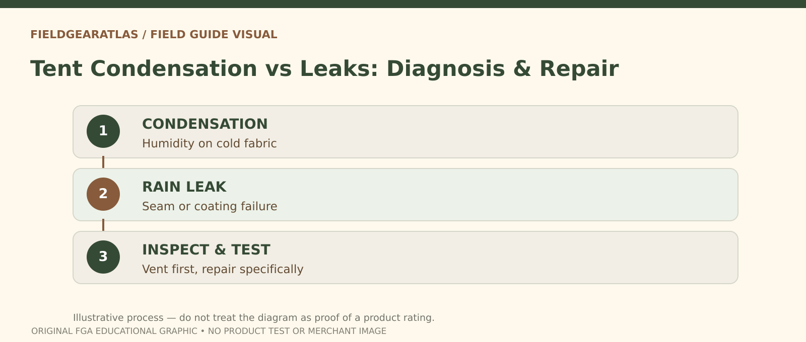

# Tent Condensation vs Leakage: Identify the Cause

*Conceptual research graphic created for FieldGearAtlas. No specific commercial product or hands-on test is represented.*

**Quick answer:** Water found **inside** a tent is not always proof that rain passed through its fabric. **Condensation** forms when humid air contacts a cooler surface, while **leakage** occurs when outside water enters through failed seams, fabric coatings, openings or setup problems. Diagnose the pattern before attempting repairs.

## Start with where the water appears

[REI's condensation guide](https://www.rei.com/learn/expert-advice/how-to-prevent-condensation-in-a-tent.html) explains how respiration, humid air and wet gear can add moisture inside a tent. That moisture may collect on the underside of the fly. By contrast, a localized wet line along seam tape or a drip following external rainfall can suggest a leak. These are clues, not guaranteed diagnostic tests.

| Observation | Investigate first | Why |
|---|---|---|
| Uniform droplets under the fly on cool mornings | Condensation | Moisture can form without fabric failure |
| Water tracks from a seam in sustained rain | Seam integrity | Tape or sealing can age or fail |
| Damp floor near ground runoff | Site drainage / floor placement | Water can flow beneath or into poorly pitched shelter |
| Interior splashes during strong wind | Vent/door orientation | Wind-driven precipitation may enter openings |
| Sticky, peeling coating | Fabric coating deterioration | May require repair or replacement advice |

Multiple mechanisms can happen together. A wet tent on a rainy night may have both internal condensation and an external ingress problem.

## The five-step diagnosis

1. **Record conditions.** Was the air humid? Was there rain? How many people and wet items were inside?
2. **Look high before low.** Droplets under the rainfly and around cool surfaces suggest moisture condensation is possible.
3. **Inspect contact points.** A sagging fly touching the inner tent can transfer moisture where it ordinarily would not reach.
4. **Check seams and openings.** Examine tape, zippers, doors, floors and stake-out tension for obvious defects.
5. **Retest safely in benign conditions.** Follow the tentmaker's care and testing instructions; do not attempt harsh chemicals or improvised repairs while occupied.

## Reduce condensation before blaming the coating

REI recommends selecting a suitable campsite, limiting wet items inside and increasing ventilation consistent with weather. When possible, pitch the fly taut with enough separation from the inner fabric, open designed vents and avoid blocking airflow. Wet clothes stored inside increase moisture; drying them elsewhere when safe can help.

The goal is to balance ventilation with rain protection. Opening every flap during a storm can introduce more water than it removes, so use the shelter's intended ventilation pattern.

## What to do if there really is a leak

Check whether the garment—here, shelter—uses silicone-treated fabric or polyurethane-coated construction before choosing a seam sealer. [REI's tent repair guide](https://www.rei.com/learn/expert-advice/tent-repair-how-to.html) notes that sealants are not interchangeable across all fabrics. Follow manufacturer instructions and allow drying/curing before returning the shelter to use.

A deteriorating waterproof coating may need a different treatment than a seam, and extensively failing material may be unsuitable for continued use. Do not promise that spraying generic “waterproofing” will fix all leaks.

## A useful campsite example

Two people sleep in a small tent after hiking in wet conditions. The next morning, droplets cover the **underside** of the rainfly even though no rain fell. Condensation is plausible. Moving airflow through designed vents and handling wet clothing may help. If a different trip produces a concentrated wet trail at the same seam during rain, inspect and repair that seam separately.

These are hypothetical examples, not results of FieldGearAtlas field tests.

## Symptom map: condensation, leakage or an open door?

Start by **observing the pattern** rather than applying seam sealer to every wet surface.

| What you observe | First hypothesis to investigate | Next check |
|---|---|---|
| Uniform moisture on the underside of a cool rainfly after sleeping | Internal condensation | Ventilation, moisture sources, campsite placement |
| Drips aligned with a seam during sustained rain | Possible seam leakage | Condition and seam construction; follow the tentmaker's repair method |
| Water near a doorway after wind-driven rain | Weather entering through an opening | Door orientation, fly tension, splash and pitch |
| Wet patch underneath the floor | Ground moisture or floor damage | Site drainage, groundsheet placement and floor condition |

These patterns **suggest possibilities**, not conclusive tests. REI notes that condensation can form even in well-designed shelters when warm moist air meets a cooler rainfly. Try opening vents as weather permits, tensioning the fly for separation and limiting wet gear stored inside. A failed coating, ripped floor or damaged seam requires model-appropriate repair—not simply additional ventilation.

After any wet outing, dry the tent promptly before long-term storage. REI warns that damp storage can damage fabric and coatings. FieldGearAtlas has not conducted hydrostatic-head or seam-leak testing on named tents.

## Practical decision example: Where is the moisture coming from?

If many inside surfaces are lightly wet after a cool night, investigate condensation and airflow. If one seam repeatedly produces a localized wet line during rain, inspect that seam and seal. Neither pattern alone proves a factory defect, but it guides the next check.

**Write down before choosing:** Dry the tent safely and follow manufacturer cleaning and sealant instructions rather than applying random waterproof spray everywhere.

## FAQ

### Can a waterproof tent have condensation?

Yes. Even a properly built shelter can collect interior moisture because breathable air and cold surfaces remain present.

### Is seam sealer the best first step for all dripping?

No. Identify the water source and fabric type first; repair material must be suitable for the construction.

### Can I store the tent wet after the trip?

Dry it as soon as feasible. [REI's care guide](https://www.rei.com/learn/expert-advice/caring-tent.html) warns that damp storage can damage fabrics and coatings.

## Evidence note

This guide provides a diagnostic framework, not an evaluation of any specific tent's hydrostatic head or weather resistance.

- [REI — Prevent Condensation](https://www.rei.com/learn/expert-advice/how-to-prevent-condensation-in-a-tent.html)
- [REI — Tent Repair](https://www.rei.com/learn/expert-advice/tent-repair-how-to.html)
- [REI — Caring for a Tent](https://www.rei.com/learn/expert-advice/caring-tent.html)
