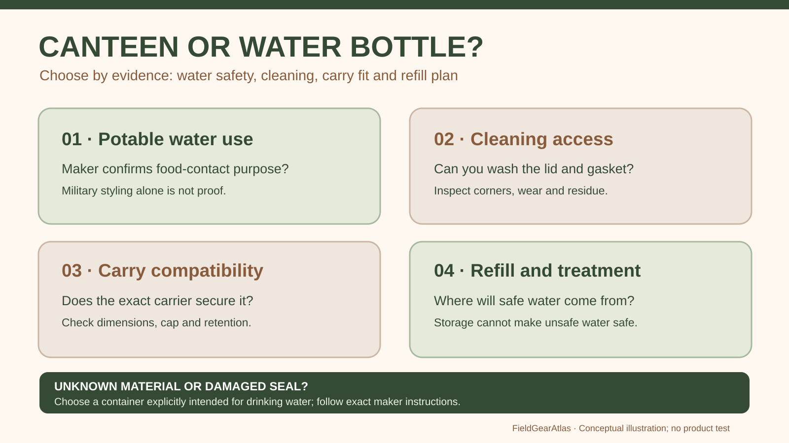

# Military Canteen vs Water Bottle: Fit and Hygiene

*Conceptual research graphic created for FieldGearAtlas. No specific commercial product or hands-on test is represented.*

**Quick answer:** The choice between a **traditional military-style canteen** and a modern water bottle should be driven by safe drinking-water storage, ease of cleaning, carrying compatibility and how you refill—not by nostalgia, material color or a “field gear” label. Either format can work when the exact container is appropriate for potable water and maintained correctly.

## Compare the carrying systems, not just the vessels

A canteen often belongs to a larger carry arrangement: fitted cover, pouch, strap, possible cup and a dedicated position on a belt or pack. Many modern bottles are standalone cylinders designed for side pockets, backpack sleeves or hand carry. Those physical interfaces can make one much more useful in a particular setup even when the water volumes are similar.

Take the bottle or canteen you already own and check whether you can remove and replace it without setting the pack down. If you must undo several straps to get a drink, storage convenience becomes a practical weakness rather than a feature.

## Six inspection factors

| Factor | What to check | Why it matters |
|---|---|---|
| Food-contact suitability | Manufacturer's intended drinking-water use | “Military style” does not certify safety |
| Cleaning access | Mouth opening, internal corners, gasket removal | Hidden residue can be difficult to wash |
| Closure | Threads, cap seal, retaining tether | Leakage and lost-cap risks |
| Carry compatibility | Belt carrier or pack pocket dimensions | A great container is useless if it does not fit securely |
| Material care | Allowed cleaning and heat exposure | Some plastics and seals dislike heat |
| Actual usable volume | Published capacity and real fill/access needs | Shape can limit how it fits with other equipment |

The [CDC's safe-water storage guidance](https://www.cdc.gov/global-water-sanitation-hygiene/about/about-safe-water-storage.html) emphasizes using suitable clean containers and avoiding vessels that previously held hazardous chemicals. Those principles matter more than whether a vessel has a vintage silhouette.

## Canteen considerations

A canteen may fit well in an existing purpose-built pouch. Ask whether the cover, cap and cup are designed to work together; surplus-style items may come from different makers. Inspect older seals for wear. Some vintage products were not intended for repeated high-temperature cleaning with modern appliances: seek exact manufacturer or material guidance before boiling, dishwasher use or heat sterilization.

Canteen cups are a **separate** equipment decision. A cup that appears to nest under the canteen in a photograph may fail to fit a different generation or commercial clone.

## Modern bottle considerations

Wide mouths can make filling and cleaning easier; narrow mouths may fit some attachments more readily. Insulated double-wall bottles can help keep temperatures stable but may be heavier and occupy more room than thin-wall designs. Straw lids add convenience while introducing small parts that require cleaning.

A “leakproof” claim is model- and seal-dependent. A lid with a damaged gasket can drip even if the container's walls are intact. Test with clean water in a safe environment before packing alongside electronics or documents.

## Two route choices

**Short day walk:** Select the container that you can fill, carry and drink from easily, with capacity appropriate to the plan. Check if refill points are actually available.

**Remote outdoor trip:** Your main problem becomes reliable access to enough safe water and appropriate purification or treatment where necessary. The [National Park Service hiking safety guide](https://www.nps.gov/articles/hiking-safety.htm) encourages planning water needs and water-source reliability rather than picking a fixed vessel for every trail.

## Water container decision worksheet

Record this for the **exact vessel and carrier**, not a generic 'military-style' category:

| Question | Your evidence |
|---|---|
| Does the maker say this vessel is for potable water? | ______ |
| What is its exact capacity and mouth diameter? | ______ |
| Can the lid/gasket be disassembled and cleaned as instructed? | ______ |
| Is it approved for the intended water temperature? | ______ |
| Does it fit and remain secured in the carrier you actually own? | ______ |
| Is a refill or treatment method available on your route? | ______ |

**Selection:** When safe-water suitability or condition is unknown, do not rely on a vintage or surplus container for drinking. Choose a vessel explicitly intended for potable water and follow its cleaning instructions. CDC safe-water storage guidance addresses preventing contamination of **already safe water**, not certifying every canteen model for food contact.

## Practical decision example: A cleaning and refill decision

A wide-mouth bottle may be easier to inspect internally; a canteen may fit a particular carrier or integrated cup. Check whether either is approved for intended beverages and cleaning procedures, and whether its cap and gasket can be replaced.

**Write down before choosing:** A sealed container can store already-safe drinking water; it does not purify contaminated water.

## FAQ

### Is a military canteen automatically safer than a plastic bottle?

No. Drinking-water suitability comes from its specific materials, intended use and condition, not the label.

### Can I put boiling water into any canteen?

No. Follow the exact model's material and temperature instructions; caps, gaskets and containers have different tolerances.

### Can a modern bottle fit a canteen cover?

Only if dimensions and retention method are compatible. Try the combination or check exact measurements.

## Scope and evidence

No specific canteen or bottle underwent migration, microbiological, leak or thermal testing by FieldGearAtlas.

- [CDC — Safe Water Storage](https://www.cdc.gov/global-water-sanitation-hygiene/about/about-safe-water-storage.html)
- [NPS — Hike Smart: Water](https://www.nps.gov/articles/hiking-safety.htm)
