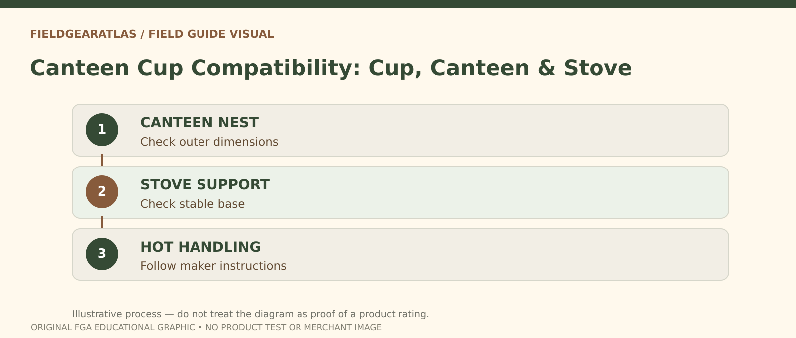

# Canteen Cup Compatibility: Nesting, Material and Heat

*Conceptual research graphic created for FieldGearAtlas. No specific commercial product or hands-on test is represented.*

**Quick answer:** A **canteen cup** is only useful as part of a cooking or drinking kit when its actual **dimensions, material, handle design and heat suitability** are compatible with the vessel and stove you plan to use. A seller calling something “military cup” does not establish that it nests with your canteen or is approved for direct flame.

**Heating is a separate permission question:** Food-contact suitability, stove suitability and direct-flame suitability are not interchangeable. Check the maker's instructions for the exact vessel and any coating, lid, plastic part or handle before applying heat. A product-photo resemblance to a military canteen cup is not evidence of safe use on an open flame or with an unknown burner.

## First identify the intended task

Are you looking for a cup to drink from, a nesting container that saves packing space, a lightweight vessel for heating water, or a pot large enough for food? These goals can point to different shapes. A cup that fits snugly beneath a canteen may have awkward handles near certain stove supports; a camping mug designed for drinking may not be suitable for direct heating.

Before purchase, identify each exact item: cup, canteen, pouch and stove model. Do not infer interchangeability from the broad phrase “GI-style.”

## A physical compatibility checklist

| Interface | What to check | Typical mistake |
|---|---|---|
| Canteen → cup | Outer dimensions and cup opening | Similar silhouettes assumed identical |
| Cup → pouch | Maximum outside profile with handles folded | Set too tight to retrieve |
| Cup → stove | Base diameter, support stability and burner clearance | Cup tips or handle nears flame |
| Lid → cup | Lip shape and actual manufacturer fit | Generic lid falls through |
| Handle → hands | Folded clearance and heat management | Bare-hand handling of hot metal |

A simple way to test physical nesting is to obtain the actual product measurements; buying online from pictures alone is unreliable because perspective hides taper and wall thickness.

## Material matters, but so does construction

The [REI cookware guide](https://www.rei.com/learn/expert-advice/cookware.html) describes typical stainless-steel, aluminum and titanium tradeoffs. Stainless steel is durable but may distribute heat unevenly; titanium is light and heats rapidly but also needs care to prevent overheating; aluminum variants differ by treatment and construction. These are general material characteristics, not a ranking of particular canteen cups.

Avoid assuming that a steel-looking cup is food-contact safe or that a coated mug can be used directly over a flame. Follow the actual maker's heating and cleaning directions; plastic handles, gaskets and decorative coatings may be incompatible with stove use.

## Field-use checks that reveal hidden problems

**Cold setup test:** Put the empty cup on the stove's designed supports with the stove unlit and cold. It should sit stably without obstructing controls or creating a tipping hazard. Measure clearances rather than relying on visual resemblance.

**Carry test:** Place it inside its pouch or with the canteen as intended. Confirm that the handle does not snag and that the full kit can be removed without pulling on a hot or sharp edge.

**Cleaning test:** Inspect folded handles, welded joints and seams for places where food residue could collect. Verify whether detergents and abrasive cleaning methods are suitable for the chosen finish.

## Safety boundaries

Cooking and heating require proper stove operation and ventilation. Do not use combustion stoves in enclosed tents or other unsafe locations; follow the stove's safety manual. Metal cups can become hot enough to burn skin. A photo of a cup on a stove is not proof the arrangement was stable or manufacturer-approved.

If collecting surplus, identify stamps and origin separately from fitness for cooking. An old canteen cup with a valid-looking mark may still have damaged metal, unsuitable coatings or unknown contamination. Historical authenticity does not establish current food-contact suitability.

## Practical decision example: Dry-fit before cooking

Before heating anything, confirm that the specific cup is stable on the intended stove, the handles operate without interfering and the material is approved for heat. A cup fitting around a canteen in a catalog photo does not establish safe stove compatibility.

**Write down before choosing:** Never use a vessel with unknown coating or heat rating for open-flame cooking based solely on “military style”.

## FAQ

### Can I put a canteen cup directly on a campfire?

Only if the specific cup's materials, handles and construction are intended for that use, and safe cooking conditions allow it. Do not assume this for coated or unknown products.

### Are all military canteen cups the same size?

No. Commercial reproductions and various patterns may differ. Check dimensions.

### Is titanium always the best?

No. Weight is only one criterion; price, heat distribution, handling and ease of cleaning also matter.

## Evidence note

FieldGearAtlas has not cooked with, measured or tested any commercial cup or stove for this article. Compatibility examples describe inspection methods only.

- [REI — Camping Cookware Materials](https://www.rei.com/learn/expert-advice/cookware.html)
- [CDC — Safe Water Storage](https://www.cdc.gov/global-water-sanitation-hygiene/about/about-safe-water-storage.html)
- [NPS — Ten Essentials (Fire and Water Planning)](https://www.nps.gov/articles/10essentials.htm)
