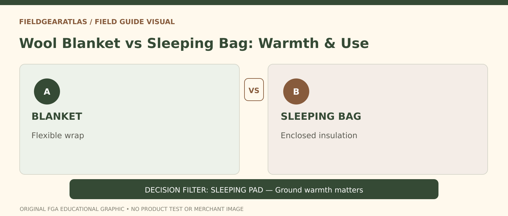

# Wool Blanket vs Sleeping Bag: Field Sleep Choices

*Conceptual research graphic created for FieldGearAtlas. No specific commercial product or hands-on test is represented.*

**Quick answer:** A **wool blanket** can be versatile for sitting, wrapping and mild-condition comfort, but a **sleeping bag** is usually designed specifically to manage overnight insulation around the body. Neither product type alone guarantees comfortable or safe sleep at a specified temperature. The sleeping pad and weather shelter are part of the decision.

## Compare the shape before debating fabric

A flat blanket is flexible: you can fold it, drape it over shoulders or share part of it while awake. That openness also creates gaps where air can move and heat can be lost during sleep. A sleeping bag is more enclosed and typically uses baffles, zippers and a shaped fit to contain insulation. The construction aims to keep an insulating layer around the sleeper, although real performance varies.

This is not a claim that every sleeping bag is warm or every wool blanket is cold. Thickness, fiber, air movement, pad insulation, humidity and personal preferences matter more than the name.

## Compare by use case

| Question | Wool blanket | Sleeping bag |
|---|---|---|
| Flexible daytime wrap | Often convenient | Less convenient for moving around |
| Enclosed overnight shape | Requires folding/tucking | Purpose-built on many designs |
| Lab temperature rating | Not automatically provided | May have standardized test data for eligible models |
| Pack bulk | Depends on weave, size and thickness | Depends on insulation type, size and fill |
| Ground insulation | Not a replacement for a pad | Also not a replacement for a pad |
| Care | Wool-care instructions vary | Down/synthetic care instructions vary |

REI explains that sleeping-bag **comfort and lower-limit ratings** are meaningful only when the rating's test framework is identified. It also emphasizes the interaction between the bag and pad. See [REI's sleeping-bag guide](https://www.rei.com/learn/expert-advice/sleeping-bag.html).

## Three practical setups

**Picnic or brief rest:** A blanket can cover legs and shoulders, serve as an accessible layer, and be easy to reposition. Weather exposure still matters.

**Car camping in mild weather:** A broad rectangular sleeping bag or a suitable blanket arrangement may be comfortable depending on the forecast and sleeping preferences. Choose against actual low conditions rather than a decorative product title.

**Backpacking with cold overnight conditions:** A purpose-built bag and suitable sleeping pad with documented performance are generally more useful reference points. Do not replace a rated sleep system with an untested blanket simply because it is made from wool.

## Why the ground matters

The underside of a sleeping bag can compress, reducing effective insulation. A suitable sleeping pad provides resistance to heat loss to the ground. REI's [sleep-system explanation](https://www.rei.com/learn/expert-advice/sleeping-bag-backpacking.html) addresses this interaction and how real-world comfort depends on more than the bag rating. A blanket placed on cold earth is not an equivalent laboratory-tested pad system.

## Evaluate a commercial wool blanket honestly

Check size in unfolded dimensions, fabric content, care instructions, weight, edge construction and whether it sheds fibers or has a rough surface. A listing labeled “military wool blanket” may mean only the appearance or market category. Any claim of actual issuing history needs independent evidence.

For sleeping bags, look for the exact rating label, standard (where applicable), comfort versus lower-limit distinction, fit and zipper arrangement. Avoid interpreting the lowest advertised number as a promise of comfortable sleep.

## Practical decision example: Keep the ground in the decision

A wool blanket may serve multiple camp roles, but a properly selected sleeping bag and pad make a different insulation arrangement for overnight use. Compare how each prevents drafts and how the system handles moisture and ground contact, not just fiber names.

**Write down before choosing:** Do not claim a specific comfort temperature for a blanket without an applicable product-level test.

## FAQ

### Does wool stay warm when wet?

Wool can retain some useful insulating properties in damp conditions, but comfort and safe warmth depend on many factors. Do not treat it as a guarantee for wet cold exposure.

### Can a wool blanket replace a winter sleeping bag?

Do not make that substitution without a conditions-appropriate sleep-system plan supported by reliable performance information.

### Is a heavier blanket always warmer?

No. Thickness, weave, air gaps, material and setup matter; weight alone is incomplete.

## Research and test disclosure

No temperature or material performance measurements were made by FieldGearAtlas. The comparison is about product format and documented sleep-system concepts.

- [REI — How to Choose a Sleeping Bag](https://www.rei.com/learn/expert-advice/sleeping-bag.html)
- [REI — Sleeping Bags for Backpacking / Sleep Systems](https://www.rei.com/learn/expert-advice/sleeping-bag-backpacking.html)
- [REI — Sleeping Pads](https://www.rei.com/learn/expert-advice/sleeping-pads.html)
