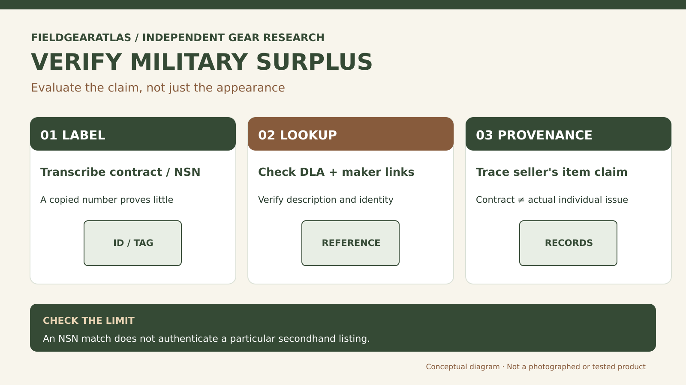

# How to Identify Genuine Military Surplus Without Guessing

*Technical explanation diagram created for FieldGearAtlas. Not a photograph of a commercial product.*

**Quick answer:** Authentic military surplus needs **evidence for the particular claim**. A product can be military-style without being government-issued; it can carry a real manufacturer's part number without having been issued to a service member. Labels, official catalog records, construction details and seller provenance should be considered together, not as isolated proof.

The most important question is not 'Does this look military?' but '**What exactly is the seller claiming?**' Original government-contract production, never-issued stock, used issued equipment and civilian reproductions are different categories. A camouflage pattern or olive fabric says little about contract origin.

## An evidence ladder for surplus claims

| Evidence | What it can support | What it does not prove by itself |
|---|---|---|
| Government contract label | A reference for researching a procurement association | This individual item was ever issued |
| National Stock Number (NSN) | An item-of-supply identifier in catalog systems | A particular listing is genuine or unaltered |
| CAGE and part number | Identifies the named source/part relationship | Condition, date, issue history |
| Manufacturer documentation | Original model and intended specification | Exact origin of a secondhand example |
| Seller chain of custody | Context about how the item was obtained | Authenticity without other evidence |
| Stitching, tags and construction | Possible consistency with a period/model | A definitive conclusion from aesthetics alone |

DLA PUB LOG provides public catalog information connecting NSNs with reference numbers and CAGE records. It can support research, but a database match is not a certificate attached to the item in your hand.

## A practical inspection order

**First, record every label exactly.** Photograph the entire garment or pack plus care tags, contract marks, part numbers and manufacturing labels. Do not transcribe ambiguous characters from memory. Check whether labels were sewn over older ones or replaced.

**Second, verify the identifier.** Search DLA public logistics information for the NSN or manufacturer/part relationship where applicable. An item in an active or historical catalog is not enough; compare size, description and the manufacturer's identity.

**Third, look for model-consistent construction.** Pockets, stitching, fabric and hardware may differ across generations and contractors. Treat conflicts as questions requiring research rather than instantly calling a seller fraudulent.

**Fourth, ask about provenance.** Is it sold as 'military-inspired', 'contract manufactured', 'unissued', 'used issued equipment', or 'surplus from a named agency'? Require the evidence appropriate to that specific statement. Save the listing description and receipt.

## A lesson from official uniform guidance

The U.S. Army's equipment FAQ states that specified ACU garments should have a size label and a separate label with a government contract number and NSN.

**Keep the Army FAQ in its historical lane:** That example is situated in an Army Combat Uniform discussion about particular specifications and purchasing conditions. It is **not** a universal tag rule for every historic US military garment, every branch or every category of equipment. An item lacking an ACU-like second label cannot be declared fake solely from that rule. This is an **example specific to that uniform guidance**, not a rule that all historical or commercial military gear must display the same tags.

That qualification matters for vintage pieces. Missing a modern contract format from a much older jacket cannot, on its own, prove it is fake. Equally, copying a contract-looking code onto a new garment does not make it genuine.

## Worked example: ambiguous jacket listing

*Hypothetical:* A listing calls a field jacket 'original Army issue' and shows only the exterior and a modern brand label. The cut may resemble a known field jacket, but no procurement evidence is supplied. A cautious description would be **'military-style jacket; issue status unverified'** until the seller provides meaningful labels or provenance.

## Practical decision example: An evidence chain beats one label

A surplus listing shows a label with an NSN-like number. First confirm that the number is valid and corresponds to the claimed item; then inspect maker, contract/context and seller’s provenance information. A genuine identifier alone cannot show that this individual garment was issued.

**Write down before choosing:** Separate “matches a government catalog entry” from “this physical item was issued and used”.

## FAQ

### Is a real NSN sufficient proof of authenticity?

No. An NSN identifies a supply item in a cataloging system; the same number can be copied into an unrelated sales listing.

### Does 'made for military use' mean 'issued'?

Not necessarily. Production, contracting, purchasing and individual issue are distinct events.

### Can new old stock be genuine surplus?

Possibly, but 'new old stock' describes claimed storage/condition, not a stand-alone chain of custody. Ask for evidence.

## Editorial limits

This guide does not authenticate an individual collectible or military uniform. Consult specialized documentation for the exact era, branch and contract, and avoid making legal or regulatory claims from appearance alone.

## Research references

- [DLA — How to Search PUB LOG for NSNs](https://www.dla.mil/Small-Business/Resource-Center/Training-Resources/Details/Article/4179917/how-to-use-pub-log-to-find-national-stock-number-information/)
- [US Army CPE Ground — Government Contract Uniform Label FAQ](https://cpeground.army.mil/Resources/Frequently-Asked-Questions/)
- [DLA — Public Logistics Data](https://www.dla.mil/Information-Operations/Services/Applications/PUB-LOG/)
