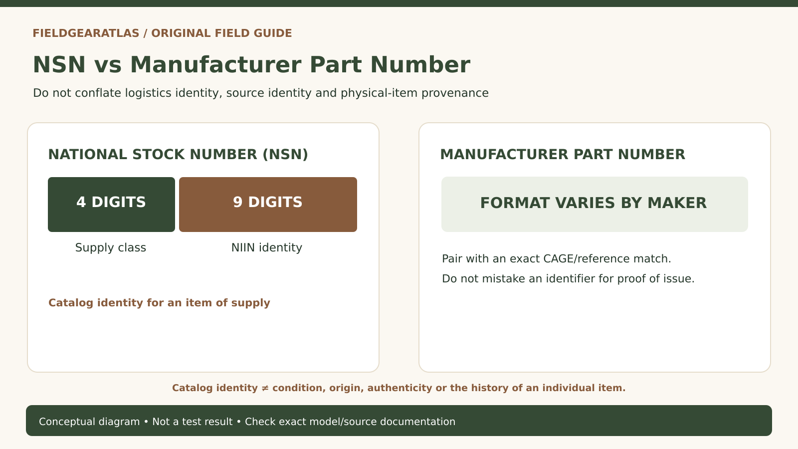

# NSN vs Manufacturer Part Number: How to Identify Military Surplus Gear

*Original conceptual infographic. Not a tested model or product performance result.*

**Quick answer:** A National Stock Number (NSN) is a government logistics identity for an item of supply, typically expressed as 13 digits. A **manufacturer part number** identifies a product or part in a manufacturer's own numbering system. They can be cross-referenced, but they are not interchangeable, and a number printed on a commercial product does not by itself prove that a particular physical item was issued to the US military.

If you buy surplus packs, jackets, canteen accessories or field equipment, numbers can provide valuable evidence—but only if you know what the number identifies and whether it belongs to the item being sold.

## Four different identifiers you may encounter

| Identifier | What it refers to | Mistake to avoid |
|---|---|---|
| NSN — National Stock Number | Standardized catalog identity for a supply item | Treating it as a serial number for one object |
| NIIN — National Item Identification Number | Nine-digit item identity within the NSN | Treating every number ending in nine digits as valid without context |
| CAGE code | Identity of a commercial/government entity | Assuming the code proves a particular product's manufacture date or issue history |
| Manufacturer part/reference number | Supplier's identification for a model or part | Assuming one part number uniquely maps to one NSN in every context |

DLA's public logistics reference system, PUB LOG, includes cross-reference records relating NSNs, part numbers and CAGE identifiers, among other information. These records help with identification; they are not photographs of the exact used item a reseller is offering.

## Understand the structure of an NSN

An NSN has 13 digits. The first four identify a supply class; the remaining nine form the NIIN. The structure supports cataloging, but copying 13 digits into a listing is not a substitute for checking what that record describes. Formatting may include hyphens for readability; those do not create a different stock number.

A source document may identify an interchangeable item rather than one unique consumer-facing model. Consequently, a product's commercial brand name and a logistics catalog description need not match word-for-word. Avoid concluding that two objects are physically identical simply because a seller asserts they share a number.

## A practical authenticity workflow

1. **Photograph the actual item's label**, not merely a seller's generic stock photo. Record every visible line without filling illegible characters from a guess.
2. **Separate identifiers.** Is the number presented as NSN, CAGE, contract number, or manufacturer part number? If the label does not say, mark it unknown.
3. **Look up NSN/CAGE relationships** using an official reference where public data is available, such as DLA PUB LOG. Preserve the version and lookup date.
4. **Compare item description and construction.** Material, dimensions, markings and configuration should make sense together. A database match alone is not physical authentication.
5. **Check seller provenance and condition.** Ask for photos of the exact item, repairs, missing hardware, modifications and return terms.
6. **Record remaining uncertainty.** An NSN match may support identity while leaving the item's actual issue history unproven.

**Check the type of evidence explicitly:** DLA's public logistics records support **catalog-level** identification and part-number relationships. They do not identify who physically wore a particular jacket or carried a particular bag, and they are not proof of present condition. A seller's contract number, an NSN and an agency issue record answer different questions; do not combine them into a single “authenticated” badge.

## Three claims that are not the same

- **“Military-style”**: describes appearance or design inspiration. It does not establish government purchasing or issuance.
- **“Made to military specification”**: a claim about design or testing that needs the exact applicable specification and evidence. It is not the same as being issued.
- **“Government issue”**: a claim about procurement/issuance history. That calls for stronger provenance than an isolated number on a listing.

Government catalog records can be valuable in testing these claims, but do not treat them as certificates covering the condition or history of an individual surplus object.

## Hypothetical label-reading example

A secondhand bag has a manufacturer label containing a part number and another tag showing a 13-digit number. The seller calls it 'standard issue.' A careful researcher would preserve both numbers, check the DLA cross-reference, inspect the construction and ask what evidence ties this particular bag to the claim. If public catalog data supports an item identification, report that *limited fact* without upgrading it into proof the bag was issued or tested.

## Where PUB LOG is useful—and where it stops

DLA PUB LOG contains public logistics data with item identification, part-number reference and CAGE relationships. It is useful for researching issue-era part identities and distinguishing supply catalog descriptions from retail names. It is **not** a live consumer marketplace feed, not a current price comparison service and not an image license for third-party product photographs.

Some information may be absent, outdated for a particular item or excluded from public release. Missing results are not necessarily proof that an item is fake. Conversely, a matching record does not make a seller's claimed product condition trustworthy.

## Practical decision example: A three-field identifier exercise

Copy a claimed NSN, manufacturer part number and CAGE code into separate fields; look up the public logistics relationships where available. Confirm whether the number identifies an item of supply, a maker reference or a retail product identifier.

**Write down before choosing:** A cross-reference can support correct identification without proving the seller’s authenticity claim.

## Frequently asked questions

### Is an NSN a serial number?

No. It identifies a cataloged item of supply rather than uniquely identifying every physical unit made or issued.

### Does a CAGE code prove a product is American-made?

No. A CAGE code identifies an entity; country-of-origin and the actual place of manufacturing require separate evidence.

### Can a civilian commercial item share an identity with military supply records?

Supply catalogs may reference manufacturers and commercial part numbers, so relationships can exist. Verify the exact record and do not assume the consumer listing is identical in specifications, status or condition.

## A number identifies catalog information, not the individual used item

DLA's publicly available logistics information supports looking up **stock numbers and manufacturer/reference relationships**. A supply-number record can help validate an item's *catalog identity*, but it does not document a particular used pack's chain of custody, service history or present condition. [DLA — PUB LOG](https://www.dla.mil/Information-Operations/Services/Applications/PUB-LOG/).

For used field gear, record **three separate evidence tracks**: (a) catalog identifier checked against DLA, (b) physical markings/construction of the actual item shown, and (c) seller provenance/condition. A positive match on track (a) should never automatically turn (b) or (c) into “authenticated government issue.”

## Sources and limitations

- [DLA — How to use PUB LOG to find NSN information](https://www.dla.mil/Small-Business/Resource-Center/Training-Resources/Details/Article/4179917/how-to-use-pub-log-to-find-national-stock-number-information/) — fields and search workflow.
- [DLA — PUB LOG reference and characteristic data](https://www.dla.mil/Information-Operations/Services/Applications/PUB-LOG/ProceduresManuals/) — NSN, CAGE and part number cross-references.
- [NATO Support and Procurement Agency — Codification](https://eportal.nspa.nato.int/public/eportal.aspx) — 13-digit catalog identification context.

**Transparency:** This is a reference guide, not a paid authentication service. No named surplus listing has been authenticated or linked to a particular government procurement transaction.
