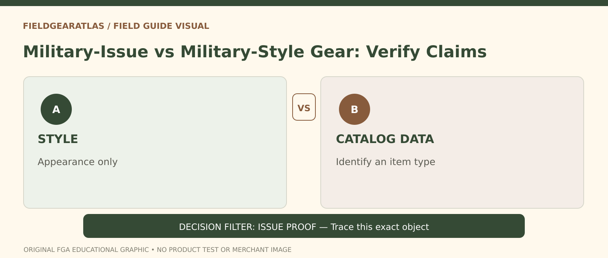

# Military-Issue vs Military-Style Gear: Evidence Matters

*Conceptual research graphic created for FieldGearAtlas. No specific commercial product or hands-on test is represented.*

**Quick answer:** **Military-issued gear** is a provenance claim about an item's relationship to an armed force's procurement or distribution system. **Military-style gear** is a design or marketing description. A product can borrow camouflage, colors, pockets or pouch attachment geometry without having ever been procured or issued by a government.

## First separate the four different claims

1. **Looks military:** design resembles field equipment. This is visual description only.
2. **Made for military use:** maker may have designed the product for a military market, but that alone does not prove procurement.
3. **Government contract or catalog relation:** documentation may link a specific item type or producer to an identifiable procurement record.
4. **This individual example was issued:** a stronger historical claim requiring a chain of evidence relating the physical object to service distribution.

A listing often slides between these without clarifying which is supported. FieldGearAtlas should not repeat a seller's strongest phrasing as verified fact.

**Three separate evidence questions:** (1) Does the item design or component appear in a military logistics catalog? (2) Can this physical item be associated with a documented manufacturer/contract or known production batch? (3) Is there evidence it was actually **issued** to a unit or individual? DLA records help mainly with the first question and some reference relationships in the second; they do not settle the third for a secondhand item.

## Where NSNs and CAGE codes help—and where they stop

The Defense Logistics Agency's [PUB LOG](https://www.dla.mil/Information-Operations/Services/Applications/PUB-LOG/) provides publicly releasable NSN, CAGE and part/reference information for catalog research. An NSN can help identify an item of supply; a CAGE code identifies a commercial or government entity in the relevant system. Such data may support a **catalog relationship**, not a certificate that a particular jacket, pouch or bottle was issued to an individual.

A photographed label with an NSN-looking string can be incorrect, altered or placed on a reproduction. Cross-check the format, maker, part number and construction against reliable records. Even a genuine catalog code does not supply the full ownership history of the item on a resale platform.

## Evaluate the evidence chain

| Evidence presented | What it might support | What it does not alone prove |
|---|---|---|
| Olive / camouflage fabric | Military-inspired styling | Any official procurement |
| PALS-style webbing | A style of attachment interface | Certification or issuance |
| Maker's label | A product or maker identity | Authentic service history |
| Matching NSN / part number | A specific cataloged type association | Individual item was issued |
| Contract paperwork | Particular supply relationship if genuine | Current condition or complete provenance |
| Seller story | A lead for further inquiry | Reliable authentication by itself |

## A seller-contact checklist

Request clear photographs of the exact item's front, back, construction details and **all labels**. Ask whether the seller means original issue, overrun, unissued stock, later civilian manufacture or reproduction. Request how the claimed period or issuing organization was determined and whether any paperwork pertains to **this object** rather than a similar model.

For surplus in worn condition, document repairs, relabeling, missing parts, alterations and storage damage. A historically interesting object may still be unsuitable for current protective or food-contact use.

## Three situations

**Collecting history:** Provenance can be central. If documentation is weak, use conservative language such as “military-style,” “reported as surplus,” or “unverified issue claim.”

**Buying functional outdoor gear:** Practical specifications, fit, materials and safe use may matter more than procurement history. A civilian product can be good without military origin.

**Comparing merchant listings:** Two sellers may attach different stories to identical-looking objects. Compare the actual manufacturer/part number and evidence before concluding they are the same item or from the same period.

## Avoid an authenticity shortcut

A contract number, national stock number or camouflage pattern is one piece in a chain, not the chain itself. The [DLA instructions for finding NSN information](https://www.dla.mil/Small-Business/Resource-Center/Training-Resources/Details/Article/4179917/how-to-use-pub-log-to-find-national-stock-number-information/) explain the search fields used for research; they do not certify individual resale listings.

## Practical decision example: Classify the seller’s actual claim

One listing says “military-style”, another says “made to military specification”, a third says “government issued”. Ask for increasingly specific evidence. Style can be assessed visually; a specification claim calls for exact model and verification; issued provenance needs traceable evidence about that individual item.

**Write down before choosing:** Do not upgrade a style or supply-chain reference into an issue certificate.

## FAQ

### Can civilian companies make gear for both military and civilian buyers?

Yes. A maker's broader business does not establish which channel a particular garment came through.

### Is “MIL-SPEC” an authentication certificate?

Not from the phrase alone. Ask which actual specification and revision applies and what evidence establishes conformance.

### Does new old stock always mean never issued?

No universal seller grading convention exists. Ask for condition, original packaging and documented history.

## Evidence limits

No individual piece of surplus has been authenticated by FieldGearAtlas. This guide presents standards of evidence for readers to apply.

- [DLA — PUB LOG](https://www.dla.mil/Information-Operations/Services/Applications/PUB-LOG/)
- [DLA — How to Find NSN Information](https://www.dla.mil/Small-Business/Resource-Center/Training-Resources/Details/Article/4179917/how-to-use-pub-log-to-find-national-stock-number-information/)
