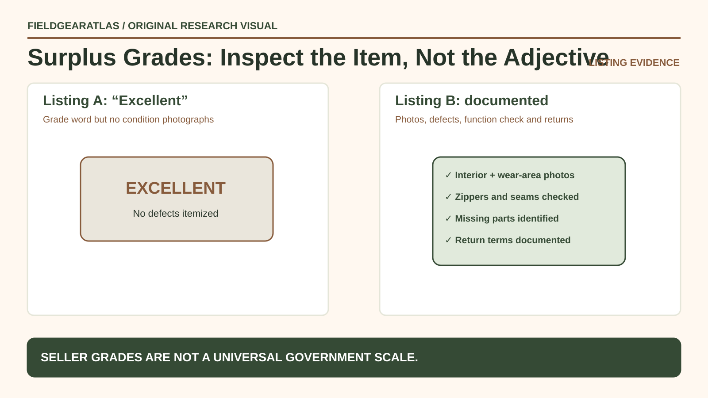

# Military Surplus Condition Grades: How to Read Listings

*Technical explanation diagram created for FieldGearAtlas. Not a photograph of a commercial product.*

**Quick answer:** Surplus grading language is often **seller-defined**, not a universal military condition standard. 'Unissued', 'new old stock (NOS)', 'excellent', 'good' and 'field-used' describe different claims about history, storage and present condition. Ask for photographs and a clear returns policy rather than relying on a grade word alone.

A durable canvas pouch with abrasion may remain completely functional; an apparently clean waterproof jacket may have badly degraded seam tape. Condition must be judged against the specific item's intended function, not how impressive it looks in a thumbnail.

## Condition and provenance are two separate questions

| Listing term | Plausible meaning | What to verify |
|---|---|---|
| Unissued | Seller claims no end-user service issue | What documentation supports that claim? |
| New old stock (NOS) | Old inventory represented as unused | Storage conditions, aging of coatings/elastic |
| Excellent | Minor or no visible wear, according to seller | Close photos; function tests if relevant |
| Good | Usable with visible wear | Exact damage, repairs, missing parts |
| Fair / field-used | Heavy wear or repairs may be present | Whether it is safe and serviceable for your use |
| Reproduction | Newly made item styled after historical gear | Clearly separate from original issue provenance |

**Crucial distinction:** 'Unissued' does not mean 'newly manufactured', and 'new old stock' does not mean all materials remain as good as new. Rubber, adhesive, coated fabrics, seam tape and elastic can age in storage.

## Inspect function-specific failure points

For **boots**, ask for outsole condition, sole attachment, cracking, lining and inner padding. For **rainwear**, examine seam sealing and coating stickiness or delamination. For **packs**, check buckles, zippers, webbing anchors and stitching. For **sleep systems**, look for mold, moisture damage, smell, loft loss and missing components.

A photograph showing only the front of the item cannot establish condition. Request at least an interior view, identifying labels, known wear areas and detail photos of fasteners or seams.

## A listing checklist the buyer can copy

Before paying, ask:

1. What exact model or part number is this?
2. What does the seller mean by the listed condition grade?
3. Are all components included and original?
4. Are there any repairs, replacements or modifications?
5. What defects cannot be seen in the photos?
6. Has functionality relevant to the intended use been checked?
7. Can you return the item if the description is wrong?
8. Is 'military issued' claimed, and what independent evidence supports it?

Save the answers with the transaction record. A clear negative answer is more useful than an unsupported promise of 'museum quality'.

## When the cheaper option is not actually cheaper

*Hypothetical:* A used field bag costs less than a modern civilian bag, but the closure is broken and a replacement component is no longer available. A higher-priced bag in documented working condition may cost less to put into service. The same reasoning applies to older boots whose adhesives have aged regardless of tread wear.

Do not use surplus emergency or protective equipment for safety-critical duties simply because its label appears authentic. Its current serviceability and applicable standards must be established separately.

## Practical decision example: Grades need a shared inspection checklist

Two sellers both say “excellent condition”, but one supplies photographs of zipper, lining and abrasion points while the other uses a single stock photo. Prefer verifiable condition details, return terms and a clear defect list over an unsupported adjective.

**Write down before choosing:** Treat grades as seller-defined unless the merchant documents an explicit, repeatable grading standard.

## FAQ

### Is 'unissued' a formal universal grade?

No single cross-market grading vocabulary has been demonstrated for all surplus sellers. Ask each seller for their written definition and evidence.

**Source-bound warning:** DLA PUB LOG identifies supply items; it does not publish a universal retail scale translating “NOS,” “excellent” or “field-used” into guaranteed remaining life. Those words must remain attributed to the seller. When function is important, ask for actual-condition photos and a documented component inspection rather than deriving a grade from government catalog data.

### Can something be genuine surplus and damaged?

Yes. Provenance addresses origin; grade addresses present condition. They are independent.

### Does an NSN tell me its condition?

No. DLA's NSN cataloging data describes items of supply. It is not a condition report for a particular secondhand listing.

## Evidence note

DLA and Army sources support distinctions about item identifiers and certain government uniforms. The condition labels above are **editorial interpretations of common seller wording**, not DLA-defined grading standards. FieldGearAtlas has not inspected the listed products.

## Research references

- [DLA — Public Logistics Data](https://www.dla.mil/Information-Operations/Services/Applications/PUB-LOG/)
- [US Army CPE Ground — Government Uniform and Label Guidance](https://cpeground.army.mil/Resources/Frequently-Asked-Questions/)
